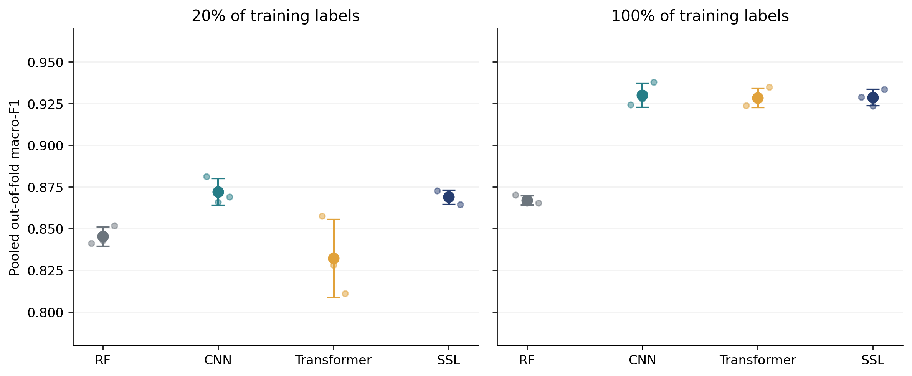

# Self-Supervised Forest Clear-Cut Detection Using Sentinel-2 Time Series

Code, data cohort, frozen experimental protocol, run records and manuscript for a controlled study of
masked-reconstruction self-supervised pretraining on **DISFOR** Sentinel-2 time series
(Mehmet Oğuz Güneren, Istanbul Technical University; Nida Kumbasar, TÜBİTAK BİLGEM BTE).

The study asks a narrow question with a careful design: when a pretrained Transformer beats a supervised
one under a small label budget, how much of that gain survives (i) a supervised comparator that receives the
same number of optimizer steps and (ii) spatially grouped evaluation? Every number in the manuscript is read
from the analysis files in `experiments/` by `scripts/compose_paper.py`; nothing is typed by hand.

<p align="center">
  
</p>

## Key results

Binary cohort: 2,213 high-confidence DISFOR locations (1,937 stable forest, 276 clear cut), one 24-month
window each, ten Sentinel-2 bands aggregated to monthly medians. Evaluation: five spatially grouped folds
(5 km + shared disturbance events, 874 components), three seeds, pooled out-of-fold macro-F1, paired
spatial-component bootstrap (2,000 draws).

| Setting (20% of training labels) | Macro-F1 (mean ± SD over 3 seeds) |
|---|---|
| Supervised Transformer, 40 epochs | 0.8322 ± 0.0236 |
| **Block-and-band masked pretraining + 40 epochs** | **0.8690 ± 0.0043** (vs. above: +0.0368, 95% CI [0.0245, 0.0506]) |
| Supervised Transformer, optimizer-step matched (320 epochs) | **0.8987 ± 0.0112** (SSL − control: −0.0297, CI [−0.0430, −0.0179]) |
| Temporal CNN | 0.8721 ± 0.0081 |
| Random forest on temporal summaries | 0.8452 ± 0.0058 |
| Independent-cell masking (control) | 0.8609 ± 0.0098 |

With all labels the three neural models converge at 0.929 to 0.930. Along a label-budget curve (5%, 10%,
20%, 50%, 100%) the pretrained Transformer never exceeds the step-matched control, and below 20% labels it
also trails the CNN and the random forest. Under coarser spatial grouping (10 km, 20 km) it degrades least and
leads at 20 km (single seed). Covariate-only diagnostics show that observation gaps and sampling metadata
alone carry label information (macro-F1 0.55 and 0.65 without any spectral input).

**Reading:** the low-label benefit of masked pretraining on this cohort is better described as robustness
to geographic shift than as label efficiency, and claims of label efficiency should be accompanied by an
optimization-matched comparator and spatially grouped evaluation.

<p align="center">
  
  
</p>

## Manuscript

| File | Content |
|---|---|
| [`TESLIM_2026-10-18/Orman_SSL_Makale_Kumbasar_Guneren_FINAL.pdf`](TESLIM_2026-10-18/Orman_SSL_Makale_Kumbasar_Guneren_FINAL.pdf) | Two-column manuscript (LaTeX), revision 3 |
| [`TESLIM_2026-10-18/Orman_SSL_Makale_Kumbasar_Guneren_2col.docx`](TESLIM_2026-10-18/Orman_SSL_Makale_Kumbasar_Guneren_2col.docx) | Same text as an editable Word file |
| [`paper/manuscript_authored.md`](paper/manuscript_authored.md) | Plain-text source of the manuscript |
| [`paper/references.json`](paper/references.json), [`paper/references.bib`](paper/references.bib) | 36 references, each verified against Crossref |
| [`paper/SUPPLEMENT.md`](paper/SUPPLEMENT.md), [`paper/CLAIM_LEDGER.md`](paper/CLAIM_LEDGER.md) | Supplementary analyses and a ledger that maps every claim to its evidence file |
| [`TESLIM_2026-10-18/latex_twocolumn/`](TESLIM_2026-10-18/latex_twocolumn/) | LaTeX source and figures |

## Repository layout

```
src/orman_ssl/          model definitions, training loop, inference (advanced.py, experiment.py, predict*.py)
scripts/                data download and preparation, frozen experiments, analysis, figures, manuscript build
tests/                  unit tests for the pipeline, the protocols and the manuscript build
data/disfor/            pinned DISFOR sample table and manifest (revision 2562332e…)
data/processed/         the 2,213-window cohort as a NumPy archive (real_series.npz)
experiments/paper_v4/   primary experiment: protocol, folds, 180 run records, pooled predictions, analysis.json
experiments/paper_v6_label_curve/   label-budget extension (225 fits)
experiments/paper_v5_exploratory/   grouping-radius extension (75 fits)
experiments/advanced_v3/            engineering ensemble (5 CNN + 5 SSL) used by the local demo app
experiments/turkiye_zero_shot/      declared, not yet executed, zero-shot transfer protocol for Türkiye
paper/                  manuscript sources, references, figures, supplement, claim ledger
docs/                   protocol, data contract, model card, audits and Turkish project notes
TESLIM_2026-10-18/      delivered package: manuscript (PDF, DOCX, LaTeX), executed notebook, guides
```

## Reproducing the results

Python 3.11 is required (the environment lock in `requirements-lock.txt` was produced with it).

```bash
git clone https://github.com/oguzgnrn/disfor-clearcut-ssl.git
cd disfor-clearcut-ssl
bash scripts/setup.sh                      # creates .venv and installs the pinned requirements
.venv/bin/python scripts/check_environment.py
.venv/bin/python -m unittest discover -s tests -v
```

Data. The pinned DISFOR table is included; `scripts/download_disfor.py` re-downloads and hashes it from
Hugging Face and `scripts/prepare_disfor.py` rebuilds `data/processed/real_series.npz`
(`scripts/audit_data_reproduction.py` checks the rebuild against the frozen hashes).

Experiments. Each protocol is frozen in a `protocol.json` before training and every completed fit is kept.

```bash
.venv/bin/python scripts/train_paper.py --workers 3           # primary experiment, 180 fits (experiments/paper_v4)
.venv/bin/python scripts/analyze_paper.py                      # pooled metrics, bootstrap intervals, analysis.json
.venv/bin/python scripts/label_curve_v6.py prepare|train|analyze   # label-budget extension, 225 fits
.venv/bin/python scripts/scientific_v5.py prepare|train|analyze    # grouping-radius extension, 75 fits
.venv/bin/python scripts/verify_paper.py                       # consistency checks between records, analysis and text
```

Figures and manuscript.

```bash
.venv/bin/python scripts/plot_paper.py && .venv/bin/python scripts/plot_extensions.py
.venv/bin/python scripts/plot_examples.py                      # example windows with labels and predictions
.venv/bin/python scripts/plot_chips.py                         # Sentinel-2 chips (needs network, display only)
ORMAN_AUTHORED=1 .venv/bin/python scripts/compose_paper.py    # manuscript text from analysis files
.venv/bin/python scripts/build_paper_docx_twocol.py           # Word, two columns
.venv/bin/python scripts/build_latex_twocolumn.py             # LaTeX + PDF (pdflatex)
```

Training was run on CPU; the primary experiment takes a few hours with three workers. Results on other
hardware reproduce the recorded probabilities up to floating-point differences of about 1e-6
(`scripts/verify_spatial_v5.py --tolerance`).

## Inference on new data

The engineering ensemble in `experiments/advanced_v3` predicts clear-cut probabilities for any location
given two calendar years of monthly Sentinel-2 observations in the same ten bands:

```bash
.venv/bin/python scripts/run_advanced.py --observations observations.parquet --windows windows.json --out output/my_prediction
.venv/bin/python scripts/serve_product.py --open     # local review app at 127.0.0.1
```

The input contract is documented in `docs/VERI_SOZLESMESI.md`. The ensemble is a working demonstration and is
kept separate from the audited scientific comparison; its scores should not be mixed with the manuscript's.

The `*.command` files in the repository root are macOS double-click launchers for the same scripts
(demo, verification, Türkiye transfer probe, GitHub push).

## Data source and license

The DISFOR dataset (Viehweger et al., 2026, Earth System Science Data Discussions,
[10.5194/essd-2026-185](https://doi.org/10.5194/essd-2026-185); data
[JR-DIGITAL/DISFOR](https://huggingface.co/datasets/JR-DIGITAL/DISFOR)) is distributed under the
European Union Public Licence 1.2. This repository, including the derived cohort and all code, is released
under the same licence; see [`LICENSE`](LICENSE). The Presto weights in `third_party/presto` and the Natural
Earth boundaries in `third_party/natural_earth` keep their own licences.

## Citation

```bibtex
@unpublished{guneren2026clearcut,
  author = {G{\"u}neren, Mehmet O{\u{g}}uz and Kumbasar, Nida},
  title  = {Self-Supervised Forest Clear-Cut Detection Using Sentinel-2 Time Series},
  year   = {2026},
  note   = {Manuscript in preparation. Code and data: https://github.com/oguzgnrn/disfor-clearcut-ssl}
}
```

A `CITATION.cff` file is included for GitHub's citation widget.

## Disclosure

AI coding assistants (OpenAI Codex and Anthropic Claude) were used for code generation, experiment
orchestration, analysis checks, figure preparation and manuscript drafting under the first author's
direction. All reported numbers come from the frozen run records in this repository.

Turkish project notes, meeting material and the earlier Turkish README are in [`docs/`](docs/)
(see [`docs/README_TR.md`](docs/README_TR.md)).
