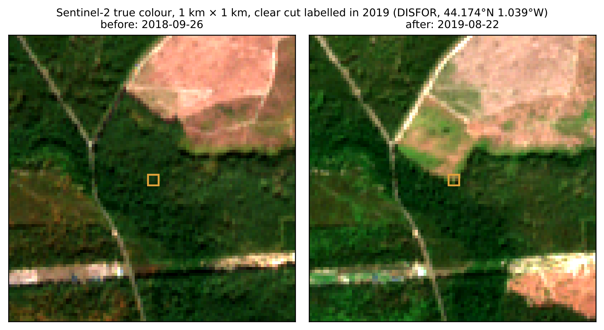
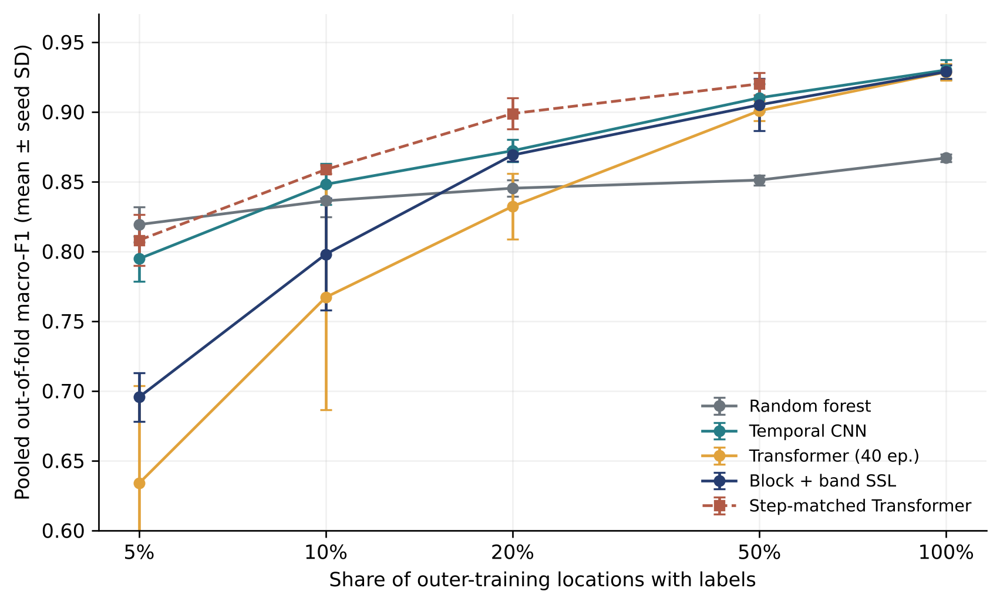

# Sentinel-2 Zaman Serileriyle Öz Denetimli Orman Kesimi Tespiti

**DISFOR** Sentinel-2 zaman serileri üzerinde maskeli yeniden kurma (masked reconstruction) ile öz denetimli
ön eğitimin kontrollü bir incelemesi: kod, veri kohortu, dondurulmuş deney protokolü, koşu kayıtları ve makale
(Mehmet Oğuz Güneren, İstanbul Teknik Üniversitesi; Nida Kumbasar, TÜBİTAK BİLGEM BTE).

Çalışma dar bir soruyu dikkatli bir tasarımla soruyor: ön eğitimli bir Transformer az etiketle denetimli
modeli geçtiğinde, bu kazancın ne kadarı (i) aynı sayıda optimizasyon adımı alan denetimli bir karşılaştırıcıya
ve (ii) mekânsal olarak gruplanmış değerlendirmeye dayanıyor? Makaledeki her sayı `experiments/` altındaki
analiz dosyalarından `scripts/compose_paper.py` ile okunur; elle yazılmış tek bir sayı yoktur.

[English README](docs/README_EN.md)

<p align="center">
  
</p>

## Ana sonuçlar

İkili kohort: 2.213 yüksek güvenli DISFOR konumu (1.937 sağlıklı orman, 276 kesim), her biri için 24 aylık bir
pencere, aylık medyana indirgenmiş on Sentinel-2 bandı. Değerlendirme: mekânsal olarak gruplanmış beş kat
(5 km + ortak bozulma olayları, 874 bileşen), üç tohum, kat dışı havuzlanmış macro-F1, mekânsal bileşen
düzeyinde eşli bootstrap (2.000 çekim).

| Ayar (eğitim etiketlerinin %20'si) | Macro-F1 (3 tohum üzerinde ortalama ± SS) |
|---|---|
| Denetimli Transformer, 40 epok | 0,8322 ± 0,0236 |
| **Blok + bant maskeli ön eğitim + 40 epok** | **0,8690 ± 0,0043** (üsttekine göre +0,0368, %95 GA [0,0245, 0,0506]) |
| Denetimli Transformer, optimizasyon adımı eşlenmiş (320 epok) | **0,8987 ± 0,0112** (SSL − kontrol: −0,0297, GA [−0,0430, −0,0179]) |
| Zamansal CNN | 0,8721 ± 0,0081 |
| Zamansal özetler üzerinde rastgele orman | 0,8452 ± 0,0058 |
| Bağımsız hücre maskeleme (kontrol) | 0,8609 ± 0,0098 |

Tüm etiketlerle üç sinir ağı modeli 0,929 ile 0,930 arasında birleşiyor. Etiket bütçesi eğrisi boyunca
(%5, %10, %20, %50, %100) ön eğitimli Transformer adım eşlenmiş kontrolü hiçbir noktada geçmiyor; %20'nin
altında CNN'in ve rastgele ormanın da gerisinde kalıyor. Daha kaba mekânsal gruplamada (10 km, 20 km) ise en az
bozulan model o ve 20 km'de öne geçiyor (tek tohum). Yalnızca ortak değişkenlere bakan tanı deneyleri, gözlem
boşluklarının ve örnekleme meta verisinin tek başına etiket bilgisi taşıdığını gösteriyor (spektral girdi olmadan
macro-F1 0,55 ve 0,65).

**Okuma:** Bu kohortta maskeli ön eğitimin az etiketteki faydası "etiket verimliliği"nden çok coğrafi kaymaya
dayanıklılık olarak tanımlanmalı; etiket verimliliği iddiaları optimizasyon bütçesi eşlenmiş bir karşılaştırıcı
ve mekânsal olarak gruplanmış değerlendirme ile birlikte sunulmalı.

<p align="center">
  
  
</p>

## Makale

| Dosya | İçerik |
|---|---|
| [`TESLIM_2026-10-18/Orman_SSL_Makale_Kumbasar_Guneren_FINAL.pdf`](TESLIM_2026-10-18/Orman_SSL_Makale_Kumbasar_Guneren_FINAL.pdf) | İki sütunlu makale (LaTeX), revizyon 3 |
| [`TESLIM_2026-10-18/Orman_SSL_Makale_Kumbasar_Guneren_2col.docx`](TESLIM_2026-10-18/Orman_SSL_Makale_Kumbasar_Guneren_2col.docx) | Aynı metnin düzenlenebilir Word hali |
| [`paper/manuscript_authored.md`](paper/manuscript_authored.md) | Makalenin düz metin kaynağı |
| [`paper/references.json`](paper/references.json), [`paper/references.bib`](paper/references.bib) | Her biri Crossref ile doğrulanmış 36 kaynak |
| [`paper/SUPPLEMENT.md`](paper/SUPPLEMENT.md), [`paper/CLAIM_LEDGER.md`](paper/CLAIM_LEDGER.md) | Ek analizler ve her iddiayı kanıt dosyasına bağlayan defter |
| [`paper/REVIZYON_3_NOTU.md`](paper/REVIZYON_3_NOTU.md) | Hakem/ortak yazar notlarına karşılık yapılan değişiklikler |
| [`TESLIM_2026-10-18/latex_twocolumn/`](TESLIM_2026-10-18/latex_twocolumn/) | LaTeX kaynağı ve şekiller |

## Depo yapısı

```
src/orman_ssl/          model tanımları, eğitim döngüsü, çıkarım (advanced.py, experiment.py, predict*.py)
scripts/                veri indirme ve hazırlama, dondurulmuş deneyler, analiz, şekiller, makale üretimi
tests/                  boru hattı, protokoller ve makale üretimi için birim testleri
data/disfor/            sabitlenmiş DISFOR örnek tablosu ve manifest (revizyon 2562332e…)
data/processed/         2.213 pencerelik kohort, NumPy arşivi (real_series.npz)
experiments/paper_v4/   ana deney: protokol, katlar, 180 koşu kaydı, havuzlanmış tahminler, analysis.json
experiments/paper_v6_label_curve/   etiket bütçesi uzantısı (225 koşu)
experiments/paper_v5_exploratory/   gruplama yarıçapı uzantısı (75 koşu)
experiments/advanced_v3/            yerel demo uygulamasının kullandığı mühendislik topluluğu (5 CNN + 5 SSL)
experiments/turkiye_zero_shot/      Türkiye için beyan edilmiş, henüz çalıştırılmamış sıfır atış aktarım protokolü
paper/                  makale kaynakları, kaynakça, şekiller, ek, iddia defteri
docs/                   protokol, veri sözleşmesi, model kartı, denetimler ve Türkçe proje notları
TESLIM_2026-10-18/      teslim paketi: makale (PDF, DOCX, LaTeX), çalıştırılmış defter, rehberler
```

## Sonuçların yeniden üretilmesi

Python 3.11 gerekir (`requirements-lock.txt` bu sürümle üretildi).

```bash
git clone https://github.com/oguzgnrn/disfor-clearcut-ssl.git
cd disfor-clearcut-ssl
bash scripts/setup.sh                      # .venv oluşturur ve sabitlenmiş paketleri kurar
.venv/bin/python scripts/check_environment.py
.venv/bin/python -m unittest discover -s tests -v
```

Veri. Sabitlenmiş DISFOR tablosu depoda yer alır; `scripts/download_disfor.py` tabloyu Hugging Face'ten yeniden
indirip özetini (hash) doğrular, `scripts/prepare_disfor.py` ise `data/processed/real_series.npz` kohortunu yeniden
kurar (`scripts/audit_data_reproduction.py` yeniden kurulumu dondurulmuş özetlerle karşılaştırır).

Deneyler. Her protokol eğitimden önce bir `protocol.json` içinde dondurulur ve tamamlanan her koşu saklanır.

```bash
.venv/bin/python scripts/train_paper.py --workers 3           # ana deney, 180 koşu (experiments/paper_v4)
.venv/bin/python scripts/analyze_paper.py                      # havuzlanmış metrikler, bootstrap aralıkları, analysis.json
.venv/bin/python scripts/label_curve_v6.py prepare|train|analyze   # etiket bütçesi uzantısı, 225 koşu
.venv/bin/python scripts/scientific_v5.py prepare|train|analyze    # gruplama yarıçapı uzantısı, 75 koşu
.venv/bin/python scripts/verify_paper.py                       # kayıtlar, analiz ve metin arasında tutarlılık denetimi
```

Şekiller ve makale.

```bash
.venv/bin/python scripts/plot_paper.py && .venv/bin/python scripts/plot_extensions.py
.venv/bin/python scripts/plot_examples.py                      # etiket ve tahminleriyle örnek pencereler
.venv/bin/python scripts/plot_chips.py                         # Sentinel-2 görüntü parçaları (internet gerekir, yalnız gösterim)
ORMAN_AUTHORED=1 .venv/bin/python scripts/compose_paper.py    # makale metni analiz dosyalarından üretilir
.venv/bin/python scripts/build_paper_docx_twocol.py           # Word, iki sütun
.venv/bin/python scripts/build_latex_twocolumn.py             # LaTeX + PDF (pdflatex)
```

Eğitim CPU üzerinde yapıldı; ana deney üç işçiyle birkaç saat sürer. Başka donanımlarda kayıtlı olasılıklar
yaklaşık 1e-6 düzeyinde kayan nokta farklarıyla yeniden üretilir (`scripts/verify_spatial_v5.py --tolerance`).

## Yeni veriyle tahmin

`experiments/advanced_v3` içindeki mühendislik topluluğu, aynı on bantta iki takvim yılı aylık Sentinel-2 gözlemi
verilen herhangi bir konum için kesim olasılığı üretir:

```bash
.venv/bin/python scripts/run_advanced.py --observations observations.parquet --windows windows.json --out output/my_prediction
.venv/bin/python scripts/serve_product.py --open     # 127.0.0.1 üzerinde yerel inceleme uygulaması
```

Girdi sözleşmesi `docs/VERI_SOZLESMESI.md` içinde anlatılır. Topluluk bir çalışan gösterimdir ve denetlenmiş
bilimsel karşılaştırmadan ayrı tutulur; skorları makaledekilerle karıştırılmamalıdır.

Depo kökündeki `*.command` dosyaları aynı betikler için macOS çift tıklama başlatıcılarıdır (demo, doğrulama,
Türkiye aktarım testi, GitHub'a gönderme).

## Veri kaynağı ve lisans

DISFOR veri seti (Viehweger ve diğerleri, 2026, Earth System Science Data Discussions,
[10.5194/essd-2026-185](https://doi.org/10.5194/essd-2026-185); veri
[JR-DIGITAL/DISFOR](https://huggingface.co/datasets/JR-DIGITAL/DISFOR)) Avrupa Birliği Kamu Lisansı 1.2 ile
dağıtılır. Türetilmiş kohort ve tüm kod dahil bu depo aynı lisansla yayımlanır; bkz. [`LICENSE`](LICENSE).
`third_party/presto` altındaki Presto ağırlıkları ve `third_party/natural_earth` altındaki Natural Earth sınırları
kendi lisanslarını korur.

## Atıf

```bibtex
@unpublished{guneren2026clearcut,
  author = {G{\"u}neren, Mehmet O{\u{g}}uz and Kumbasar, Nida},
  title  = {Self-Supervised Forest Clear-Cut Detection Using Sentinel-2 Time Series},
  year   = {2026},
  note   = {Hazırlanmakta olan makale. Kod ve veri: https://github.com/oguzgnrn/disfor-clearcut-ssl}
}
```

GitHub'ın atıf kutusu için bir `CITATION.cff` dosyası da yer alır.

## Beyan

Kod üretimi, deney yönetimi, analiz kontrolleri, şekil hazırlama ve makale taslağı için yapay zekâ kodlama
yardımcıları (OpenAI Codex ve Anthropic Claude) birinci yazarın yönetiminde kullanılmıştır. Raporlanan tüm sayılar
bu depodaki dondurulmuş koşu kayıtlarından gelir.

Proje notları, toplantı belgeleri ve önceki Türkçe README [`docs/`](docs/) altındadır
(bkz. [`docs/README_TR.md`](docs/README_TR.md)).
