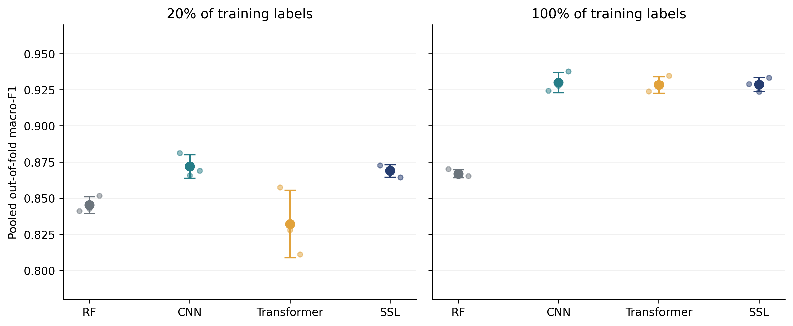
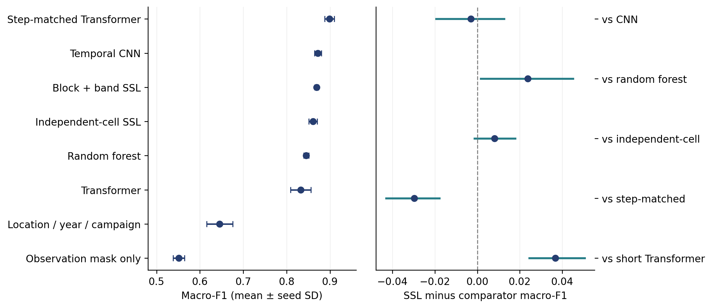
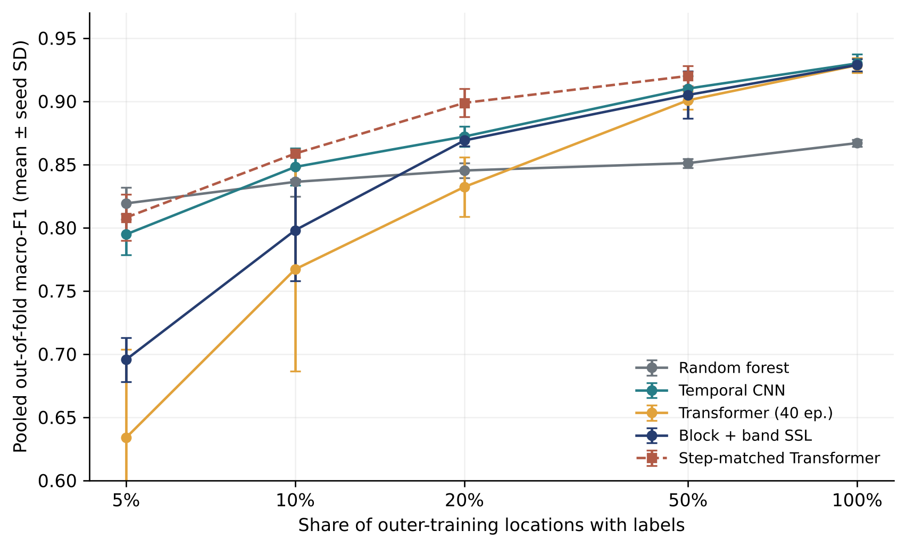
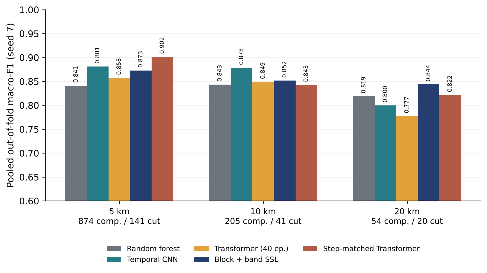

# Uydu zaman serilerinden orman kesimi sınıflandırması

Nida Hocayla araştırma görüşmesi için  |  27 Eylül 2026, uzantılarla güncellenmiş 16 Ekim 2026

### Çalışmanın sonucu

Gerçek Sentinel-2 gözlemleriyle, iki yıllık bir zaman penceresinde orman kesimi olup olmadığını sınıflandıran bir araştırma ve çalışan yerel uygulama hazırladım. Veri hazırlama, model eğitimi, coğrafi değerlendirme ve tahmin çıktıları aynı proje içinde yeniden çalıştırılabiliyor. İngilizce makale, deney kayıtları ve Türkçe ürün kılavuzu teslim dosyasına eşlik ediyor.

Araştırmanın ana sonucu karşılaştırma tasarımıyla ilgili: az etiketle ön eğitim kısa Transformer eğitimine göre fayda sağlıyor; ancak yaklaşık eşit optimizasyon adımı verilen denetimli model daha yüksek macro-F1 elde ediyor. Bu sonuç, ön eğitimin yararını tartışırken güçlü bir denetimli karşılaştırmanın gerekli olduğunu gösteriyor.

| Somut çıktı | Doğrulanmış kapsam |
| --- | --- |
| Gerçek veri | 2.213 konum ve 874 mekânsal bileşen |
| Bilimsel deney | 5 coğrafi kat ve 3 seed ile 180 eğitim |
| Çalışan model | 10 üyeli CNN ve SSL Transformer birleşimi |
| Yerel ürün | Örnek inceleme ve ham veriden gerçek çıkarım |
| Teslim | Türkçe rapor ve İngilizce makale ile kod ve veri |

### Bu teslimin kullanım amacı

Dosya, hocayla yöntem ve yayın yönünü somut sonuçlar üzerinden tartışmak için hazırlandı. Ürün uyumlu veride yerel tahmin üretir; mevcut başarı ölçümleri Avrupa kaynaklı DISFOR verisinden gelir. Türkiye’de bağımsız saha başarımı henüz ölçülmedi. Bu ayrım, araştırma sonuçlarının uygulamaya aktarılmasında temel sınırdır.

Görüşmeye ürün ekranıyla başlanabilir; ardından bu rapordaki sonuç tabloları ve İngilizce makale üzerinden yöntem tartışılabilir. Gerçek yazar, kurum, katkı ve fon bilgileri araştırmacılarla kesinleştirilecek; dosyada bu bilgiler varsayılmadı.

## Araştırma sorusu ve literatürdeki yeri

Uydu zaman serilerinde etiketler sınırlı olduğunda, etiketsiz gözlemlerden öğrenilen temsil sınıflandırmayı iyileştirebilir. İncelediğim soru, bu iyileşmenin daha fazla eğitim adımı verilen denetimli bir model karşısında sürüp sürmediğidir. İkinci soru, zamansal blok ve bant maskelemesinin bağımsız hücre maskelemesine göre ölçülebilir bir üstünlük sağlayıp sağlamadığıdır.

### Önceki çalışmalarla ilişki

| Çalışma | Bu projeyle ilişkisi |
| --- | --- |
| Zerveas ve ark. 2021 [3] | Maskeli çok değişkenli zaman serisi öğrenmesi yöntemsel dayanak. |
| Zhang ve ark. 2025 [2] | Orman bozulmasında Sentinel-1 ve Sentinel-2 ile farklı çok modlu görev. |
| Presto 2024 [7] | Ön eğitimli piksel zaman serisi modelleri için ilgili referans. |
| Roberts ve ark. 2017 [4] | Yapılandırılmış veride uygun çapraz doğrulamanın gerekçesi. |
| DISFOR 2026 [1] | Kaynak veri ve mevcut yorumlanmış orman bozulması etiketleri. |

Maskeli öğrenme, Transformer ve zamansal CNN yeni icatlar olarak sunulmuyor. Katkı; aynı konumlar, aynı etiket alt kümeleri ve sabit coğrafi katlar üzerinde yöntemleri karşılaştıran, eğitim adımı ve eksik gözlem kontrollerini birlikte raporlayan yeniden üretilebilir bir ampirik incelemedir. Temel model karşılaştırmalarının yanında olumsuz bulgular da korunmuştur.

### Karşılaştırmanın sınırı

Zhang çalışmasındaki çok modlu yöntem burada yeniden uygulanmadı; Presto ile doğrudan bir başarı yarışı yapılmadı. Veri, görev ve değerlendirme tasarımları farklı olduğundan yayınlar arasındaki F1 değerleri tek tabloda üstünlük sıralaması olarak kullanılmıyor. Resampling augmentation çalışması [8] ise zaman serisi kontrolleri için ilgili bir yöntemsel bağlam sunuyor.

Model tarifleri daha önce aynı kaynak veride geliştirilmişti. Son deneyin protokolü ve kod hash’leri yeni koşuların skorları üretilmeden sabitlendi; buna karşın bütün çalışma geriye dönük bir denetimdir. Yeni katlar, geçmişteki veri kümesi düzeyindeki uyarlamaları ortadan kaldırmaz. Bu nedenle katkıyı şeffaf ve kontrollü karşılaştırma olarak konumlandırıyorum.

## Veri hazırlama ve coğrafi ayrım

DISFOR’un sabit kaynak sürümündeki 3.822 konumdan yüksek güvenli, iki yıllık zaman penceresi kurulabilen ve yeterli açık ayı bulunan örnekler seçildi. Son görev bozulmamış orman ile kesim ayrımıdır. Etiketler kaynak veri üreticilerinin yorumlarından gelir; bu proje için yeni arazi ölçümü yapılmadı. Veri makalesi kaynak denetimi tarihinde incelemedeki ön baskıdır [1].

| Ardışık seçim adımı | Konum |
| --- | --- |
| Kaynak tablo | 3.822 |
| Düşük yorum güveni nedeniyle dışlanan | 598 |
| Uygun iki yıllık pencere bulunamayan | 606 |
| Açık ay sayısı yetersiz | 116 |
| İkili göreve alınmayan yangın örnekleri | 289 |
| Kalan orman ve kesim | 1.937 ve 276 |

Her örnek 24 ay ve 10 bant içerir. Source clear ile SCL 4 veya 5 koşulunu sağlayan gözlemlerin aylık medyanı alınır; her yılda en az altı gözlenmiş ay gerekir. Eksik değerler enterpole edilmez, ayrı maskeyle tutulur. Kaynak DN ölçeği korunur; standardizasyon yalnız dış eğitim katında gözlenmiş değerlerle hesaplanır. Etiket veya olay tarihi sınıflandırıcıya girdi olarak verilmez.

### Aynı bölgenin iki tarafta görünmesini önleme

Beş kilometre içindeki noktalar ve aynı kaynak bozulma olayını paylaşan uygun kampanya kayıtları bir grafikte birleştirilir. Ortaya çıkan 874 bağlı bileşen parçalanmadan beş coğrafi kata atanır. Eğitim ve test arasındaki en kısa uzaklık 5,0011 km’dir. Denetlenen 215 olay anahtarı katlar arasında bölünmez; birebir aynı gözlem dizisi bulunmamıştır.

Bu tasarım yakın nokta ve aynı olay sızıntısını belirlenen kurala göre önler. Bütün mekânsal bağımlılığın yok olduğunu kanıtlamaz. Kampanya 2’deki örnekleme katmanları olay kimliği olarak değerlendirilmez. Tam seçim kuralları ve kaynak sürümü, yöntem eki ile veri manifestlerinde kayıtlıdır.

## Eğitim düzeni ve yeniden üretilebilir deney

Ana deney dört yöntemi yüzde 20 ve yüzde 100 etiket bütçesinde karşılaştırır. Her yöntem beş coğrafi katta ve üç seed ile çalışır. Aynı kat ve seed içindeki yöntemler birebir aynı etiketli konumları kullanır; böylece sonuç farkı farklı etiket örneklemlerinden kaynaklanmaz. Bütün dış test konumları ön işleme ve ön eğitim dışında tutulur.

| Yöntem | Eğitim tarifi |
| --- | --- |
| Random forest | 500 ağaç ve 60 zamansal özet özellik |
| Zamansal CNN | 64 kanal genişliği ve 3 artık blok ile 40 epoch |
| Transformer | 48 genişlik ve 2 katman ile 40 epoch |
| SSL Transformer | 60 maskeli ön eğitim ve 40 sınıflandırma epoch’u |
| Adım eşlenmiş kontrol | Yüzde 20 etikette 320 denetimli epoch |
| Diğer kontroller | Bağımsız hücre maskesi ve iki bilgi kaynağı kontrolü |

Ana düzen 120 eğitimden, yüzde 20 etiketteki dört ek kontrol 60 eğitimden oluşur. Toplam 180 koşulun tamamı tutulmuştur. Son bilimsel deneyde erken durdurma, test skoruna göre seed seçimi, kalibrasyon veya karar eşiği optimizasyonu yoktur; eşik 0,5’tir. Etiket bütçesi sınıf içinden seçildiği için bu düzen kontrollü bir etiket azlığı benzetimidir; gerçek bir anotasyon maliyeti ölçümü değildir.

### Ölçütlerin hesaplanması

Her seed için beş katın ayrılmış tahminleri birleştirilerek 2.213 konum üzerinde macro-F1 hesaplanır. Tablolardaki ortalama ve standart sapma bu üç seed’den gelir. Macro-F1, iki sınıfın F1 değerlerini eşit ağırlıkla birleştirir; örneklerin yüzde kaçının doğru bulunduğuyla aynı değildir. AP, average precision ölçütüdür.

Ana yöntem farkı için 874 mekânsal bileşen 2.000 kez eşlenmiş bootstrap ile yeniden örneklenir. Aynı çekiliş her iki yönteme uygulanır ve üç seed birlikte korunur. Bu aralıklar sabit veri, katlar ve mevcut eğitimler koşulundadır; yeni bir veri kümesinde yeniden eğitim belirsizliğini veya geçmiş model geliştirme etkisini içermez.

## Ana sonuçlar

| Etiket | Yöntem | Macro F1 ve SD | AP | Kesim duyarlılığı |
| --- | --- | --- | --- | --- |
| %20 | Random forest | 0,8452 ± 0,0058 | 0,7969 | 0,7295 |
| %20 | Zamansal CNN | 0,8721 ± 0,0081 | 0,8494 | 0,7983 |
| %20 | Transformer | 0,8322 ± 0,0236 | 0,8419 | 0,7995 |
| %20 | SSL Transformer | 0,8690 ± 0,0043 | 0,8636 | 0,8007 |
| %100 | Random forest | 0,8669 ± 0,0028 | 0,8382 | 0,7101 |
| %100 | Zamansal CNN | 0,9299 ± 0,0071 | 0,9273 | 0,8853 |
| %100 | Transformer | 0,9285 ± 0,0057 | 0,9227 | 0,8720 |
| %100 | SSL Transformer | 0,9287 ± 0,0049 | 0,9337 | 0,8756 |

Yüzde 20 etikette SSL Transformer 0,8690, kısa denetimli Transformer 0,8322 macro-F1 elde etti. Tam hassasiyetli değerlerden hesaplanan fark 0,0368; koşullu yüzde 95 aralık [0,0245; 0,0506]. Aynı bütçede CNN’in ortalaması 0,8721’dir. SSL ile CNN farkının aralığı sıfırı içerdiği için genel bir SSL üstünlüğü sonucu çıkarılmıyor.

Şekil 1. Sabit coğrafi katlardaki ayrılmış tahminlerin sonuçları. Büyük noktalar üç seed ortalaması, küçük noktalar seed sonuçları; hata çubukları standart sapmadır.

Tam etikette CNN, Transformer ve SSL Transformer ortalamaları 0,9285 ile 0,9299 arasındadır. Bu küçük farklar, her veri kümesi ve bölgede en iyi mimarinin belirlendiği anlamına gelmez. Sayılar bağımsız Türkiye saha başarımı olarak kullanılmamalıdır.

## Eğitim bütçesi ve maskeleme kontrolleri

Daha uzun denetimli eğitim, ana bulgunun yorumunu değiştiriyor. Yaklaşık aynı toplam optimizasyon adımını alan Transformer 0,8987 macro-F1’e ulaşıyor. SSL eksi bu kontrol farkı -0,0297; koşullu yüzde 95 aralık [-0,0430; -0,0179]. Bu nedenle kısa eğitimli karşılaştırmada görülen yarar, ön eğitimin benzer ölçüde uzatılan her denetimli öğrenmeden daha iyi olduğunu göstermiyor.

Şekil 2. Yüzde 20 etiketle kontroller ve SSL eksi karşılaştırıcı farkları. Aralıklar mekânsal bileşen bootstrap’ından gelir. Kısa Transformer dışındaki karşılaştırmalar keşifseldir.

### Sonuçtan çıkarılabilecek yorum

Adım eşleştirme FLOP, duvar saati veya etiketli örneğe maruz kalmayı eşitlemez. Uzun denetimli koşul aynı etiketleri daha çok kez görür. Bulgumuz ek optimizasyonun tek nedensel açıklama olduğunu kanıtlamıyor; kullanılan karşılaştırıcının bilimsel yorumu değiştirdiğini gösteriyor. Ayrıca SSL’nin AP değeri 0,8636 iken uzun denetimli kontrolünki 0,8445’tir; sıralama başarısı ile sabit eşikteki sınıflandırma başarısı aynı yönde değişmek zorunda değildir.

Bağımsız hücre SSL 0,8609 elde etti. Yapılandırılmış maskelemenin 0,0080 farkına ait aralık sıfırı içeriyor. Yalnız eksik gözlem maskesi kullanan kontrol 0,5515, yalnız konum yıl kampanya kullanan kontrol 0,6455 macro-F1’e ulaşıyor. Bu sonuçlar örnekleme bağlamının tahmin edici bilgi taşıdığını gösterir; spektral modeldeki nedensel katkı yüzdesini ölçmez.

## Hatalar ve çalışan modelin davranışı

Genel ortalama bütün alt grupları temsil etmiyor. Mevcut ayrılmış tahminlerin yıl ve kaynak kampanyasına göre sonradan incelenmesi, tam etiketli CNN’in 2022 grubunda 0,8188 macro-F1’e indiğini gösteriyor. Bu grupta 265 konum ve yalnızca 12 kesim var. Bu tablo ileri zamanlı veya kampanya dışı doğrulama yerine betimsel hata incelemesidir.

| Hedef yıl | Konum | Kesim | CNN macro F1 |
| --- | --- | --- | --- |
| 2018 | 645 | 68 | 0,9168 |
| 2019 | 388 | 76 | 0,9426 |
| 2020 | 328 | 65 | 0,9418 |
| 2021 | 286 | 40 | 0,9444 |
| 2022 | 265 | 12 | 0,8188 |
| 2023 | 301 | 15 | 0,9279 |

CNN veya SSL modelinin üç seed’inden en az ikisinde yanlış sınıflandırılan 81 konum inceleme listesine alındı. Etiketleri model çıktısına bakılarak değiştirilmedi. GeoJSON ve hata tablosu, kaynak gözlemlerle insan incelemesini mümkün kılar; liste yeni ve düzeltilmiş bir gerçek etiket kümesi değildir.

### Üründeki modelin ayrı değerlendirmesi

Yerel uygulama advanced_v3 modelini çalıştırır: beş CNN ve beş SSL Transformer üyesi, eğitim içindeki coğrafi seçimle belirlenmiş ve geliştirme verisinde kalibre edilmiştir. Bu birleşim paper_v4’teki tekil modellerden farklıdır. Daha önce incelenmiş 486 örnekte macro-F1 0,9187 ve AP 0,9359 elde etmiştir.

| Gerçek sınıf | Orman tahmini | Kesim tahmini |
| --- | --- | --- |
| Orman | 448 | 0 |
| Kesim | 10 | 28 |

38 kesimin 28’i bulundu; 10’u kaçırıldı. Bu 448 orman örneğinde yanlış kesim alarmı gözlenmemesi, yeni bölgede sıfır yanlış alarm garantisi değildir. Kalibre edilmiş skorlar da yeni coğrafyada doğrulanmış güven olarak yorumlanmamalıdır. Üyeler arası farklılık yalnız model anlaşmazlığı göstergesidir.

## Yerel ürünü kullanma ve gösterim

Uygulama, eğitilmiş modeli araştırma görüşmesinde çalıştırılabilir hale getirir. Başlangıçta 486 örneğin kayıtlı çıktıları, konum görünümü ve gözlem serileri açılır. Kullanıcı bir örneği seçip aylık bant değerlerini, gözlenmeyen ayları, kesim skorunu ve kalite durumunu inceleyebilir. Nokta görünümü bir örnek dağılımıdır; kesintisiz ülke orman haritası değildir.

### Görüşmede beş dakikalık akış

1. URUNU_AC.command dosyasını çalıştır ve yerel arayüzü aç. Hazır örnek kümesinin DISFOR’dan geldiğini ve gerçek modeli kullandığını belirt.

2. Kesim tahminlerini filtrele. Bir örneğin 24 aylık gözlem serisini aç; eksik ayları ve kalite bilgisini göster.

3. Ayrı değerlendirme bölümünde gerçek etiketi ve tahmini karşılaştır. Kaçırılan bir kesim örneğini de göster; başarıyı yalnız doğru örneklerle anlatma.

4. Örnek veride analizi çalıştır düğmesiyle ham gözlemleri aylık girdiye dönüştürüp kayıtlı modeli gerçekten çalıştır. Bu işlem modeli yeniden eğitmez.

5. JSON veya GeoJSON çıktısını indir. Sonra araştırma sonuçlarına geçerek ürünün 486 örnekli değerlendirmesiyle makalenin 2.213 konumlu çapraz doğrulamasını ayır.

### Yeni gözlemle çalışma

Özel veri için komut satırı akışı vardır. Gözlem tablosu sample_id, timestamps, clear, SCL ve on Sentinel-2 bandını; pencere dosyası id, sample_id ve target_year alanlarını içermelidir. Harita için WGS84 lon ve lat eklenir. Etiket sütunu gerekmez. Kaynak ve DN işleme geçmişi --source ile belirtilir. Ayrıntılı alanlar docs/VERI_SOZLESMESI.md ve ürün kılavuzundadır.

Her pencere iki tam takvim yılını kapsar; hedef ikinci yıldaki kesimdir. Bu nedenle ürün, tek bir uydu görüntüsünden anlık kesim algılayan veya erken uyarı veren bir servis değildir. Kalite bayrağı yalnız aylık gözlem desteğini denetler; yeni bölgenin ekolojik ve radyometrik uyumunu doğrulamaz.

Sunucu yalnız bu bilgisayardaki 127.0.0.1 adresinde çalışır. Model veya gözlemler harici bir sunucuya gönderilmez. İnternet olmadan hazır veri ve kayıtlı modelle gösterim yapılabilir; ilk ortam kurulumu paket indirme gerektirebilir.

## Tekrar üretim ve teslim dosyaları

Araştırma sonucunu yalnız tablodan okumakla sınırlamayan bir kanıt zinciri kuruldu: sabit ham dosyalar, işlenmiş örnekler, kat ve etiket kimlikleri, koşu kayıtları, ayrılmış tahminler ve yeniden hesaplanan ölçütler. Ham Parquet dosyalarından ayrı bir klasörde kurulan 2.213 örneğin tüm dizileri ve örnek manifesti birebir eşleşti.

Kompakt bilimsel paket başka bir klasöre açılarak bir SSL koşulu sıfırdan yeniden eğitildi. Aynı ortamda bütün tahmin olasılıkları kayıtlı koşulla aynı çıktı. Bu denetim tek bir koşunun tekrar üretimidir; bütün 180 koşulun bu son kontrolde yeniden eğitildiği iddia edilmiyor. Farklı donanım ve kitaplıklarda küçük sayısal farklar oluşabilir.

| Teslim | İçerik ve kullanım |
| --- | --- |
| Hocaya sunum paketi | Türkçe sonuç raporu ve İngilizce makale ile çevrimdışı araştırma özeti. |
| Tam proje paketi | Ürün, ham ve işlenmiş veri, model ağırlıkları, testler ve tüm deney kayıtları. |
| Paper paketi | Makale deneyini tekrar üretmek için işlenmiş veri ve 180 koşul kaydı. |
| Nihai model paketi | 10 üyeli model ve etiketsiz örnek NPZ ile bağımsız çıkarım. |

### Hangi kontrol neyi kanıtlıyor

Otomatik testler girdi sözleşmesi, eksik gözlem işleme, etiket ayrımı ve değerlendirme sınırlarını kontrol eder. Model kabul denetimi üye dosyalarının hash’lerini, eğitim ve kalibrasyon kimliklerini ve 486 örnekte çıkarım eşitliğini denetler. Bilimsel denetim 180 kayıttan tahminleri birleştirir; macro-F1 ve AP değerlerini yeniden hesaplar. Güncel test sayısı ve son çalıştırmalar reports/final_delivery_verification.json dosyasında tutulur.

ZIP arşivleri dosya boyutu, CRC, yol güvenliği ve SHA-256 manifestiyle doğrulanır. Paket bütünlüğü verinin bilimsel doğruluğundan farklı bir kontroldür. Deney modelleri ve protokolü korunmuş; son teslim çalışması ürün, raporlama ve doğrulama katmanını tamamlamıştır.

### Kaynak ve kullanım koşulları

DISFOR kaynak lisansı ve atıfları pakette korunur. Yeni proje kodunun yayın lisansı araştırmacılarla seçilecektir. Yapay zekâ; kodlama, analiz denetimi ve rapor yazımında kullanılmıştır. Nihai bilimsel sorumluluk, yazarlık, kurum ve fon beyanları gerçek katkılara göre belirlenmelidir. Hiçbir dosya gönderilmedi veya kamuya yayımlanmadı.

## Uzantılar: etiket bütçesi eğrisi ve mekânsal yarıçap

Ana deney dondurulduktan sonra iki ek deney ayrı protokollerle ilan edilip koşuldu. İkisi de paper_v4 dosyalarını ve ürün modelini değiştirmez; aynı DISFOR kohortu üzerinde geriye dönük analizlerdir ve dış doğrulama değildir.

### Etiket bütçesi eğrisi (paper_v6)

İlk araştırma planındaki %5 ve %10 etiket koşulları ile %50 koşulu, paper_v4'ün aynı beş katı, üç seed'i, iç içe etiket tahsisi ve tarifleriyle 225 ek koşu olarak eğitildi. %5 etikette bir katın etiketli eğitim kümesi yaklaşık 90 konumdur ve bunların sadece 11–12'si kesimdir; bu yüzden düşük bütçelerde belirsizlik büyüktür.

| Etiket | RF | CNN | Transformer | SSL | Adım eşlenmiş |
| --- | --- | --- | --- | --- | --- |
| %5 | 0,8192 ± 0,0126 | 0,7946 ± 0,0161 | 0,6338 ± 0,0699 | 0,6955 ± 0,0175 | 0,8080 ± 0,0182 |
| %10 | 0,8362 ± 0,0117 | 0,8480 ± 0,0147 | 0,7670 ± 0,0805 | 0,7979 ± 0,0403 | 0,8586 ± 0,0030 |
| %20 | 0,8452 ± 0,0058 | 0,8721 ± 0,0081 | 0,8322 ± 0,0236 | 0,8690 ± 0,0043 | 0,8987 ± 0,0112 |
| %50 | 0,8510 ± 0,0035 | 0,9100 ± 0,0099 | 0,9007 ± 0,0071 | 0,9049 ± 0,0187 | 0,9200 ± 0,0081 |
| %100 | 0,8669 ± 0,0028 | 0,9299 ± 0,0071 | 0,9285 ± 0,0057 | 0,9287 ± 0,0049 | — |

SSL eksi kısa Transformer farkı: %5'te 0,0618, %10'da 0,0309, %50'de 0,0042. SSL eksi adım eşlenmiş Transformer farkı: %5'te -0,1124, %10'da -0,0606, %50'de -0,0150. Aralıklar makalenin Bölüm 5.1 ve Tablo 5'inde; %20 ve %100 satırları paper_v4'ün dondurulmuş sonuçlarıdır.

Şekil: Etiket bütçesi eğrisi. Noktalar üç seed ortalaması, çubuklar seed standart sapması; güven aralığı değildir.

### Mekânsal gruplama yarıçapı duyarlılığı (paper_v5)

Aynı kohort 5, 10 ve 20 km yarıçapla yeniden gruplanıp beş yöntem yalnız seed 7 ve %20 etiketle yeniden eğitildi (75 koşu, bütün ağırlıklar saklandı). Yarıçap büyüdükçe bileşenler birleşir: 874 → 205 → 54. Bu tek seed, betimsel bir analizdir.

| Yarıçap | Bileşen | RF | CNN | Transformer | SSL | Adım eşlenmiş |
| --- | --- | --- | --- | --- | --- | --- |
| 5 km | 874 | 0,8411 | 0,8812 | 0,8576 | 0,8726 | 0,9017 |
| 10 km | 205 | 0,8434 | 0,8784 | 0,8490 | 0,8515 | 0,8429 |
| 20 km | 54 | 0,8190 | 0,7997 | 0,7772 | 0,8437 | 0,8216 |

5 km'de adım eşlenmiş denetimli model önde (0,9017 / SSL 0,8726); 20 km'de SSL en iyi tarif (0,8437 / adım eşlenmiş 0,8216 / CNN 0,7997). Yani ana deneydeki 'uzun denetimli model SSL'yi geçer' bulgusu 5 km tasarımına özgüdür; eğitim ve test bölgeleri daha sert ayrılınca ön eğitimli temsil daha az bozulur. Bunu doğrulamak için ek seed'ler ve kampanyalardan bağımsız tanımlanmış dış bölgeler gerekir.

Şekil: Yarıçap duyarlılığı, %20 etiket, yalnız seed 7. Her çubuk tek bir birleştirilmiş macro-F1 değeridir.

## Bilimsel değerlendirme ve sonraki karar

Bu teslimde gerçek model eğitimi, kontrollü karşılaştırma, olumsuz bulguların raporlanması ve çalışan çıkarım ürünü tamamlandı. Araştırma sorusu ve sonucu hocayla tartışılabilecek kadar somut. Yayın yönünü belirleyecek esas ek çalışma, yeterli kesim desteği olan ve geliştirme sürecinde kullanılmamış bir değerlendirme kümesidir.

### Bağımsız değerlendirme için uygulanabilir sıra

Önce hedef kullanım tanımlanmalı: iki yıllık pencere içinde orman kesimi sınıflandırması. Bölge ve dönem, model skorları görülmeden seçilmeli. Kaynak verinin hakları, işleme ölçeği, bantları ve gözlem takvimi mevcut veri sözleşmesiyle karşılaştırılmalı. Ardından etiketleyicinin model skorunu görmediği bir yorumlama düzeni ve belirsiz örnekler için ortak karar süreci kurulmalı.

Örneklem büyüklüğü istenen kesim duyarlılığı ve yanlış alarm belirsizliğine göre önceden belirlenmeli; aynı olaydan gelen yakın noktalar bağımsız örnek sayılmamalı. Model ve karar eşiği değerlendirmeden önce dondurulmalı. Sonuçta macro-F1, AP, kesim duyarlılığı, yanlış alarm sayıları ve olay grubu belirsizliği birlikte raporlanmalı. Temsil edici bir harita örneklemi kurulmadıkça nokta precision değeri ülke ölçeğine taşınmamalı.

### Mevcut kullanılmamış veri neden yeterli değil

DISFOR içinde önceki konumları, ortak olayları ve beş kilometre komşuluklarını dışlayan taramada 111 uygun pencere kaldı. Bunların 110’u orman, yalnız biri kesim. Bu destekle bağımsız kesim başarımı ölçülmedi ve skor üretilmedi. Üstelik aynı kaynaktaki yeni noktalar da bağımsız saha toplamasıyla aynı kanıt düzeyinde değildir.

### Hocayla netleştirilecek karar

Önerim, mevcut çalışmayı eğitim bütçesine duyarlı SSL karşılaştırması olarak konumlandırmak ve bu soruya uygun bağımsız bir veri kaynağını birlikte seçmek. Ürün, yeni veri protokolü kesinleştikten sonra aynı girdileri işlemeyi ve hataları incelemeyi kolaylaştıracak hazır araştırma aracı olarak kullanılabilir. Sentinel-1 füzyonu veya temel model karşılaştırması seçilirse, yeni sürüm ve önceden tanımlı hipotezle ayrı deney olmalıdır.

Toplantıda beklenen karar; yayın kapsamı, bağımsız doğrulama verisi ve fiilî katkılara göre araştırmacı rolleridir. Kabul, yeni mimari veya Türkiye’de doğrulanmış başarı sözü verilmiyor. Eldeki bulgu ve çalışan sistem, bu kararları varsayımlar yerine somut kanıtlarla vermeyi sağlar.

## Kaynakça ve kanıt dosyaları

[1] Viehweger, J.; Hirschmugl, M.; Puhm, M.; Burtscher, R.; Gallaun, H.; Deutscher, J. (2026). Dense labelled time-series for mapping European forest disturbance agents. Earth System Science Data Discussions, preprint under review. https://doi.org/10.5194/essd-2026-185

[2] Zhang, M.; Li, G.; Lu, D.; Xu, C.; Zhao, H.; Li, D. (2025). Self-supervised deep learning for detection of forest disturbance types in a subtropical ecosystem using transformer and Sentinel-1 and Sentinel-2 time series data. International Journal of Digital Earth, 18, article 2537325. https://doi.org/10.1080/17538947.2025.2537325

[3] Zerveas, G.; Jayaraman, S.; Patel, D.; Bhamidipaty, A.; Eickhoff, C. (2021). A Transformer-based Framework for Multivariate Time Series Representation Learning. Proceedings of the 27th ACM SIGKDD Conference on Knowledge Discovery and Data Mining. https://doi.org/10.1145/3447548.3467401

[4] Roberts, D. R.; Bahn, V.; Ciuti, S.; Boyce, M. S.; Elith, J.; Guillera-Arroita, G.; Hauenstein, S.; Lahoz-Monfort, J. J.; Schroder, B.; Thuiller, W.; Warton, D. I.; Wintle, B. A.; Hartig, F.; Dormann, C. F. (2017). Cross-validation strategies for data with temporal, spatial, hierarchical, or phylogenetic structure. Ecography, 40, 913-929. https://doi.org/10.1111/ecog.02881

[5] Breiman, L. (2001). Random Forests. Machine Learning, 45, 5-32. https://doi.org/10.1023/A:1010933404324

[6] Guo, C.; Pleiss, G.; Sun, Y.; Weinberger, K. Q. (2017). On Calibration of Modern Neural Networks. Proceedings of Machine Learning Research, 70, 1321-1330. https://proceedings.mlr.press/v70/guo17a.html

[7] Tseng, G.; Cartuyvels, R.; Zvonkov, I.; Purohit, M.; Rolnick, D.; Kerner, H. (2024). Lightweight, Pre-trained Transformers for Remote Sensing Timeseries. arXiv:2304.14065, version 4. https://doi.org/10.48550/arXiv.2304.14065

[8] Saget, A.; Lafabregue, B.; Cornuejols, A.; Gancarski, P. (2025). Resampling Augmentation for Time Series Contrastive Learning: Application to Remote Sensing. Proceedings of the TerraBytes ICML Workshop, PMLR 292, 32-45. https://proceedings.mlr.press/v292/saget25a.html

[9] Yuan, Y.; Lin, L. (2021). Self-Supervised Pretraining of Transformers for Satellite Image Time Series Classification. IEEE Journal of Selected Topics in Applied Earth Observations and Remote Sensing, 14, 474-487. https://doi.org/10.1109/JSTARS.2020.3036602

[10] Yuan, Y.; Lin, L.; Liu, Q.; Hang, R.; Zhou, Z.-G. (2022). SITS-Former: A pre-trained spatio-spectral-temporal representation model for Sentinel-2 time series classification. International Journal of Applied Earth Observation and Geoinformation, 106, article 102651. https://doi.org/10.1016/j.jag.2021.102651

[11] Pelletier, C.; Webb, G. I.; Petitjean, F. (2019). Temporal Convolutional Neural Network for the Classification of Satellite Image Time Series. Remote Sensing, 11(5), article 523. https://doi.org/10.3390/rs11050523

[12] Rußwurm, M.; Körner, M. (2020). Self-attention for raw optical Satellite Time Series Classification. ISPRS Journal of Photogrammetry and Remote Sensing, 169, 421-435. https://doi.org/10.1016/j.isprsjprs.2020.06.006

[13] Sainte Fare Garnot, V.; Landrieu, L.; Giordano, S.; Chehata, N. (2020). Satellite Image Time Series Classification With Pixel-Set Encoders and Temporal Self-Attention. Proceedings of the IEEE/CVF Conference on Computer Vision and Pattern Recognition (CVPR), 12322-12331. https://doi.org/10.1109/CVPR42600.2020.01234

[14] He, K.; Chen, X.; Xie, S.; Li, Y.; Dollár, P.; Girshick, R. (2022). Masked Autoencoders Are Scalable Vision Learners. Proceedings of the IEEE/CVF Conference on Computer Vision and Pattern Recognition (CVPR), 15979-15988. https://doi.org/10.1109/CVPR52688.2022.01553

[15] Cong, Y.; Khanna, S.; Meng, C.; Liu, P.; Rozi, E.; He, Y.; Burke, M.; Lobell, D. B.; Ermon, S. (2022). SatMAE: Pre-training Transformers for Temporal and Multi-Spectral Satellite Imagery. arXiv:2207.08051 (Advances in Neural Information Processing Systems 35). https://doi.org/10.48550/arXiv.2207.08051

[16] Jakubik, J.; Roy, S.; Phillips, C. E.; et al. (2023). Foundation Models for Generalist Geospatial Artificial Intelligence. arXiv:2310.18660. https://doi.org/10.48550/arXiv.2310.18660

[17] Hansen, M. C.; Potapov, P. V.; Moore, R.; Hancher, M.; Turubanova, S. A.; Tyukavina, A.; Thau, D.; Stehman, S. V.; Goetz, S. J.; Loveland, T. R.; Kommareddy, A.; Egorov, A.; Chini, L.; Justice, C. O.; Townshend, J. R. G. (2013). High-Resolution Global Maps of 21st-Century Forest Cover Change. Science, 342(6160), 850-853. https://doi.org/10.1126/science.1244693

[18] Senf, C.; Seidl, R. (2021). Mapping the forest disturbance regimes of Europe. Nature Sustainability, 4, 63-70. https://doi.org/10.1038/s41893-020-00609-y

[19] Hirschmugl, M.; Gallaun, H.; Dees, M.; Datta, P.; Deutscher, J.; Koutsias, N.; Schardt, M. (2017). Methods for Mapping Forest Disturbance and Degradation from Optical Earth Observation Data: a Review. Current Forestry Reports, 3, 32-45. https://doi.org/10.1007/s40725-017-0047-2

[20] Zhu, Z.; Woodcock, C. E. (2014). Continuous change detection and classification of land cover using all available Landsat data. Remote Sensing of Environment, 144, 152-171. https://doi.org/10.1016/j.rse.2014.01.011

[21] Ploton, P.; Mortier, F.; Réjou-Méchain, M.; Barbier, N.; Picard, N.; Rossi, V.; Dormann, C.; Cornu, G.; Viennois, G.; Bayol, N.; Lyapustin, A.; Gourlet-Fleury, S.; Pélissier, R. (2020). Spatial validation reveals poor predictive performance of large-scale ecological mapping models. Nature Communications, 11, article 4540. https://doi.org/10.1038/s41467-020-18321-y

[22] Meyer, H.; Pebesma, E. (2022). Machine learning-based global maps of ecological variables and the challenge of assessing them. Nature Communications, 13, article 2208. https://doi.org/10.1038/s41467-022-29838-9

[23] Wadoux, A. M. J.-C.; Heuvelink, G. B. M.; de Bruin, S.; Brus, D. J. (2021). Spatial cross-validation is not the right way to evaluate map accuracy. Ecological Modelling, 457, article 109692. https://doi.org/10.1016/j.ecolmodel.2021.109692

[24] Wang, L.; Liu, S.; Song, W.; Ding, S.; Zhang, J. (2026). Global high-resolution forest disturbance type dataset. Earth System Science Data, 18, 1601-1617. https://doi.org/10.5194/essd-18-1601-2026

[25] Maze, M.; Attaher, S.; Taqi, M. O.; Elsawy, R.; Gad El-Moula, M. M. H.; Hashem, F. A.; Moussa, A. S. (2025). Enhanced agricultural land use/land cover classification in the Nile Delta using Sentinel-1 and Sentinel-2 data and machine learning. ISPRS Journal of Photogrammetry and Remote Sensing, 229, 239-253. https://doi.org/10.1016/j.isprsjprs.2025.08.019

[26] Vyas, N.; Singh, S.; Sethi, G. K. (2025). A novel image fusion-based post classification framework for agricultural variations detection using Sentinel-1 and Sentinel-2 data. Earth Science Informatics, 18, article 40 (online 2024). https://doi.org/10.1007/s12145-024-01506-0

### Sayısal kanıtların adresi

Ana tablolar ve fark aralıkları: experiments/paper_v4/analysis.json. Kat ve koşu kayıtları: aynı dizindeki folds.json, jobs.json ve runs/.

Alt grup ve hata analizi: paper/ERROR_AUDIT.md ve experiments/paper_v4/support_error_audit.json. İnceleme listesi: review_candidates.geojson.

Ürün modeli ve ayrı değerlendirmesi: models/advanced_v3/model_card.json ve experiments/advanced_v3/evaluation.json.

Tekrar üretim: paper/SUPPLEMENT.md. Kaynak denetimi: docs/NIHAI_BILIMSEL_DENETIM.md. Güncel teslim doğrulaması: reports/final_delivery_verification.json.
