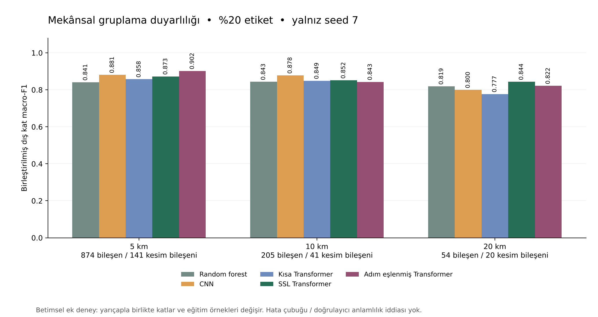

# Mekânsal yarıçap duyarlılığı tamamlanan ek deney

**Sürüm:** paper_v5_exploratory. **Durum:** 75 gerçek eğitim tamamlandı; 75 checkpoint yeniden yüklenerek tahminleri doğrulandı. paper_v4 ana deneyi ve ürün modeli değiştirilmedi.

Bu çalışma, aynı sabit DISFOR kohortunda mekânsal gruplama kuralını 5, 10 ve 20 km olarak değiştirir. Her yarıçapta aynı beş yöntem, beş dış kat, seed 7 ve yüzde 20 etiketle çalıştırıldı. Sonuçlar tek seed için birleştirilmiş dış kat tahminleridir. paper_v4 tablosundaki üç seed ortalamasıyla aynı istatistik değildir.

## Önceden sabitlenen düzen

Kod, işlenmiş veri, örnek manifesti, protokol, bütün katlar ve paylaşılan etiket kimlikleri ilk v5 eğitimi başlamadan SHA-256 ile kaydedildi. Yerel hazırlama olayı `preparation_event.json` dosyasında sıfır koşu kaydıyla tutulur; dışarıda kaydedilmiş bir ön kayıt iddiası yapılmaz. Yeni eğitim kodu yalnız yeni deney dizinine yazar.

Toplam 3 yarıçap × 5 kat × 1 seed × 1 etiket bütçesi × 5 yöntem = 75 koşu gerçekten yeniden eğitildi. Ana tarifler random forest, CNN, 40 epoch Transformer, 60 ön eğitim + 40 ince ayar epoch’lu SSL ve 320 epoch adım eşlenmiş Transformer’dır. Test eşiği 0,5’tir. Yeni model veya yarıçap seçimi, erken durdurma ve kalibrasyon yapılmadı. Adım eşleme işlem yükünü, süreyi, öğrenme oranını veya etiketli örnek gösterim sayısını eşitlemez.

## Nokta desteği ile bağımsız bileşen desteği

| Yarıçap | Bileşen | Kesim içeren bileşen | En büyük bileşen | Bir test katındaki en az kesim bileşeni |
|---|---:|---:|---:|---:|
| 5 km | 874 | 141 | 45 | 24 |
| 10 km | 205 | 41 | 304 | 2 |
| 20 km | 54 | 20 | 306 | 2 |

Her yarıçapta aynı 2.213 konum, 1.937 orman ve 276 kesim korunmuştur; bütün test katlarında iki sınıf bulunur. Buna karşın 10 ve 20 km’de bazı katlardaki kesimler yalnız iki mekânsal bileşene dayanır. Çok sayıda yakın noktayı bağımsız kesim olayı gibi saymak belirsizliği küçümser. Örnekler yalnız uzaklıkla değil, uygun kampanyalardaki ortak kaynak olaylarıyla da birleştirilir.

## Gerçekten ölçülen sonuçlar

| Yarıçap | Yöntem | Macro-F1 | AP | Kesim duyarlılığı | Brier |
|---|---|---:|---:|---:|---:|
| 5 km | Random forest | 0,8411 | 0,7924 | 0,7246 | 0,0575 |
| 5 km | CNN | 0,8812 | 0,8560 | 0,7935 | 0,0457 |
| 5 km | Kısa Transformer | 0,8576 | 0,8518 | 0,8007 | 0,0560 |
| 5 km | SSL Transformer | 0,8726 | 0,8707 | 0,8152 | 0,0482 |
| 5 km | Adım eşlenmiş Transformer | 0,9017 | 0,8503 | 0,7971 | 0,0408 |
| 10 km | Random forest | 0,8434 | 0,7734 | 0,6775 | 0,0570 |
| 10 km | CNN | 0,8784 | 0,8675 | 0,8152 | 0,0442 |
| 10 km | Kısa Transformer | 0,8490 | 0,8244 | 0,7862 | 0,0602 |
| 10 km | SSL Transformer | 0,8515 | 0,8443 | 0,8080 | 0,0576 |
| 10 km | Adım eşlenmiş Transformer | 0,8429 | 0,8172 | 0,8043 | 0,0676 |
| 20 km | Random forest | 0,8190 | 0,7425 | 0,6884 | 0,0626 |
| 20 km | CNN | 0,7997 | 0,7997 | 0,7790 | 0,0813 |
| 20 km | Kısa Transformer | 0,7772 | 0,7829 | 0,7536 | 0,0892 |
| 20 km | SSL Transformer | 0,8437 | 0,8426 | 0,8043 | 0,0581 |
| 20 km | Adım eşlenmiş Transformer | 0,8216 | 0,7825 | 0,7464 | 0,0743 |



Her satırdaki ölçüt, beş test katındaki 2.213 tahmin birleştirildikten sonra hesaplandı. Kat F1 değerlerinin ortalaması alınmadı. AP average precision’dır; Brier için düşük değer tercih edilir. ROC-AUC dahil tam sayılar `results.csv` ve `analysis.json` içindedir.

## Karşılaştırmanın yorumu

- 5 km: SSL eksi kısa Transformer farkı 0,0150; SSL eksi adım eşlenmiş Transformer farkı -0,0291.
- 10 km: SSL eksi kısa Transformer farkı 0,0026; SSL eksi adım eşlenmiş Transformer farkı 0,0086.
- 20 km: SSL eksi kısa Transformer farkı 0,0664; SSL eksi adım eşlenmiş Transformer farkı 0,0220.

Bu farklar betimseldir. Bir seed üzerinden standart sapma, p değeri veya doğrulayıcı güven aralığı raporlanmaz. Yarıçap büyüdükçe bağlı bileşenler birleşir; katlar ve eğitime seçilen etiket kimlikleri de değişir. Bu deney, yalnız mesafenin nedensel etkisini ayıran bir deney değildir. Yarıçapların her biri içindeki yöntemler aynı etiketli örneklerle eşlenmiştir.

Sonuçlar, coğrafi değerlendirme tasarımına duyarlılığı görünür kılar. Bir yarıçapta en yüksek skoru almak o yarıçapı seçme gerekçesi yapılmamalıdır. Yeni dış saha doğrulaması, ülke haritası veya genel mimari üstünlüğü kanıtı üretilmiş değildir.

## Ülke dışarıda bırakma kapsamı

Sabit kaynak `samples.parquet` tablosunda ve işlenmiş örnek manifestinde ülke alanı bulunmadı. Bu v5 protokolünde kaynakta olmayan bir ülke etiketi varsayılmadı; ülke başına sınıf ve olay desteği bu nedenle null olarak kaydedildi ve ülke dışarıda bırakma deneyi çalıştırılmadı. Kaynağı doğrulanmış sınır poligonlarından ayrıca ülke türetmek mümkündür; böyle bir alan kaynak DISFOR etiketi değil, yeni türetilmiş metadata olur ve ayrı destek denetimi/protokol gerektirir.

## Yeniden üretim ve bütünlük

5 km koşullarının eski paper_v4 seed 7 olasılıklarıyla en büyük farkı 2.22e-16 olarak ölçüldü. Bu karşılaştırma yeniden üretim kontrolüdür; yeni bağımsız doğrulama değildir.
Yeni 75 kayıtlı ağırlık tekrar yüklendi. Çıkarım ile kaydedilmiş olasılıklar arasındaki en büyük fark 2.21e-06; kontrol edilen tahmin değeri sayısı 33195 oldu. Bunlar aynı 2.213 konumun farklı model/yarıçap tekrarlarıdır.

```bash
.venv/bin/python scripts/scientific_v5.py prepare
.venv/bin/python scripts/scientific_v5.py pilot --workers 1 --max-jobs 5
.venv/bin/python scripts/scientific_v5.py train --workers 2 --max-jobs 75
.venv/bin/python scripts/verify_spatial_v5.py
.venv/bin/python scripts/report_spatial_v5.py
.venv/bin/python -m unittest discover -s tests -p test_scientific_v5.py -v
```

Tamamlanan koşular aynı imzalarla tekrar çalıştırıldığında önbellekte tutulur. Gerçek sıfırdan tekrar için ayrı proje kopyasında yeni v5 koşu/ağırlık çıktı alanları kullanılmalıdır; özgün kayıtlar korunmalıdır. Kod veya protokol değişirse imza denetimi yürütmeyi durdurur. Dosyalar: `protocol.json`, `support_audit.json`, `folds_r*.json`, `groups.json`, `jobs.json`, `signature.json`, `runs/`, `checkpoints/`, `analysis.json`, `results.csv`, `oof_predictions.npz`, `verification.json`, `checkpoint_verification.json`.
