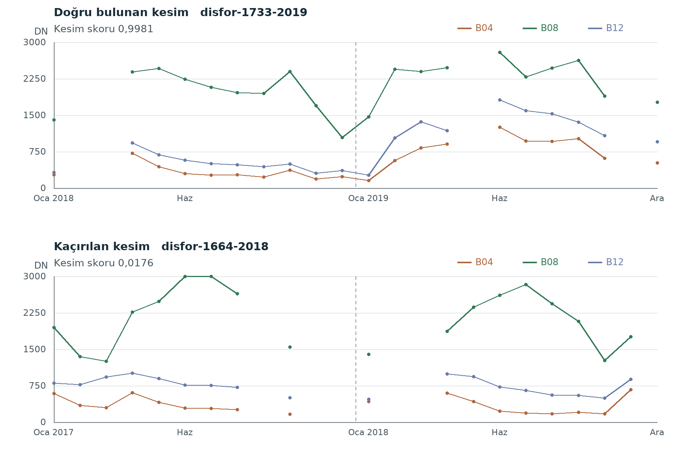
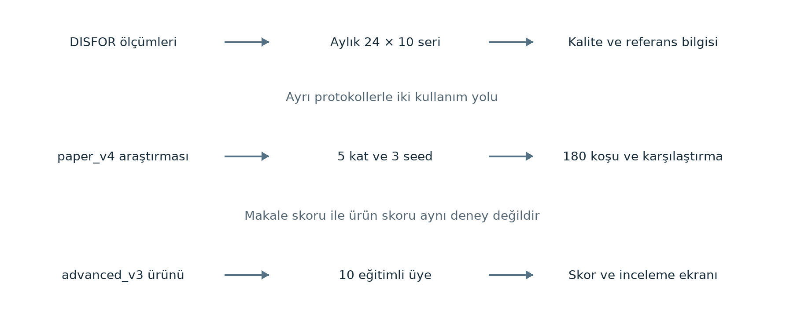

# Orman SSL Sıfırdan Proje Hakimiyet Rehberi

1 Ekim 2026 güncellemesi

Bu rehber konuya yeni başlayanlar için temel kavramları, gerçek deneyleri, dosyaları, canlı gösterimi ve hocayla görüşmeyi birlikte öğretir.


## Projenin çözdüğü soruyu kendi cümlenle anlat

Bir orman noktasının iki yıllık uydu ölçümlerini önüne koyduğunu düşün. Soru şu: İlk yıl orman olan bu yer, ikinci yılda kesim geçirmiş mi; yoksa iki yıl boyunca bozulmamış orman olarak mı kalmış? Orman SSL bu iki seçenek arasında sınıflandırma yapan bir araştırma ve yerel uygulama projesidir.

Model tek bir fotoğrafa bakmıyor. Aynı konumun 24 aylık, 10 farklı ışık bandındaki sayı dizisini inceliyor. “Sınıf”, verebileceği cevap kategorisidir. Bu projede 0 bozulmamış orman, 1 kesim demektir. Modelin ürettiği kesim skoru, sabit 0,50 eşiğiyle sınıf kararına dönüştürülür.

### Araştırma sorusu ile ürünün görevi

Ürünün görevi verilen uydu dizisine bir tahmin üretmektir. Araştırmanın sorusu daha farklıdır: Az sayıda etiketimiz varken, önce etiketsiz uydu dizileri üzerinde alıştırma yapan model daha iyi öğrenir mi? Bunu yanıtlamak için farklı modelleri aynı veride ve aynı coğrafi ayrımlarda karşılaştırdık. Eğitimi daha uzun tutmanın etkisini de ayrıca kontrol ettik.

Etiket, kaynak araştırmacıların bir noktaya verdiği referans cevaptır. “Etiketsiz” demek verinin boş olması değil, modelin o verinin sınıf cevabını öğrenme sırasında kullanmaması demektir. Bu ayrım, SSL konusunu anlamanın başlangıcıdır.

### Hocaya söyleyebileceğin ilk cümle

“Gerçek Sentinel 2 zaman serilerinden orman kesimini geriye dönük sınıflandıran bir sistem hazırladık. Araştırmada, az etiketli öğrenmede SSL kazancının eğitim bütçesi kontrol edildiğinde sürüp sürmediğini inceledik.” Bu cümledeki her kelimenin gerekçesini ilerleyen sayfalarda öğreneceksin.

**Kendini kontrol et:** Model gelecekte çıkacak bir orman yangınını haber veriyor mu?

**Yanıt:** Hayır. Görev, seçilmiş iki yıllık pencerede orman kesimini sonradan sınıflandırmaktır. Yangın, geleceği tahmin etme ve erken uyarı bu çalışmada doğrulanmadı.

Dayanak: README.md; experiments/paper_v4/protocol.json


## Uydu görüntüsünün içindeki sayılar

Uzaktan algılama, bir yere dokunmadan sensörle ölçüm yapmaktır. Sentinel 2, yeryüzünden gelen ışığı farklı dalga boylarında ölçen bir uydu görevidir. Bir fotoğrafın kırmızı, yeşil ve mavi kanallarına benzer biçimde farklı “bantlar” vardır; bazıları insan gözünün görmediği ışığı ölçer. Resimde renk gördüğümüz yerde bilgisayar sayılar görür.

Piksel, görüntüdeki küçük bir alanın ölçümüdür. Bir pikseli tek bir ağaçla eş tutamazsın; içinde ağaç, toprak ve başka yüzeyler birlikte bulunabilir. Sentinel 2 cihazının 13 bandı ve banda bağlı 10, 20, 60 metre yer örnekleme ölçekleri vardır. Bizim modelimiz seçilmiş 10 bandın hazır konum serisini kullanır. Bütün bantların doğal çözünürlüğünün aynı olduğunu söyleme. [G1]

| Kullandığımız bantlar | Basit karşılığı |
| --- | --- |
| B02 B03 B04 | Mavi yeşil kırmızı görünür ışık |
| B05 B06 B07 | Bitki örtüsüne ilişkin değişimleri incelemekte yararlı kırmızı kenar bölgesi |
| B08 B8A | Yakın kızılötesi ışık |
| B11 B12 | Kısa dalga kızılötesi ışık |

Ağaç örtüsü değişince ışığın ölçülen biçimi de değişebilir. Ancak bulut, gölge, mevsim, nem ve arazi koşulları da ölçümleri değiştirir. Bu yüzden tek bir bandın azalmasını “kesin kesim” diye okumayız. Model birden fazla bant ve ayın birlikte oluşturduğu örüntüleri öğrenmeye çalışır.

Bu projede baştan uydu görüntüsü indirme, pikselleri yeniden örnekleme ve fiziksel yansıtım düzeltme zinciri kurulmadı. DISFOR kaynağında hazır olan konum ölçümleri kullanıldı. Kaynağın DN adı verilen sayısal değerleri korundu; yeni bir yansıtım dönüşümü eklenmedi.

**Kendini kontrol et:** B08 değeri bir ayda düştüyse neden tek başına kesim diyemeyiz?

**Yanıt:** Çünkü aynı değişimin birden fazla nedeni olabilir. Diğer bantlara, önceki ve sonraki aylara, gözlem kalitesine ve bağımsız referans bilgisine birlikte bakmak gerekir.

Dayanak: src/orman_ssl/inputs.py; paper/SUPPLEMENT.md


## Bir örneğin biçimi ve zaman penceresi

Zaman serisi, aynı yerden farklı zamanlarda alınan ölçümlerin sıralı listesidir. Bunu bir kişinin iki yıllık aylık sağlık ölçümlerine benzetebilirsin. Tek bir ölçümden çok, ölçümlerin birlikte nasıl değiştiği önemlidir. Bizde her örnek bir konum, her satır bir ay, her sütun bir uydu bandıdır.

| Öğe | Bu projedeki anlamı |
| --- | --- |
| Bir örnek | Bir konum için tek bir 24 aylık pencere |
| x | 24 ay × 10 bantlık sayısal dizi |
| observed | Her ay ve bant için ölçüm mevcut mu bilgisi |
| days | Her ayın 15. gününün pencere başından itibaren gün karşılığı |
| y | Eğitim ve değerlendirmede kullanılan sınıf etiketi |
| id | Örneği dosyalar arasında eşleştiren benzersiz kimlik |

Örneğin target_year 2019 ise pencere Ocak 2018 ile Aralık 2019 arasındadır. Kesim örneğinde ilk yılın bozulmamış orman olması, uygun kesimin ikinci yılda gerçekleşmesi istenir. Negatif örnekte iki yıl boyunca orman referansı vardır. Aylık ölçümler, penceredeki tüm aylar tamamlandıktan sonra geriye dönük incelenir.

x dizisinin tüm veri için biçimi 2213 × 24 × 10 olur. İlk sayı konum adedidir; 24 × 10 ise her konumdaki ölçüm hücreleridir. Hücrelerin bazıları eksiktir. Bu nedenle 2213 × 240 hesabını bağımsız örnek sayısı gibi sunamazsın. Aynı konumun ayları birbirleriyle ilişkilidir.

Etiketler veri kümesinin uygun pencerelerini kurarken kullanıldı. Tahmin programı ise etiket istemez; ölçümleri ve hangi iki yılı inceleyeceğini alır. Bu, seçilmiş ve etiketli bir araştırma verisiyle çalıştığımız gerçeğini ortadan kaldırmaz.

**Kendini kontrol et:** target_year 2020 olan örnek hangi dönemi kapsar?

**Yanıt:** Ocak 2019 ile Aralık 2020. Kesim sınıfındaki uygun olay ikinci takvim yılında aranır; 24 aylık pencere olayın kesin gününü tahmin ettiği anlamına gelmez.

Dayanak: src/orman_ssl/inputs.py; scripts/prepare_disfor.py


## Veri nereden geldi ve neden bu kadar örnek kaldı

DISFOR, Avrupa orman bozulmalarını incelemek için hazırlanmış açık bir veri kaynağıdır. Kaynak araştırmacılar mevcut bilgiler ve uydu görüntüleriyle yorumlanan referans etiketler sağlamıştır. Bu projede yeni arazi ziyaretleriyle etiket toplanmadı. Bir modelin kendi tahminini doğru cevap kabul edip eğitim verisi diye sunmadık. [G2]

Kaynağın sabit bir sürümü indirildi. “Sabit sürüm” aynı veriye daha sonra yeniden erişebilmek için kullanılan bir kimliktir. Bizim indirilen konum tablomuz 3.822 kayıt içeriyor; kaynak kartındaki farklı bir sayıyı kendi işlenen örnek sayımız gibi kullanmıyoruz.

| Sıralı seçim adımı | Konum sayısı |
| --- | --- |
| İndirilen konum tablosu | 3.822 |
| Yüksek güven dışında kalanlar | −598 |
| Uygun ve açık iki yıllık pencere olmayanlar | −606 |
| Yeterli açık ay gözlemi bulunmayanlar | −116 |
| İkili görev dışında bırakılan yangın örnekleri | −289 |
| Son çalışma kümesi | 2.213 |
| Orman ve kesim dağılımı | 1.937 orman ve 276 kesim |

Bu filtreler, hedefi daha tutarlı bir ikili sınıflandırma sorusuna indirger. Bunun karşılığı, sonucun bütün orman bozulmalarını veya bütün coğrafyaları temsil etmemesidir. Kolay yorumlanan ve yeterli gözlemi bulunan noktaları seçmek, gerçek dünyadaki zor örnekleri daha az temsil ediyor olabilir.

Sınıf dengesizliği var: kesim sayısı orman sayısından çok daha az. Hep “orman” diyen bir sistem, çoğunluğu yakaladığı için yüksek doğruluk gösterebilir; buna rağmen tek bir kesimi bulamaz. Bu yüzden sınıfları ayrı değerlendiren ölçütlere ihtiyaç duyuyoruz.

**Kendini kontrol et:** 2.213 konumun tamamı sahaya gidilip bizim ölçtüğümüz noktalar mı?

**Yanıt:** Hayır. Kaynak DISFOR etiketleri ve ölçümleri üzerinde tanımlı seçim ve hazırlama adımları uygulandı. Etiketlerin kaynağı ile bizim veri işleme katkımızı ayrı anlatmalısın.

Dayanak: reports/disfor_preparation.json; data/disfor/downloads.json


## Ham gözlemden kullanılabilir aylık veriye

Aynı ayda birden fazla uydu gözlemi olabilir. Önce kaynağın clear alanı doğru olan ve SCL değeri 4 veya 5 olan gözlemler tutulur. SCL, sahne sınıflandırmasıdır; 4 bitki örtüsü, 5 bitkisiz yüzey sınıfıdır. Bitkisiz yüzeyi tutmak mantıklıdır: kesimden sonra yerin görünümü değişebilir. Bu filtre kusursuz bulut temizliği garantisi vermez. [G3]

Sonra her ay ve bant için medyan alınır. Medyan, sıralanan sayıların ortasındaki değerdir. Öğretici bir örnek: 100, 110 ve 900 değerlerinde medyan 110 olur. Aşırı değerin ortalamaya etkisi daha büyüktür. Bu üç sayı gerçek deney verisi değildir; aylık özetlemenin mantığını göstermek içindir.

Bir ayda uygun ölçüm yoksa o ayın değeri uydurulmaz. Eksiklik observed adlı maske ile kaydedilir. “Maske”, hangi hücrelerin kullanılabileceğini belirten doğru veya yanlış işaretidir. Eksik ayı sıfır saymak, sensörün gerçekten sıfır ölçtüğünü iddia etmek olur. Aylık hazırlamada zamanlar arası ara değer doldurma yapılmaz.

Bir örneğin kalite koşuluna uygun sayılması için her takvim yılında en az altı gözlenen ay gerekir. Kod bu sayımı en az bir gözlenen bandı bulunan ay üzerinden yapar. Arayüzde tamamen yeşil ay hücresi ise 10 bandın da gözlendiğini gösterir. Kalite uygunluğu ve tahmin doğruluğu ayrı kavramlardır.

### Ölçekleme neden yalnız eğitimde öğreniliyor

Bantların sayısal ölçekleri farklı olabilir. Model hazırlığında eğitim verisindeki gözlenen değerlerden ortalama ve standart sapma öğrenilir; değerler bu ölçülerle ölçeklenir. Test verisinin genel bilgisini bile baştan öğrenme sürecine katmamak için test değerlerinden yeni bir ölçekleyici hesaplanmaz. Eksikliği işaretleyen maske model boyunca korunur.

**Kendini kontrol et:** Ayı eksik olan örnekte çizgiyi neden kesik görüyorsun?

**Yanıt:** Çünkü ölçmediğimiz bir dönemi ölçülmüş gibi çizmek istemiyoruz. Boşluk, veri kalitesi hakkında görünür bir bilgidir; tek başına kesim kanıtı değildir.

Dayanak: src/orman_ssl/inputs.py; src/orman_ssl/experiment.py; reports/product.html


## Öğrenme tahmin ve ölçme üç ayrı iştir

Bir öğrenciye örnek sorular ve çözümleri verildiğini düşün. Öğrenme sırasında öğrenci yaklaşımını düzeltir. Sınavda ise yeni bir soruya cevabını verir. Cevabı değerlendirmek için bir cevap anahtarı gerekir. Makine öğrenmesinde de eğitim, çıkarım ve değerlendirme farklı adımlardır.

| İşlem | Ne kullanır | Ne değişir |
| --- | --- | --- |
| Eğitim | Ölçümler ve yönteme göre sınıf etiketleri | Modelin öğrenilen sayıları |
| Çıkarım | Yeni veya mevcut ölçümler ve kayıtlı model | Tahmin dosyası |
| Değerlendirme | Tahminler ve referans etiketler | Başarı ve hata ölçümleri |

Üründe “Örnek veride analizi çalıştır” düğmesine basınca model yeniden eğitilmez. Hazır ağırlıklar kullanılarak aynı paketli ham gözlemler işlenir ve tahminler yeniden üretilir. Ağırlıklar, eğitim sonunda modelin öğrendiği çok sayıdaki sayısal parametredir. Düğmeye tekrar basmak yeni bir bilimsel deney veya bağımsız test yaratmaz.

Bir tahminin kesim skoru 0,80 ise ürün sabit eşik 0,50 olduğu için “kesim” der. Skor 0,30 ise “orman” der. Bu sayılar öğretici örnektir. “0,80 skor” ifadesi, yeni bir ülkede bu tahminin kesinlikle yüzde 80 doğru olduğu anlamına gelmez. Skorun bu şekilde yorumlanabilmesi için hedef koşullarda ayrıca kalibrasyon ve doğrulama gerekir.

Bir diğer fark, yazılım testi ile model başarımıdır. Geçen 58 test; dosyaların, veri kontrollerinin ve işlem akışının beklendiği gibi çalışmasını denetler. Bir program bütün yazılım testlerini geçip yeni bir bölgede kötü tahmin yapabilir. Başarımın kanıtı, uygun biçimde ayrılmış veri ve referans etiketlerle yapılan ölçümdür.

**Kendini kontrol et:** Çalıştır düğmesi başarılı olduysa modelin Türkiye performansını kanıtladık mı?

**Yanıt:** Hayır. Çalıştırma, mevcut veriyle çıkarım akışını doğrular. Türkiye performansı, geliştirmede kullanılmamış ve yeterli referans bilgisi olan Türkiye verisinde ayrıca ölçülmelidir.

Dayanak: scripts/serve_product.py; reports/final_delivery_verification.json


## İki gerçek örneği birlikte oku

Aşağıdaki grafikler ürünün kullandığı gerçek aylık girdiden çizildi. Üst örnek doğru bulunan kesim; alt örnek referansı kesim olduğu hâlde modelin orman dediği noktadır. Her çizgi bir bandın zaman içinde değişimidir. Boş aylar çizgide birleştirilmez.



Önce yatay eksende ayları, sonra bandın rengini ve dikey eksendeki ölçüm birimini bul. Dikey kesik çizgi ikinci yılın başlangıcıdır; olayın gerçek kesim günü değildir. Bir çizginin değiştiği anı doğrudan olay tarihi olarak ilan etme.

İki örnek de referansta kesimdir. Birinin skoru çok yüksekken diğerinin düşük olması, modelin hata yapabildiğini görünür kılar. Bu iki örnek, açıklama amacıyla seçildi; modelin toplam başarımı bütün değerlendirme kümesinden hesaplanır. Grafikteki üç bant, modelin kullandığı on bandın yalnız bir bölümüdür.

**Kendini kontrol et:** Alt örneğin skoru düşük diye kaynak etiketini orman yapabilir miyiz?

**Yanıt:** Hayır. Model ile referans çelişiyorsa ayrı kanıtlarla incelenir. Model kararı, kendi başına referans etiketini değiştirme gerekçesi değildir.

Dayanak: output/advanced_prediction/input.npz; output/advanced_prediction/predictions.json; data/disfor/sample_manifest.json


## Bütün sistemi tek akışta birleştir

Şimdi parçaları bir araya getir. Veri hazırlama, öğrenme ve kullanım tek bir dosya değildir. Her adımın belirli bir girdisi, görevi ve çıktısı vardır. Bu ayrımı kurabilirsen hocanın “Bu sayı nereden geldi?” sorusuna doğru kanıtı açarak cevap verirsin.



Bilimsel yol, yöntemleri karşılaştırmak içindir. paper_v4 sürümünde aynı etiket alt kümeleri ve coğrafi katlar kullanılır. Her yöntemin kendi dış test tahminleri birleştirilir; karşılaştırma tablosu buradan çıkar. Test sonucu, o koşunun modelini eğitmek için geri beslenmez.

Ürün yolu, eldeki eğitilmiş sistemi kullanılabilir hâle getirir. advanced_v3 sürümünde beş CNN ile beş SSL Transformer birlikte çalışır. Arayüz bu birleşimin tahminini, konumunu ve zaman serisini gösterir. Ürünün 486 noktalık skoru ile makalenin 2.213 konum üzerinde üretilen skorları farklı düzenlerden gelir.

Bir araştırmayı bitirmek, bundan sonra soru kalmadığı anlamına gelmez. Burada yöntem karşılaştırması, kanıt dosyaları, çalışan ürün ve raporlama tamamlanmış durumdadır. Dış saha doğrulaması bir sonraki çalışmadır. Bu kitabın amacı mevcut sonuca hâkim olmanı ve yeni çalışmanın hangi kararla başlayacağını anlayabilmeni sağlamaktır.

**Kendini kontrol et:** Hocan ürünün F1 değeriyle makale tablosunu neden doğrudan yarıştırmadığını sorarsa?

**Yanıt:** Veri bölünmeleri, eğitim tarifleri ve tekil model ile ensemble yapıları farklıdır. Adil bir karşılaştırma için modeller aynı önceden tanımlanmış değerlendirme düzeninde ölçülmelidir.

Dayanak: experiments/paper_v4/protocol.json; models/advanced_v3/model_card.json; README.md


## Bir model öğrenirken gerçekte ne değişir

Model, girdiden bir çıktı üreten matematiksel bir kuraldır. Bu projede girdi, bir konumun 24 aylık uydu gözlemleridir; çıktı, kesim sınıfına ait bir skordur. Model ormana bakıp insan gibi düşünmez. Eğitim örneklerinde tekrarlanan sayısal ilişkileri kullanır. Aynı girdi, aynı kayıtlı model ve aynı işlem koşulları altında aynı tahmini vermelidir.

Sinir ağında ağırlık, bir bilginin sonraki hesaplamaya ne kadar etki edeceğini belirleyen öğrenilebilir sayıdır. Bir ses masasındaki çok sayıda ayar düğmesini düşün. Başlangıçta düğmeler uygun konumda değildir. Eğitim, örnekleri kullanarak bu sayıları düzenler. Mimari, düğmelerin nasıl bağlandığını; eğitilmiş model ise bu bağlantılarla birlikte son ayar değerlerini ifade eder.

Kayıp, İngilizcesi loss, modelin eğitim hedefine ne kadar uzak olduğunu ölçen sayıdır. Kesim etiketli bir örneğe çok düşük kesim skoru verilmesi kaybı artırır. Gradyan, ağırlıklardaki küçük değişimlerin kaybı hangi yönde değiştireceğini gösteren türev bilgisidir. Optimizasyon algoritması bu bilgiyi kullanarak ağırlıkları günceller. Projede sinir ağları AdamW adlı algoritmayla eğitilir. Düşük eğitim kaybı, yeni konumlarda başarıyı tek başına garanti etmez.

Batch, bir güncellemede birlikte işlenen küçük örnek grubudur; burada boyutu 64’tür. Epoch, o aşamada kullanılan eğitim örneklerinin tamamı üzerinden bir geçiştir. Örneğin 128 etiketli örnek iki tam batch oluşturur: 40 epoch, 80 güncelleme demektir. Bu yalnız açıklayıcı bir sayısal örnektir; gerçek katlardaki örnek sayıları farklıdır. Batch ve epoch aynı birim değildir.

Seed, rastgele sayı üretiminin başlangıç değeridir. Başlangıç ağırlıkları ve örnek sıraları gibi rastgele seçimleri izlenebilir kılar. paper_v4 deneyinde 7, 17 ve 27 kullanılır. Bunlar üç yeni veri kümesi değildir; aynı araştırmanın farklı rastgele seçimlerle tekrarıdır. Aynı seed de farklı donanım ve yazılımda her zaman birebir sayısal eşitlik garantilemez.

Tahmin sırasında ağırlıklar güncellenmez. Üründeki çalıştırma düğmesi kayıtlı ağırlıkları kullanır; yeni eğitim başlatmaz. Random forest ise sinir ağı değildir ve burada anlatılan gradyanlı eğitim düzenini kullanmaz.

**Kendini kontrol et:** Kırk epoch eğitmek kırk örnek görmek midir

**Yanıt:** Hayır. Her epoch o aşamanın bütün eğitim örneklerini kapsar; her örnek birçok kez görülür.

Dayanak: src/orman_ssl/advanced.py; scripts/train_paper.py; experiments/paper_v4/protocol.json


## Üç model ailesi aynı seriyi nasıl okur

Mimari, modelin bilgiyi işleme düzenidir. Aynı 24 aylık seriyi üç kişinin farklı yöntemlerle incelemesini düşün. Biri özet fişi okur, biri birbirine yakın ayların örüntülerini arar, diğeri uzak ayları da karşılaştırır. Projedeki random forest, CNN ve Transformer ayrımını bu benzetmeyle başlatabiliriz; hiçbiri için peşinen en iyi kararı veremeyiz.

Random forest, rastgele orman, birçok karar ağacının birleşimidir. Karar ağacı, sayısal koşullarla örnekleri dallara ayırır. Bu projedeki ana orman 500 ağaçtır. Ham aylık diziyi olduğu gibi almaz. Her bant için gözlenen değerlerin ortalaması, değişkenliğini ölçen standart sapması, en küçüğü, en büyüğü, ikinci yıl ortalaması eksi ilk yıl ortalaması ve gözlenen hücre oranı hesaplanır. On bant çarpı altı özet, 60 özellik eder. Özellik, modelin karar verirken kullandığı sayısal girdidir.

Bu özet fişi hızlı ve güçlü olabilir; fakat aynı ortalamaya sahip iki farklı aylık dizinin ayrıntılı sırasını kaybedebilir. Yıllar arasındaki fark özelliği bir miktar zaman bilgisi taşır. Dolayısıyla bu modeli tamamen zamansız diye nitelemek de doğru değildir. Projedeki orman, uydu görüntü parçalarını inceleyen bir görüntü sınıflandırıcısı değildir.

CNN, evrişimli sinir ağıdır. Burada küçük öğrenilebilir süzgeçler ay ekseni boyunca kayar; bantlardaki yakın dönem değişimlerini birlikte işler. Genişliği 64 olan ağda üç artık blok bulunur. Artık bağlantı, bir bloğun girdisini işlenmiş çıktısına ekleyerek bilginin sonraki bloğa taşınmasını kolaylaştırır. Süzgeç aralıkları büyütülerek daha uzak aylar da ilişkilendirilir.

Transformer, dikkat mekanizmasıyla farklı zaman adımlarındaki bilgileri birlikte değerlendirir. Dikkat, hangi ay bilgisinin diğer ayı yorumlarken ne kadar ağırlık alacağını hesaplayan işlemdir; insan dikkati veya neden açıklaması değildir. Projedeki ağ iki katmanlı, dört dikkat başlıklı ve 48 genişliklidir. CNN ve Transformer her ayda on değer, on gözlem göstergesi ve üç zaman özelliği kullanır.

En iyi aileyi isimden seçmek yerine aynı veri ve koşullarda ölçeriz. Tam etikette CNN ortalama 0,9299 macro-F1 üretmiştir. Bu tek görevdeki sonuç, CNN’in bütün uydu problemlerinde üstün olduğunu göstermez.

**Kendini kontrol et:** Random forest neden 240 ham değer yerine 60 özellik alıyor

**Yanıt:** Çünkü bu uygulama her bandın 24 aylık dizisini altı özetle temsil ediyor.

Dayanak: src/orman_ssl/advanced.py; src/orman_ssl/experiment.py; experiments/paper_v4/analysis.json


## Özdenetimli öğrenmede model neyi tahmin eder

Denetimli öğrenmede örneğin sınıf etiketi eğitim hedefidir: bu konum kesimdir veya ormandır. Özdenetimli öğrenmede, İngilizcesi self supervised learning ve kısaltması SSL, eğitim hedefi verinin kendisinden oluşturulur. Bu projede gözlenen uydu değerlerinin bir kısmı bilinçli olarak gizlenir; model görünür bölümden gizleneni tahmin etmeye çalışır. Bu yöntem, orman ile kesim etiketlerini doğrudan kullanmadan temsil öğrenmesini sağlar.

Bir cümlede bazı kelimeleri kapatıp boşlukları tamamlamayı düşün. Cümleyi yeniden kurmak için çevresindeki ilişkileri öğrenirsin. Burada kelimelerin yerinde aylık bant değerleri vardır. Yeniden oluşturma, reconstruction, gizlenen sayıları tahmin etme görevidir. Modelin öğrendiği iç sayısal gösterime temsil denir. Daha sonra bu temsil kesim sınıflandırmasına uyarlanır; bu ikinci aşama fine tuning, yani ince ayardır.

İki farklı maskeyi ayırmalısın. Kalite veya gözlem maskesi, kaynaktan gerçekten kullanılabilir ölçüm gelip gelmediğini bildirir. Bulut nedeniyle bulunmayan değerin doğrusu bilinmez; onu yeniden oluşturma kaybında hedef olarak kullanamayız. Eğitim maskesi ise başlangıçta bilinen bir değeri alıştırma amacıyla geçici olarak saklar. Doğru değer elimizde olduğu için modelin tahminiyle karşılaştırabiliriz. Eksik gözlemi sıfırmış gibi kabul etmek bu ayrımı bozar.

Ana SSL tarifinde her seriden ardışık iki ile altı ay uzunluğunda bir blok ve ayrıca iki tam bant gizlenir. Karşılaştırma tarifinde ise her gözlenen hücre yaklaşık üçte bir olasılıkla bağımsız gizlenir. Tam gözlenen tabloda ortalama gizleme ölçekleri benzerdir; gerçek eksiklik örüntüsü nedeniyle her örnekte aynı hücre sayısının gizlenmesi garanti edilmez. Kod hem görünür bilgi hem öğrenilecek gizli değer kalmasını denetler.

Ön eğitim, yalnız ilgili katın eğitim konumlarında 60 epoch sürer. Ardından sınıf etiketleriyle 40 epoch ince ayar yapılır. Sınıflandırıcının son karar katmanı, eşlenen denetimli modelle aynı başlangıca döndürülür. Yüzde 20 etiket düzeninde ön eğitim bütün dış eğitim gözlemlerini görebilir; sınıflandırma kaybına yalnız seçilmiş etiketli örnekler girer. Dış test gözlemleri iki aşamaya da girmez.

**Kendini kontrol et:** Bulut yüzünden hiç ölçülmemiş hücre ön eğitimde doğru cevap olabilir mi

**Yanıt:** Hayır. Kaybın hedefleri yalnız başlangıçta gözlenmiş, sonra yapay olarak gizlenmiş hücrelerdir.

Dayanak: src/orman_ssl/advanced.py; scripts/train_paper.py; scripts/prepare_disfor.py; paper/manuscript.md


## Eğitim doğrulama ve test neden ayrılır

Bir sınava hazırlanırken çalışma kitabı, deneme sınavı ve final sınavı farklı iş görür. Makine öğrenmesinde eğitim kümesi ağırlıkları öğrenmek için kullanılır. Doğrulama kümesi, İngilizcesi validation, model ayarlarını seçmeye yardımcı olur. Test kümesi ise önceden kararlaştırılmış yöntemin değerlendirilmesidir. Aynı sorulara tekrar tekrar bakarak yöntemi değiştirirsen final sınavı artık tamamen sürpriz değildir.

Veri sızıntısı, değerlendirme için ayrılmış bilginin eğitim veya seçim kararlarına uygunsuz biçimde karışmasıdır. Aynı konumun hem eğitimde hem testte bulunması açık bir örnektir. Daha sessiz bir örnek, bütün verinin ortalamasını hesaplayıp girdileri buna göre ölçeklemektir. Standardizasyon, değerlerden ortalamayı çıkarıp standart sapmaya bölme işlemidir. Test gözlemlerini bu hesabın içine katmak, test dağılımından bilgi kullanır. Projede ortalama ve standart sapma yalnız dış eğitim bölümünden hesaplanır.

Uydu verisinde farklı kimlikler de birbirine çok benzeyebilir. Aynı kesim olayının yan yana iki noktası, aynı sınav sorusunun küçük değişiklikleri gibidir. Rastgele nokta ayırmak bu yakınlığı gizleyebilir. Bu yüzden projede mekânsal gruplar birlikte tutulur. Kesim etiketi ve insan yorumuyla belirlenmiş olay tarihi modelin girdi özelliği değildir. Yine de etiket geçmişi uygun pencerelerin seçilmesinde kullanılmıştır; görev geriye dönüktür.

advanced_v3 ürün sürümünde 1.266 eğitim, 461 geliştirme ve 486 geçmiş test konumu vardır. Eğitim içindeki coğrafi karşılaştırmalar model tariflerini seçmiştir. Geliştirme örnekleri skor kalibrasyonuna ve karar eşiğine yardım etmiştir. Kalibrasyon, skorları gözlenen sınıf sıklıklarıyla daha uyumlu hale getiren bir dönüşümdür. Bu dönüşümün yeni bölgede aynı şekilde çalışacağı varsayılamaz.

paper_v4 araştırması farklıdır. Beş dış kat üzerinde önceden sabitlenmiş eğitim süreleriyle çalışır; bu yeni deneyde doğrulama skoruna göre erken durdurma veya eşik seçimi yapılmaz. Fakat model tarifleri daha önce aynı veri üzerinde geliştirilmiştir. Yeni katlar doğrudan karışmayı önlese de geçmişte veriden öğrenilen tasarım kararlarını silemez. Bu nedenle çalışma bağımsız dış saha doğrulaması olarak sunulmaz.

**Kendini kontrol et:** Ayrı test dosyası bulunması her türlü sızıntıyı önler mi

**Yanıt:** Hayır. Yakın olaylar, bütün veriden hesaplanan ön işleme ve tekrarlanan test odaklı seçimler ayrıca incelenmelidir.

Dayanak: src/orman_ssl/advanced.py; src/orman_ssl/experiment.py; models/advanced_v3/model_card.json; experiments/paper_v4/protocol.json; scripts/prepare_disfor.py


## Beş coğrafi kat ve az etiket düzeni

Kat, çapraz doğrulamada sırayla değerlendirmeye ayrılan veri bölümüdür. Beş katlı düzende beş bölüm vardır: bir bölüm testteyken diğer dördü eğitimdedir. Sonraki turda test görevi başka bölüme geçer. Bunu beş farklı okul grubuyla sınav yapmak gibi düşünebilirsin. Ancak aynı aileden öğrenciler ayrı gruplara dağıtılmışsa gerçek bağımsızlık yine zayıflayabilir; bu projede aile benzeri bağlılık mekânsal bileşenle temsil edilir.

İki konum beş kilometre içinde olduğunda veya uygun kaynak kampanyasında aynı bozulma olayını paylaştığında aralarında bağlantı kurulur. Bağlı bileşen, birbirine doğrudan veya aradaki başka noktalar üzerinden ulaşabilen konumların tamamıdır. A noktası B’ye, B noktası C’ye yakınsa A ile C doğrudan yakın olmasa bile aynı bileşene girebilir. Böylece aynı çevrenin parça parça katlara dağılması sınırlanır.

2.213 konum bu kuralla 874 bileşene ayrılmıştır. Bileşenler parçalanmadan beş kata yerleştirilir; sınıf dağılımları da olabildiğince dengelenir. Birinci katın test bölümünde 385 orman ve 54 kesim bulunur. En yakın eğitim ve test çifti tüm katlar arasında 5,0011 kilometredir. Bu sayı tanımlanan mesafe kuralının sağlandığını gösterir; bütün ekolojik benzerliğin bittiğini kanıtlamaz.

Etiket bütçesi, eğitim konumlarının sınıf bilgisinden ne kadarının sınıflandırma için kullanılacağıdır. Yüzde 20 düzeninde her sınıfın eğitim örnekleri ayrı rastgele sıralanır; yüzde 20’lik sayı yukarı yuvarlanarak alınır. Birinci katta 1.552 orman ve 222 kesim eğitim örneği vardır. Böylece 311 orman ve 45 kesim, toplam 356 etiketli örnek kullanılır. Yüzde 100 düzeni bütün eğitim etiketlerini kullanır.

İç içe altküme, küçük bütçenin büyük bütçedeki aynı sıralamanın başlangıcından gelmesidir. Eşlenmiş altküme ise aynı kat, seed ve bütçede bütün yöntemlerin aynı konum etiketlerini kullanmasıdır. Böylece yöntem farkına farklı etiket seçiminin etkisi eklenmez. Seed değerleri 7, 17 ve 27, seçim ve başlangıç değişkenliğini görmeye yardım eder. Sınıf bilgisiyle örnek seçildiği için yüzde 20 düzeni gerçek anotasyon maliyetinde yüzde 80 tasarruf kanıtı değildir.

**Kendini kontrol et:** İki konumun kimlikleri farklıysa farklı katlara konabilir mi

**Yanıt:** Her zaman değil. Aynı mekânsal bileşene bağlılarsa birlikte tutulmaları gerekir.

Dayanak: scripts/prepare_disfor.py; scripts/train_paper.py; src/orman_ssl/experiment.py; experiments/paper_v4/folds.json; experiments/paper_v4/analysis.json


## Yüz seksen eğitim kaydından sonuç tablosuna

Bir eğitim koşusu, belirli yöntem, kat, seed ve etiket bütçesi birleşimiyle modelin kurulmasıdır. Deney tasarımını bir çarpım tablosu gibi düşün. Aynı tarifi üç farklı başlangıçla veya başka bir test katıyla çalıştırmak yeni koşudur; yeni bir bilimsel veri kümesi oluşturmaz. Koşu sayısıyla bağımsız konum sayısını birbirine karıştırmamak gerekir.

Ana tasarımda beş kat, üç seed, iki bütçe ve dört yöntem vardır. Hesap 5 × 3 × 2 × 4 = 120 koşudur. Yalnız yüzde 20 etikette dört ek kontrol çalıştırılır: bağımsız hücre maskeli SSL, adım eşlenmiş Transformer, yalnız gözlem maskeli random forest ve yalnız konum, yıl, kampanya bilgili random forest. Bunlar 5 × 3 × 1 × 4 = 60 koşudur. Toplam 180 olur.

Bir SSL koşusundaki 60 epoch ön eğitim ve 40 epoch sınıflandırma, bu sayımda iki ayrı koşu değildir; aynı yöntemin iki aşamasıdır. Random forest da bir koşu sayılır, fakat sinir ağındaki epoch düzeniyle eğitilmez. Sonuç dosyaları yöntem ve örnek kimliklerinin yanında eğitim geçmişlerini ve test olasılıklarını saklar. Güçsüz sonuç veren koşular da korunur.

OOF, out of fold, bir örnek için o örneğin dışarıda bırakıldığı katın modelinden gelen tahmindir. Bir seed ve yöntem için beş test bölümünün tahminleri birleştirildiğinde 2.213 konumun her birine tam bir tahmin düşer. Pooled, burada bu tahminlerin bir araya getirilmesi demektir. Macro-F1 önce bu birleşik tahminler üzerinde hesaplanır; beş katın F1 değerlerinin basit ortalaması alınmaz.

Sonra üç seed’in ayrı hesaplanmış macro-F1 değerlerinin ortalaması ve standart sapması verilir. Standart sapma, bu üç değerin birbirinden ne kadar ayrıldığını özetler; güven aralığı değildir. Beş kat çarpı üç seed, on beş bağımsız başarı gözlemi sayılmaz. Çünkü aynı konumlar ve örtüşen eğitim kümeleri tekrar kullanılmıştır.

Sekiz ana yöntem ve bütçe birleşimine dört kontrol eklenince on iki birleşim oluşur. Her biri üç kez 2.213 tahmin üretir: 12 × 3 × 2.213 = 79.668 olasılık değeri. Bu sayı büyük görünse de veri hâlâ aynı 2.213 konumdur.

**Kendini kontrol et:** Bir SSL koşusunda ön eğitim ve ince ayar kaç koşu sayılır

**Yanıt:** Bir koşu sayılır. İki aşama aynı tarifin tek kat, seed ve bütçe uygulamasıdır.

Dayanak: scripts/train_paper.py; scripts/analyze_paper.py; experiments/paper_v4/jobs.json; experiments/paper_v4/analysis.json


## Karışıklık matrisinden başarıyı hesaplamak

Karışıklık matrisi, gerçek sınıflarla model kararlarını yan yana sayar. Yoklama çizelgesi gibi, doğru ve yanlış kararları gösterir. Sayılar advanced_v3 ürününün önceden incelenmiş 486 konumuna aittir; paper_v4 ortalamaları değildir. Satırlar gerçek sınıfı, sütunlar model kararını gösterir.

| Gerçek sınıf | Orman tahmini | Kesim tahmini |
| --- | --- | --- |
| Orman | 448 | 0 |
| Kesim | 10 | 28 |

Kesimi pozitif sınıf kabul edelim. Doğru pozitif, TP, gerçek kesime kesim denmesidir: 28. Yanlış pozitif, FP, ormana kesim denmesidir: 0. Yanlış negatif, FN, kesimin kaçırılmasıdır: 10. Doğru negatif, TN, ormana orman denmesidir: 448. Pozitif, iyi sonuç değil, araştırdığımız sınıftır.

Precision, kesinlik, kesim denilenlerin ne kadarının gerçekten kesim olduğunu sorar: TP / (TP + FP) = 28 / 28 = 1. Recall, duyarlılık, gerçek kesimlerin ne kadarını bulduğumuzu sorar: TP / (TP + FN) = 28 / 38 = 0,7368. Dolayısıyla bütün kesim kararları doğruyken kesimlerin bir bölümünü kaçırmak mümkündür.

F1, kesinlik ile duyarlılığın harmonik ortalamasıdır; iki sayının dengeli olmasını ister. Kesim F1 değeri 2TP / (2TP + FP + FN) = 56 / 66 = 0,8485 olur. Ormanı hedef sınıf yapıp hesabı uyguladığımızda F1 = 896 / 906 = 0,9890 elde edilir.

Macro-F1, sınıfların F1 değerlerini eşit ağırlıkla ortalar: (56/66 + 896/906) / 2 ≈ 0,9187. Accuracy, doğruluk oranı, bütün doğru kararların payıdır: (448 + 28) / 486 = 0,9794. Orman çoğunlukta olduğundan doğruluk yüksek kalabilir. Bu 448 ormanda sıfır yanlış alarm görülmesi yeni bölgede sıfır alarm garantisi değildir.

**Kendini kontrol et:** Kesinlik bir olduğuna göre bütün kesimler bulunmuş mudur

**Yanıt:** Hayır. On kesim kaçırılmıştır; duyarlılık 28/38’dir.

Dayanak: models/advanced_v3/model_card.json; experiments/advanced_v3/evaluation.json


## Skorlar ve belirsizlik hangi soruyu yanıtlar

Bir sınıf kararı için skorun bir eşikle karşılaştırılması gerekir. paper_v4 bütün modellerde 0,5 eşiğini kullanır. Fakat modelleri yalnız bu tek kararla incelemek bazı bilgileri kaybettirir. AP, average precision, kesim örneklerinin skor sıralamasında ne kadar iyi öne çıktığını kesinlik ve duyarlılık üzerinden özetler. Bir kuyruğun önüne gerçek kesimleri yerleştirmeye benzer. AP hesabında duyarlılık artışları ilgili kesinlikle ağırlıklandırılır. Buradaki AP, yamuklarla hesaplanan genel bir eğri alanıyla aynı tanım değildir.

ROC-AUC, farklı eşiklerde doğru pozitif oranı ile yanlış pozitif oranını ilişkilendiren ROC eğrisinin alanıdır. Yanlış pozitif oranı, gerçek ormanların kaçına kesim dendiğini ölçer. ROC-AUC değerinin daha yüksek olması genellikle sınıfların skorlarla daha iyi sıralandığını gösterir. Ancak az rastlanan kesimlerde yanlış alarmların kullanıcıya etkisini tek başına anlatmaz. AP de sınıf oranından etkilenir. Seçilen konumlarda kesim oranı 276/2.213 = yüzde 12,47’dir; başka bölgedeki farklı oranla skorlar doğrudan eşit koşullu sayılmaz.

Brier skoru, tahmin edilen kesim olasılığı ile 0 veya 1 olan gerçek etiket arasındaki kare farkların ortalamasıdır; düşük olması tercih edilir. Gerçek kesime 0,8 vermenin hatası (0,8 − 1)² = 0,04’tür. Aynı kesime 0,2 vermek 0,64 hata üretir. Brier hem olasılıkların doğruluğundan hem sınıfları ayırma gücünden etkilenir; tek başına kusursuz kalibrasyon kanıtı değildir.

Bootstrap, mevcut örnekleri tekrar seçerek bir hesabın değişkenliğini inceleme yöntemidir. Burada torbaya tek tek noktalar yerine 874 mekânsal bileşen konur. Torbadan yerine geri koyarak 874 bileşen seçilir; bazıları tekrar eder, bazıları dışarıda kalır. Aynı seçim iki modele birlikte uygulanır ve üç seed beraber tutulur. Böylece eşlenmiş karşılaştırmada aynı coğrafi örnekler karşılaştırılmış olur.

Bu işlem 2.000 kez tekrarlanır. Her çekilişte her seed için macro-F1 ayrı hesaplanır; üç F1 ortalanır ve iki yöntemin ortalamaları çıkarılır; sıralanan farkların yüzde 2,5 ve yüzde 97,5 sınırları raporlanır. Ana SSL farkı için aralık [0,0245; 0,0506] bulunmuştur. Bu koşullu aralık, mevcut veri, katlar ve eğitilmiş tahminler içindir. Modeller her çekilişte yeniden eğitilmez; geçmiş model geliştirme ve yeni bölge belirsizliği içerilmez.

**Kendini kontrol et:** Bootstrap için bütün noktaları bağımsız çekmek neden uygun görülmüyor

**Yanıt:** Aynı olayın yakın noktaları bağımlıdır. Bileşenleri birlikte çekmek bu bağlılığı korur.

Dayanak: scripts/analyze_paper.py; experiments/paper_v4/analysis.json; paper/manuscript.md; paper/references.json


## Gerçek deney tablosunu yorumlamak

Tablo paper_v4’ün bütün yöntem ve etiket bütçesi birleşimlerini gösterir. RF, random forest kısaltmasıdır. F1 sütununda macro-F1 ortalaması ve üç seed’in standart sapması bulunur; bunlar yüzde doğruluk veya güven aralığı değildir. AP sıralamayı, duyarlılık bulunan kesim payını anlatır.

| Etiket | Yöntem | Macro F1 ± SD | AP | Duyarlılık |
| --- | --- | --- | --- | --- |
| %20 | RF | 0,8452 ± 0,0058 | 0,7969 | 0,7295 |
| %20 | CNN | 0,8721 ± 0,0081 | 0,8494 | 0,7983 |
| %20 | Transformer | 0,8322 ± 0,0236 | 0,8419 | 0,7995 |
| %20 | SSL | 0,8690 ± 0,0043 | 0,8636 | 0,8007 |
| %100 | RF | 0,8669 ± 0,0028 | 0,8382 | 0,7101 |
| %100 | CNN | 0,9299 ± 0,0071 | 0,9273 | 0,8853 |
| %100 | Transformer | 0,9285 ± 0,0057 | 0,9227 | 0,8720 |
| %100 | SSL | 0,9287 ± 0,0049 | 0,9337 | 0,8756 |
| %20 | Hücre SSL | 0,8609 ± 0,0098 | 0,8604 | 0,8068 |
| %20 | Uzun Transformer | 0,8987 ± 0,0112 | 0,8445 | 0,7971 |
| %20 | Maske kontrolü | 0,5515 ± 0,0129 | 0,1738 | 0,2826 |
| %20 | Konum kontrolü | 0,6455 ± 0,0300 | 0,3979 | 0,3949 |

Yüzde 20’de SSL, kısa Transformer’ı 0,0368 geçer. Koşullu yüzde 95 aralık [0,0245; 0,0506] sıfırı içermez. Buna karşılık SSL eksi uzun Transformer farkı −0,0297’dir; aralığı [−0,0430; −0,0179] olur. SSL eksi hücre maskesi farkının [−0,0013; 0,0178] aralığı ise üstünlüğü netleştirmez. Ana karşılaştırma kısadır; diğer aralıklar keşifseldir, çoklu karşılaştırmaya göre düzeltilmemiştir.

Bu, iki öğrenciyi farklı çalışma süreleriyle yarıştırırken sonucun değişmesi gibidir. Uzun denetimli modelin macro-F1’i daha yüksekken SSL’nin AP’si daha yüksektir. Tam etikette sinir ağları yakın sonuçlar verir. Olumsuz bulgu başarısız araştırma değildir; başlangıçtaki üstünlük yorumunun hangi kontrolde değiştiğini gösterir.

**Kendini kontrol et:** Bu tablodan SSL her zaman daha iyidir sonucu çıkar mı

**Yanıt:** Hayır. Uzun denetimli kontrol yüzde 20’de daha yüksek macro-F1 üretmiştir.

Dayanak: experiments/paper_v4/analysis.json; scripts/analyze_paper.py; paper/manuscript.md


## Sınırlamaları bilmek araştırmayı nasıl güçlendirir

Karşılaştırıcı, yeni tarifin sonucunu anlamak için yanında ölçülen yöntemdir; İngilizcede baseline denir. Ablasyon veya bileşen kontrolü, yöntemin bir parçasını değiştirerek o parçanın etkisini incelemeye çalışır. Bir yemeğin tadını anlamak için yalnız son tabağı övmek yerine malzemeyi veya pişirme süresini değiştirmek gibi düşünebilirsin. Ancak aynı anda birçok şey değişirse farkı tek nedene bağlayamazsın.

Bu projede uzun Transformer 320 epoch eğitilir. SSL’nin ön eğitimi ve ince ayarıyla yaklaşık aynı optimizer adımı sayısına ulaşır; optimizer adımı bir ağırlık güncellemesidir. Fakat işlem yükü, süre, öğrenme oranı ve etiketli örneklere tekrar maruz kalma eşitlenmez. Bu nedenle sonuç ek eğitimin tek mekanizma olduğunu kanıtlamaz. Mekanizma, bir etkinin hangi neden zinciriyle oluştuğuna ilişkin açıklamadır.

Yalnız gözlem maskesiyle 0,5515, yalnız konum, yıl ve kampanyayla 0,6455 macro-F1 alınması, örnekleme bağlamının tahmin edici bilgi içerdiğini gösterir. Bu, spektral model başarısının belirli bir yüzdesinin bu bilgilerden kaynaklandığını göstermez. Beş kilometre kuralı yakınlığı sınırlar; geniş coğrafi örüntüleri ve kampanya farklarını tamamen ortadan kaldırmaz.

Hata incelemesinde tam etiketli CNN veya SSL’nin üç seed’inden en az ikisinde yanlış sınıflandırılan 81 konum seçilmiştir. Bu liste insan incelemesi için adaydır. Modelin etikete katılmaması, kaynak etiketinin yanlış olduğunu kanıtlamaz. Sırf modele uysun diye etiket değiştirmek sonraki değerlendirmeyi yanlılaştırabilir. Burada kaynak etiketleri değiştirilmemiştir.

Kullanılmamış konumları arayan ayrı denetimde 111 uygun pencere kalmış, bunların yalnız biri kesim çıkmıştır. Tek kesimden güvenilir kesim başarımı çıkarılamadığı için skor verilmemiştir. Ayrıca aynı veri kaynağından kullanılmamış noktalar, bağımsız saha toplamasıyla aynı kanıt değildir. Türkiye başarımı, yangın ve hastalık tanısı veya erken uyarı bu deneyle doğrulanmış olmaz.

Bilimsel katkı, yeni mimari iddiasından ziyade güçlü kontrollerin yorumu nasıl değiştirdiğini açık göstermektir. SOTA, mevcut yöntemlerin en iyisi anlamında kullanılan bir üstünlük iddiasıdır; uygun kapsamlı karşılaştırma gerektirir. Burada böyle bir iddia yoktur. Sonraki güçlü adım, skorlar görülmeden tasarlanmış ve yeterli bağımsız kesim olayı içeren yeni değerlendirmedir.

**Kendini kontrol et:** Seksen bir hata adayı neden doğrudan düzeltilmiş veri sayılmaz

**Yanıt:** Çünkü model yanılabilir. Her adayın gözlemler ve bağımsız uzman değerlendirmesiyle incelenmesi gerekir.

Dayanak: experiments/paper_v4/protocol.json; experiments/paper_v4/support_error_audit.json; experiments/paper_v4/unused_probe_audit.json; paper/ERROR_AUDIT.md; paper/manuscript.md


## Araştırma sürümü ile ürün sürümünü ayırmak

Bu projede iki ayrı ihtiyaca cevap verdik. Araştırma kısmında, aynı veri üzerinde yöntemleri karşılaştırıp hangi koşulda hangi sonucun çıktığını ölçtük. Ürün kısmında ise eğitimli bir modeli kolayca açılan bir ekranın arkasına koyduk. Birincisi bilimsel soruya cevap arar; ikincisi hazır modelle bir örneği incelemeyi ve yeniden tahmin üretmeyi sağlar. İkisini birlikte gösterebilirsin, fakat sonuç sayılarını birbirine karıştırmamalısın.

| Sürüm | Ne için var | Hangi sonuçla konuşulur |
| --- | --- | --- |
| paper_v4 | Bilimsel karşılaştırma ve kontrol deneyleri | 2.213 konum üzerinde beş coğrafi kat ve üç seed |
| advanced_v3 | Uygulamada çalışan kayıtlı model | Daha önce incelenmiş 486 örnekte ayrı değerlendirme |
| Ürün arayüzü 1.1 | Nokta seçme ve NPZ yükleyip modeli çalıştırma | Tahmin, gözlem kalitesi, spektral seri ve indirme |

paper_v4 içinde 180 eğitim koşusunun kayıtları bulunur. Bu sayı, 180 farklı icat yaptığımız anlamına gelmez. Yöntem, coğrafi kat, rastgele başlangıç ve etiket miktarı değiştirilerek oluşturulan deneylerin toplamıdır. advanced_v3 ise beş SSL Transformer ve beş CNN olmak üzere on eğitimli modelin sonuçlarını birleştirir. Ekrandaki düğme bu kayıtlı modelleri kullanır; yeni bir eğitim başlatmaz.

### Tamamlanmış olanı nasıl anlatırsın

Gerçek veriyi hazırlama hattı, eğitim kayıtları, yöntem karşılaştırmaları, çalışan çıkarım modeli, yerel arayüz, Türkçe rapor ve İngilizce makale dosyaları hazırdır. Makale dosyasının bulunması, makalenin bir dergi tarafından kabul edildiği anlamına gelmez. Ürünün açılması da Türkiye’de bağımsız saha başarısının kanıtlandığı anlamına gelmez. Bunun için geliştirme kararlarında kullanılmamış uygun bir değerlendirme verisi gerekir.

Hocaya ekranı açarken “Burada advanced_v3 modelini çalıştırıyorum” de. Sonuç tablosuna geçerken “Şimdi paper_v4 karşılaştırmalarına geçiyorum” diye ekle. Bu iki kısa cümle, aynı proje içindeki farklı deneyleri anlaşılır biçimde ayırır. Görüntülenen kesim skoru bir örneğe aittir; makaledeki macro-F1 ise çok sayıda örneğin tahminleriyle hesaplanan toplu ölçüttür.

**Kendini kontrol et:** Ekrandaki analizi yeniden çalıştırınca 180 bilimsel deney de yeniden eğitilmiş olur mu?

**Yanıt:** Hayır. Ekran ham örnek gözlemlerini işler ve kayıtlı advanced_v3 ağırlıklarıyla tahmin üretir. paper_v4 eğitimleri ayrı deney dosyalarında ve ayrı eğitim komutunda yer alır.

Dayanak: README.md; models/advanced_v3/bundle.json; experiments/paper_v4/completion.json; scripts/run_advanced.py; reports/product.html


## Gerekli dosyaları bulmak ve kanıta ulaşmak

Projenin bütün klasörlerini ezberlemek zorunda değilsin. Önce açacağın dosyayı, sonra o dosyanın dayandığı kanıtı öğrenmen yeterli. Aşağıdaki yollar proje ana klasöründen başlar. Örneğin output/final yazısı, önce output klasörünü, onun içinden final klasörünü açmanı söyler. Dosya adının sonundaki .pdf veya .json ise dosyanın nasıl bir içerik taşıdığını anlatır.

| İhtiyacın | Açılacak yer |
| --- | --- |
| Canlı ürünü açmak | URUNU_AC.command |
| Türkçe sonuç raporunu okumak | output/final/Orman_SSL_Arastirma_ve_Urun_Raporu.pdf |
| İngilizce makaleyi okumak | output/pdf/Orman_SSL_Manuscript.pdf |
| Araştırmayı tarayıcıda incelemek | reports/paper_v4.html |
| Bir iddianın kaynağını bulmak | paper/CLAIM_LEDGER.md |
| Ürün modelinin kapsamını öğrenmek | models/advanced_v3/model_card.json |
| Son denetimin neyi kontrol ettiğini görmek | reports/final_delivery_verification.json |

İlk görüşmede Türkçe rapor ana belgendir. Düzenleme yapmak istersen aynı klasördeki aynı adlı .docx dosyasını açarsın. PDF okumak ve paylaşmak için sabit görünüm sunar; Word dosyası düzenlenebilir. İngilizce makale bilimsel anlatımın daha resmî sürümüdür. Rapor ile makale aynı amaca hizmet etmediği için ikisinin aynı başlıkları taşıması gerekmez.

### Bir sayı sorulduğunda izleyeceğin yol

Örneğin hocan “SSL için yazdığın sayı nereden geliyor?” dediğinde önce paper/CLAIM_LEDGER.md içindeki ilgili iddiayı bul. Toplu sayılar experiments/paper_v4/analysis.json içinde, tek tek deneyler experiments/paper_v4/runs klasöründedir. Ürün modelinin 486 örneklik sonucu ise models/advanced_v3/model_card.json içindedir. Böylece araştırma ortalaması ile ürün değerlendirmesini yanlışlıkla aynı kayıtta aramazsın.

Bir klasörün bulunması tek başına içindeki işin tamamlandığını göstermez. Kontrol kaydında status alanını, hangi dosyaların incelendiğini ve tarihi birlikte oku. “passed” sözcüğü belirtilen teknik kontrollerin geçtiğini söyler; bilimsel yenilik veya dış saha doğruluğu garantisi değildir. Sunum sırasında ham veri dosyalarını açmaya çalışma. Ana raporu açık tut; kanıt dosyasına yalnız sorulan noktayı göstermek için geç.

**Kendini kontrol et:** Hoca yalnız okumak istiyorsa ilk olarak hangi dosyayı açarsın?

**Yanıt:** Türkçe araştırma ve ürün raporunun PDF dosyasını. JSON deney kayıtları ayrıntılı kanıt içindir; ilk açıklamanın yerine geçmez.

Dayanak: README.md; paper/CLAIM_LEDGER.md; models/advanced_v3/model_card.json; experiments/paper_v4/analysis.json; reports/final_delivery_verification.json; scripts/package_project.py


## Mac bilgisayarda ürünü açmak

Bu bilgisayardaki proje ortamı hazırlanmış durumda. Finder’da NidaHocaylaPaper klasörünü bul ve URUNU_AC.command dosyasına çift tıkla. Bir Terminal penceresi açılır; ardından tarayıcı ürün adresine gider. Terminal, uygulamanın çalıştığı pencereyi gösterir. Görüşme boyunca açık bırakabilirsin. Sayfanın tarayıcıda görünmesi, verilerin internete gönderildiği anlamına gelmez; bu uygulama aynı bilgisayarda çalışır.

Tarayıcı kendiliğinden açılmazsa Terminal’de yazan adresi kopyalayıp adres çubuğuna yapıştır. Varsayılan adres http://127.0.0.1:8765 şeklindedir. Buradaki 127.0.0.1, kendi bilgisayarını belirtir. 8765 ise uygulamanın kullandığı bağlantı numarasıdır. İnternet araması kutusuna proje adını yazmak yerine bu adresi doğrudan kullan. Açılışta 486 kayıtlı örnek görünüyorsa başlangıç verisi yüklenmiştir.

### Başka bir bilgisayara taşırsan

Tam proje ZIP dosyası kodu, veriyi ve modelleri içerir; bilgisayara özgü .venv çalışma ortamı pakete konulmaz. Yeni bilgisayarda Python 3.11 gerekir. İlk kurulum bağımlılıkları indireceği için internet bağlantısı gerekebilir. Terminal’de proje klasöründeyken aşağıdaki komut ortamı hazırlar. Kurulum tamamlandıktan sonra URUNU_AC.command ile açılış yapılır. Yalnız PDF okumak için bu kuruluma ihtiyaç yoktur.

```bash
bash scripts/setup.sh
```

### Çift tıklama izin hatası verirse

Dosyanın çalıştırma izni eksikse Terminal üzerinden başlatabilirsin. Terminal uygulamasını aç; cd ve bir boşluk yaz, proje klasörünü Finder’dan Terminal’e sürükle, Enter’a bas. Bu işlem Terminal’i doğru klasöre taşır. Ardından aşağıdaki komutu yaz. ZIP’in içinde duran dosyayı değil, dışarı çıkarılmış proje klasörünü kullan.

```bash
bash URUNU_AC.command
```

“Orman-SSL ortamı bulunamadı” mesajı çıkarsa sorun çift tıklama değildir; önce kurulum gerekir. “Address already in use” mesajı, aynı bağlantı numarasını başka bir işlem kullanıyor demektir. Kendi açtığın eski ürün Terminal’ini bulup Ctrl+C ile durdur ve yeniden aç. Terminal’i kapattıktan sonra tarayıcıda kalan sayfa yeni analiz çalıştıramaz; yeniden başlatman gerekir.

**Kendini kontrol et:** Ürün çalışırken Terminal’i kapatabilir misin?

**Yanıt:** Sunumu sürdürmek için açık tutmalısın. Tarayıcı arayüzü, Terminal’de çalışan yerel sunucuyla konuşur. Bitirdiğinde Ctrl+C işlemi durdurur.

Dayanak: URUNU_AC.command; scripts/setup.sh; scripts/serve_product.py; docs/URUN_KILAVUZU.md; scripts/package_project.py


## Beş dakikada gerçek bir gösterim yapmak

Gösterimin amacı bütün düğmelere basmak değil, bir gözlemden tahmine nasıl ulaşıldığını anlatmaktır. Aşağıdaki iki kimlik mevcut dosyalardan doğrulanmıştır. Doğru örnek de kaçırılan örnek de aynı geçmiş değerlendirme kümesindedir. Referans etiketler kaynak görüntü yorumlarına dayanır; bu iki konuma yeni saha ziyareti yapılmış gibi anlatma.

- İlk dakika: “Örnekleri keşfet” ekranında 486 kaydı ve 28 kesim tahminini göster. Filtrelerde “Tüm tahminler” ve “Tüm yıllar” seçili olsun. “Mekânsal görünüm” içindeki noktalar gerçek koordinatlardır; altlık harita ve kesintisiz orman sınırı gösterilmez.

- İkinci dakika: “Örnek kimliği ara…” alanına disfor-1733-2019 yaz, listedeki örneğe tıkla. “Kesim tahmini” ve 0,9981 skoru görünür. Referans etiketi de kesimdir. Gözlem dönemi Ocak 2018–Aralık 2019; her yılda 10 gözlenen ay vardır.

- Üçüncü dakika: “24 aylık spektral iz” bölümünde B04, B08 ve B12 çizgilerini göster. “10 bant model girdisinin üçünü burada görüyoruz” de. Boş ayların birbirine bağlanmadığını ve değerlerin kaynak DN olduğunu anlat. Grafik tek başına olayın nedenini kanıtlamaz.

- Dördüncü dakika: “Geçmiş değerlendirme”yi aç. “Yanlış sınıflandırılan örnekler” içinden disfor-1664-2018 kimliğine tıkla. Uygulama filtreleri sıfırlayıp örneği açar. Kaynakta kesim olmasına rağmen model orman demiştir; kesim skoru 0,0176’dır. Dönem 2017–2018; her yılda dokuz gözlenen ay vardır.

- Beşinci dakika: “Örnek veride analizi çalıştır” düğmesine bas. “Analiz çalışıyor…” mesajı bittikten sonra yeniden üretim durumunu göster. “Tüm sonuçları indir” bölümünden JSON veya GeoJSON seç. Bu işlem ham gözlemleri yeniden işler; modeli yeniden eğitmez.

Arama kutusuna kimlik yazarken başka bir filtre açıksa örnek görünmeyebilir. Önce filtreleri sıfırla. İndirme bağlantıları yalnız ekranda süzdüğün noktayı değil, aktif analizin bütün sonuçlarını verir. Skoru okurken “yüzde 99 kesin kesim” deme; “modelin kalibre edilmiş kesim skoru 0,9981” ifadesini kullan. Kaçırılan örneğin de kalite koşuluna uygun olması, yeterli gözlemin doğru tahmini garanti etmediğini gösterir.

**Kendini kontrol et:** Kaçırılan örneği göstermek sunumu zayıflatır mı?

**Yanıt:** Hayır. Modelin nerede hata yaptığını bildiğini ve sonucu sınırlarıyla değerlendirdiğini gösterir. Bu hata üzerinden dış doğrulamanın neden gerekli olduğunu açıklayabilirsin.

Dayanak: reports/product.html; reports/product_ui_verification.json; output/advanced_prediction/predictions.json; output/advanced_prediction/manifest.json; data/examples/inference_windows.json; data/disfor/sample_manifest.json


## Veri ve model dosyalarının dilini okumak

Dosya uzantısı içerikle ne yapabileceğini söyler. Bazı dosyalar okunabilir metindir; bazıları büyük sayısal diziler taşır. Hepsini Word ile açmaya çalışmana gerek yok. Araştırmayı anlamak için önce dosyanın veri mi, model mi, sonuç mu, yoksa açıklama mı taşıdığını ayır.

| Tür | Bu projedeki anlamı |
| --- | --- |
| JSON | Anahtar ve değerlerle yazılmış okunabilir kayıt; örneğin predictions ve classes. |
| GeoJSON | JSON biçiminde coğrafi kayıt; geometry konumu, properties açıklayıcı alanları taşır. |
| NPZ | NumPy sayısal dizi arşivi; x, observed, days ve ids gibi alanları saklar. |
| PT | PyTorch model dosyası; öğrenilmiş ağırlıkları ve ilgili model bilgilerini taşır. |
| Parquet | Ham gözlemler gibi büyük tabloları saklamak için kullanılan dosya biçimi. |
| model_card.json | Modelin görevi, veri kapsamı, değerlendirmesi ve kullanım sınırları. |
| manifest.json | Hangi girdinin ve modelin kullanıldığını gösteren kaynak ve bütünlük kaydı. |

predictions.json içinde ids kimlikleri, predictions sayısal sınıf kararlarını, probabilities iki sınıfın skorlarını içerir. classes dizisinde önce undisturbed_forest, sonra clear_cut bulunur. Bu yüzden 0 ormanı, 1 kesimi belirtir. Aynı sıra numarasındaki kimlik, karar ve skor birlikte okunmalıdır. Liste konumunu kaydırırsan bir örneğin skorunu başka örneğe bağlarsın.

```bash
"classes": ["undisturbed_forest", "clear_cut"]
"threshold": 0.5
"quality_eligible": [true, true]
```

Bu kesit mevcut tahmin dosyasının alan adlarını gösterir; tek başına tam JSON dosyası değildir. threshold karar eşiğidir. quality_eligible=true, örneğin aylık gözlem koşulunu karşıladığını bildirir. “Tahmin doğrudur” demek değildir. GeoJSON içindeki coordinates sırası boylam, enlem şeklindedir; yerlerini değiştirmek noktayı yanlış konuma taşır.

Yeni veri hazırlarken docs/VERI_SOZLESMESI.md esas alınır. x dizisinin biçimi N örnek, 24 ay ve 10 banttır. observed, hangi hücrelerin gerçekten gözlendiğini belirtir. days zaman bilgisini; metadata bant sırasını ve birimi açıklar. Eğitimdeki y etiket alanı çıkarımda gerekmez. DN yerine rastgele 0–1 yansıtım değerleri koymak, dosyanın adı aynı kalsa bile girdi sözleşmesini değiştirir.

**Kendini kontrol et:** PT dosyasını değiştirerek bir tahmini elle düzeltebilir misin?

**Yanıt:** Hayır. Model dosyası sonuç tablosu değildir. İncelenecek tahmin JSON’dadır; modelin değişmesi ayrı eğitim, sürüm ve değerlendirme gerektirir.

Dayanak: docs/VERI_SOZLESMESI.md; output/advanced_prediction/predictions.json; output/advanced_prediction/predictions.geojson; output/advanced_prediction/manifest.json; models/advanced_v3/model_card.json; models/advanced_v3/bundle.json


## Bir eğitim kaydını deney defteri gibi okumak

“Model gerçekten eğitilmiş mi?” sorusuna yalnız son başarı sayısını göstererek cevap verme. Bir deneyin ayarlarını, eğitim günlüğünü ve eğitim dışında ürettiği tahminleri birlikte incele. Somut örneğimiz aşağıdaki dosyadır. Adındaki f0, sıfır numaralı coğrafi katı; s7, rastgele başlangıcı belirleyen seed 7’yi; b0.2, yaklaşık yüzde 20 etiket bütçesini anlatır.

```bash
experiments/paper_v4/runs/ssl_transformer48_f0_s7_b0.2.json
```

| Dosyadaki alan | Bu koşuda okuduğun bilgi |
| --- | --- |
| method | ssl_transformer48 adlı SSL Transformer yöntemi |
| n_train ve n_labeled | 1.774 eğitim örneği; 356 etiketli örnek |
| epochs | 40 denetimli eğitim turu |
| train_ids ve test_ids | Eğitim kimlikleri ve ayrı tutulan 439 test kimliği |
| log.history | Tur numarası ile eğitim kaybının kaydı |
| y ve probabilities | Referans etiketler ile ayrı tutulan örneklerin kesim skorları |

Önce ayarları oku, sonra log.history içine bak. Bu koşuda ilk turun loss değeri yaklaşık 0,7594, kırkıncı turunki 0,2119’dur. Loss, modelin eğitim amacı bakımından yaptığı hatayı özetleyen sayıdır; burada küçülmesi eğitim verisindeki uyumun geliştiğini gösterir. Saha başarısının aynı oranda arttığını göstermez. log.pretrain_loss ayrı SSL ön eğitim aşamasının kayıplarını içerir; iki aşamanın kayıpları farklı amaçlarla hesaplandığından doğrudan aynı ölçek gibi karşılaştırılmaz.

Sonra kimlik ayrımını kontrol et. Bu kayıtta train_ids ile test_ids kesişmiyor. probabilities eğitim dışında tutulan örneklerde üretilmiş skorları saklıyor. Coğrafi katların bu tahminleri birleştirilince OOF, yani her örneğin kendisinin dışarıda bırakıldığı kat modelinden aldığı tahminler oluşuyor. experiments/paper_v4/oof_predictions.npz içinde ssl_transformer48_0.2 dizisi üç seed için 3 × 2.213 değer taşıyor.

Hash, dosyanın dijital parmak izi gibi düşünülebilir. SHA-256 aynıysa dosya baytları aynı kabul edilir; bu, sonucun bilimsel olarak doğru olduğu anlamına gelmez. signature.json kod, veri ve protokol imzalarını saklar. verification.json ise 180 koşuyu, ayrımı ve OOF tahminlerinin yeniden kurulmasını kontrol eder. Bir eğitim günlüğü tek başına yeterli kanıt değildir; bu bağlantılı kayıtlar ve tekrar üretim birlikte değerlendirilir.

Kontrol edilen OOF dosyasının SHA-256 değeri aşağıdadır. Bir kopyanın bu kayıtla aynı dosya olup olmadığını karşılaştırırken bütün karakterler eşleşmelidir.

```bash
0df39e930d829cddd9c60d6d56efffb4e6cd0d0349c98778d72213e5a43ee14b
```

**Kendini kontrol et:** Loss azalınca hocaya “Model dış sahada doğrulandı” diyebilir misin?

**Yanıt:** Hayır. Eğitim kaybı öğrenme sürecini anlatır. Dış saha doğrulaması, geliştirmede kullanılmamış uygun veride ayrı ölçüm gerektirir.

Dayanak: experiments/paper_v4/runs/ssl_transformer48_f0_s7_b0.2.json; experiments/paper_v4/oof_predictions.npz; experiments/paper_v4/signature.json; experiments/paper_v4/verification.json; scripts/verify_paper.py


## Sorun çıkarsa gösterimi sürdürmek ve doğru paketi paylaşmak

Canlı gösterim hazırlığın bir parçasıdır; tek anlatım yolun değildir. Görüşmeden önce Türkçe PDF’yi ve reports/paper_v4.html dosyasını açıp çalıştıklarını gör. Araştırma HTML’i hazır sonuçları internet olmadan gösterebilir. Canlı ürün HTML’i ise sunucu gerektirir; reports/product.html dosyasına tek başına çift tıklamak aynı işlevi sağlamaz. İki dosyayı karıştırmamak, toplantıda zaman kaybını önler.

### Bir hata olduğunda sırayla düşün

- Sayfa açılmıyorsa ürün Terminal’i açık mı, adres doğru mu diye bak. Çalışan pencereyi kapatıp açmak yerine önce mesajı oku.

- Analiz başarısız görünüyorsa önceki kayıtlı sonuçları göster ve yeni denemenin tamamlanmadığını açıkça söyle. İlgili günlük output/product_demo/inference.log dosyasındadır.

- Kurulum veya güvenlik engeli hemen çözülemiyorsa Türkçe PDF ve çevrimdışı araştırma özetine geç. Hazır sonucu göstermekle o anda yeni çıkarım yapmak arasındaki farkı belirt.

| ZIP paketi | Hangi ihtiyaç için |
| --- | --- |
| Orman_SSL_Hocaya_Sunum.zip | Rapor, makale ve görüşme belgelerini okuyup değerlendirmek. |
| Orman_SSL_Proje_Paketi.zip | Canlı ürünü, ham veriyi, modelleri ve bütün proje kodunu taşımak. |
| Orman_SSL_Paper_Paketi.zip | İşlenmiş veri ve 180 koşu kaydıyla bilimsel deneyi tekrar üretmek. |
| Orman_SSL_Nihai_Model.zip | Hazır etiketsiz NPZ girdisinde advanced_v3 çıkarımı yapmak. |

Bu dört dosya output klasöründedir. Paper eğitim komutu tamamlanmış kayıtları önbellekten kullanır; sıfırdan eğitim için ayrı kopyada paper/SUPPLEMENT.md yönergesini izle. Küçük sunum paketi ham gözlemleri ve ürünün model ağırlıklarını içermez; hocanın okuyup yorumlaması için hazırlanmıştır. Paper paketi bilimsel karşılaştırma içindir, canlı ürünü çalıştırma paketi değildir. Nihai model paketi hazır girdiden tahmin üretir; ham gözlem hazırlama ve tam eğitim akışı için tam proje paketi gerekir. Her ZIP’in içindeki README kendi kapsamına göre yazılmıştır.

Hocaya önce Türkçe sonuç PDF’sini ve Hocaya_Sunum paketini gönderilecek dosyalar olarak seç. İngilizce makale bu paketin içindedir. Hoca “Ben de ürünü çalıştırayım” derse Proje_Paketi dosyasını ve ürün kılavuzunu paylaş. Dosyalar yerel olarak hazırdır; otomatik gönderilmiş sayılmaz. Toplantıdan önce son sürümü seçtiğinden emin ol; aynı adla duran eski bir indirme kopyasını kullanma.

**Kendini kontrol et:** Hoca sunum ZIP’ini açıp canlı modeli çalıştıramıyorsa ilk kontrolün ne olur?

**Yanıt:** Paketin kapsamı. Sunum arşivi okumak içindir. Canlı ürün için tam proje paketi, uygun Python ortamı ve kurulum adımları gerekir.

Dayanak: scripts/package_project.py; scripts/package_paper.py; scripts/package_advanced.py; docs/URUN_KILAVUZU.md; reports/paper_v4.html; reports/product.html


## Yedi günde anlayarak öğrenme

Bu program öneridir; yedi günde uzmanlık veya hocadan onay vaat etmez. Her gün yaklaşık kırk beş dakika ayır. Amaç bir metni ezberlemek değil, dosyayı kapattığında ne yapıldığını kendi sözlerinle açıklayabilmektir. Bir cümleyi söyleyip nedenini açıklayamıyorsan o konuya geri dön.

### Her gün aynı öğrenme döngüsünü uygula

On dakika oku, on beş dakika bir örnek üzerinde çalış, on dakika kaynağı kapatıp anlat, son on dakikada anlatımını kanıt dosyasıyla karşılaştır. Kaynağı kapatıp anlatma aktif hatırlamadır; son karşılaştırma ise geri bildirim sağlar. Yanlışlarını bir eksik listesine yaz; ertesi gün önce bu listeye dön.

- Birinci gün problemi öğren. Bir konumun iki yıllık gözlemlerini çiz; giriş, tahmin ve gerçek etiket için üç ayrı kutu oluştur. Modelin hangi yılı sınıflandırdığını açıkla.

- İkinci gün veriyi incele. Bir örnekte gözlenen ve eksik ayları göster. Eksik ölçümün sıfır yansıtım anlamına gelmediğini kendi günlük yaşamından bir örnekle anlat.

- Üçüncü gün yöntemleri ayır. Etiketli öğrenmeyi, maskeli ön eğitimi ve çıkarımı birer cümleyle tarif et. Sonra bu üç işlemin hangi verileri kullandığını yaz.

- Dördüncü gün ölçütleri hesapla. Ürünün karışıklık matrisinden bulunan ve kaçırılan kesimleri çıkar. Yüksek genel doğruluğun neden bütün kesimleri bulmak anlamına gelmediğini anlat.

- Beşinci gün karşılaştırmayı sorgula. Kısa Transformer, SSL ve uzun Transformer sonuçlarını yan yana yaz. Eğitim bütçesi kontrolünün yorumu nasıl değiştirdiğini sesli açıkla.

- Altıncı gün ürünle çalış. Bir doğru tahmini ve bir hatayı incele; ardından gerçek çıkarımı çalıştır. Ekranda sonuç göstermekle modeli yeniden eğitmenin farkını göster.

- Yedinci gün bu bölümdeki sınavı kaynaksız çöz. Sonra yanıtları kontrol et, zorlandığın iki konuyu tekrar çalış ve kısa bir görüşme provası yap.

Her günün ürünü bir çizim, hesap, açıklama veya çalışan işlem olsun. Yalnız okuduğun sayfa sayısını başarı sayma. Başkasına öğretiyormuş gibi anlatırken eksiklerini fark etmek, henüz anlamadığın terimleri düzgün telaffuz etmekten daha değerlidir.

Dayanak: docs/GORUSME_AKISI_VE_SORULAR.md; docs/ARASTIRMA_VE_URUN_RAPORU.md; README.md


## Üç uzunlukta dürüst anlatım

Aşağıdaki metinleri kendi anladığın kelimelerle yeniden kur. Süreler prova içindir. Yedi dakikalık sürüm, şekil gösterme ve ürün inceleme aralarını içerir; yalnız metni okumak yedi dakika sürmez. Yapmadığın bir işi birinci tekil şahısla sahiplenme. İki dakikalık açıklamada sonuç tablosunu gösterirken kısa duraklamalar yap.

### Otuz saniyelik giriş

Hocam, yapay zekâ desteğiyle hazırlanan bu projede gerçek uydu gözlemlerinden orman kesimi sınıflandırılıyor. Çalışan model, karşılaştırmalı deneyler ve makale taslağı var. Ana sonuç şu: az etiketle SSL kısa eğitime göre yararlı görünüyor, fakat uzun denetimli eğitim daha iyi macro-F1 veriyor. Bağımsız Türkiye doğrulaması henüz yok.

### İki dakikalık açıklama

Bir konum için iki yıllık, yirmi dört aylık Sentinel-2 gözlemleri kullanılıyor. Görev, ikinci yılda kesim olup olmadığını geriye dönük sınıflandırmak. Bilimsel deneyde 2.213 konum, beş coğrafi kat, üç seed ve toplam 180 eğitim kaydı var. Yakın noktalar ve ortak olaylar aynı grupta tutuluyor.

Yüzde 20 etikette SSL macro-F1 değeri 0,8690; kısa Transformer 0,8322. Yaklaşık adım eşlenmiş uzun Transformer ise 0,8987. Bu nedenle SSL her koşulda üstündür demiyoruz. Üründeki on üyeli model ayrı sürüm; daha önce incelenmiş 486 örnekte 38 kesimin 28’ini bulmuş, 10’unu kaçırmış.

Veri hattı ve çıkarım gerçekten çalışıyor; sonuçların yeniden hesaplanabildiği kayıtlar mevcut. Kodlama, analiz denetimi ve yazımda yapay zekâ kullanılmış. Kendi katkılarımı yaptığım işlemler üzerinden ayrıca açıklayacağım. Görüşmede bilimsel yorumu ve bağımsız değerlendirme için sonraki adımı netleştirmek istiyorum. Araştırmanın güçlü tarafı, olumlu sonucun yanına zorlayıcı kontrolleri de koyması. Sınırı ise bütün bu geliştirmelerin aynı veri kaynağında yapılmış olması. Bu ayrımı anlatabilmek, tek bir yüksek sayıyı ezberlemekten daha önemli.

### Yedi dakikalık gösterimli anlatım

- İlk dakika giriş metnini söyle: Şimdi bir örneğin modele nasıl girdiğini göstereceğim. Seriyi aç, iki yıl ve eksik ayları işaretle.

- İkinci dakika veri ayrımını çiz: Komşu noktaları ayırmak tek başına yeterli değil; ortak olayları da birlikte tutuyoruz.

- Üçüncü ve dördüncü dakika sonuç şekillerini aç: Kısa eğitim karşılaştırması olumlu, uzun eğitim kontrolü yorumu değiştiriyor. İki dakikalık açıklamanın sonuç paragrafını kullan.

- Beşinci dakika ürün ve hatayı göster: Bu on üyeli sürüm ayrı; bulunan ve kaçırılan kesimleri birlikte inceliyoruz. Gerçek çıkarımı çalıştır.

- Altıncı dakika kanıt dosyasını aç: Yeniden hesaplama çalışmayı denetlenebilir yapıyor; yeni ülkede başarıyı kanıtlamıyor.

- Son dakika kararı iste: Hangi bağımsız veri ve araştırma sorusuyla ilerleyelim. Kendi katkı kaydını ve açık sorularını göster.

Dayanak: docs/GORUSME_AKISI_VE_SORULAR.md; paper/AUTHOR_CONFIRMATION.md; README.md


## İlk beş soruyu açıklayabilmek

Bu sorularda amaç doğru terimi bulmak kadar onun neyi değiştirdiğini açıklamaktır. Önce soruyu sesli oku ve cevap vermeyi dene. Sonra örnek yanıtı incele. Yanıtı aynen kopyalamak yerine bir cümle kısaltıp kendi örneğinle yeniden anlat.

### Birinci soru Bu proje ne yapıyor

Seçilmiş bir konumun iki yıllık uydu gözlemlerinden ikinci yılda orman kesimi olup olmadığını sınıflandırıyor. Örneğin 2020 hedef yılı için 2019 ve 2020 gözlemleri kullanılır. İki yılın tamamı gerektiğinden, bu kurulum olay olurken anlık uyarı verdiğini göstermez.

### İkinci soru Etiket nereden geliyor

Etiketler DISFOR kaynağındaki insan yorumları ve yardımcı bilgilerden geliyor. Bu proje için yeni arazi ölçümü yapıldığı söylenmiyor. Eğitimde örnek yanıtı olarak kullanılan etiketle, modelin ürettiği tahmin farklıdır. Model bir etikete katılmadığında etiketin kesin yanlış olduğunu varsayamayız.

### Üçüncü soru Model zaten kayıtlıysa düğme ne yapıyor

Gerçek çıkarım, yeni hazırlanmış girdiyi kayıtlı ağırlıklardan geçirip skor ve sınıf üretir. Ağırlıklar modelin eğitim sırasında öğrenilmiş sayılarıdır. Çıkarım bunları yeniden öğrenmez. Ürün ayrıca önceden hesaplanmış sonuçları inceletir; yalnız o ekranı açmak, yeniden çıkarım çalıştırmakla aynı işlem değildir.

### Dördüncü soru Neden tek bir başarı yüzdesi yok

Çünkü farklı sorular soruyoruz. Genel doğruluk bütün örneklerin ne kadarının doğru olduğunu ölçer. Kesim duyarlılığı gerçek kesimlerin ne kadarını bulduğumuzu sorar. Macro-F1 iki sınıfın F1 değerini eşit ağırlıkla ortalar. Orman örnekleri çok olduğunda genel doğruluk yüksekken önemli kesimler kaçabilir.

### Beşinci soru Bu veri gerçekten yeterli mi

2.213 konum, kontrollü karşılaştırma yapmayı sağlıyor; her ülke için yeterlilik kanıtlamıyor. Bunların 276’sı kesim, kesim içeren mekânsal bileşen sayısı 141. Aynı olaya ait noktalar birbirine benzeyebilir. Üç seed ile tekrar eğitim, yeni bağımsız saha örneği eklemez; yalnız eğitim rastlantısının etkisini incelemeyi sağlar.

Küçük prova: Bu beş soruyu bir arkadaşına sor. O yalnız senin anlattıklarından cevaplasın. Yanlış anladığı yeri savunmaya geçmeden düzelt. Bu yöntem, açıklamandaki eksikleri ortaya çıkarır; iyi öğrenmenin göstergesi hiç soru almamak değil, soruya somut örnekle cevap verebilmektir.

Dayanak: docs/GORUSME_AKISI_VE_SORULAR.md; docs/ARASTIRMA_VE_URUN_RAPORU.md; docs/VERI_SOZLESMESI.md


## Zor sorularda kanıta dönmek

Bu sayfadaki cevapların ortak yapısı şudur: önce gözlenen sonucu söyle, sonra kontrolün neyi sınadığını açıkla, en son sonucun sınırını belirt. Bir kavramı bilmek, ona bağlı her araştırma sonucunu bildiğin anlamına gelmez.

### Altıncı soru İki farklı maske neden var

Gözlem maskesi gerçekten hangi ölçümlerin bulunduğunu bildirir. Ön eğitim maskesi ise bulunan bazı değerleri öğrenme amacıyla geçici olarak gizler. Yapılandırılmış gizleme, ardışık ayları ve bantları kullanır; bağımsız hücre kontrolü değerleri ayrı ayrı gizler. Yapılandırılmış yöntemin fark aralığı sıfırı içerdiği için kesin üstünlük gösterildi diyemeyiz.

### Yedinci soru SSL faydalı mı değil mi

Yüzde 20 etikette kısa Transformer’a göre daha yüksek macro-F1 veriyor. Fakat yaklaşık adım eşlenmiş uzun denetimli kontrol daha yüksek macro-F1 veriyor. Sonuç karşılaştırıcıya bağlı. Adım eşlemek, işlem maliyetini veya etiketlerin kaç kez görüldüğünü tam eşitlemez; tek bir nedensel açıklama kanıtlanmış değildir.

### Sekizinci soru O zaman üründe neden SSL var

Ürün advanced_v3 adlı ayrı sürümdür. O sürümün eğitim içindeki coğrafi seçiminde SSL Transformer ve CNN ilk iki tarifti; beşer eğitimleri birleştirildi. paper_v4 farklı protokolde tekil modelleri karşılaştırır. Son makale tablosunu görüp ürünü test sonuçlarına göre değiştirmek yerine, değişiklik için yeni değerlendirme planlamak gerekir.

### Dokuzuncu soru Sızıntı ve aşırı öğrenme çözüldü mü

Aşırı öğrenme, eğitimde işe yarayan ayrıntıların yeni örneklere taşınmamasıdır. Sızıntı, değerlendirme bilgisinin öğrenme veya seçim sürecine uygunsuz biçimde girmesidir. Coğrafi gruplar, yalnız eğitimde ölçekleme ve dış testin ön eğitimden çıkarılması doğrudan karışmayı sınırlar. Önceki aynı veri geliştirmeleri duruyor; bütün genelleme sorunlarının çözüldüğü söylenemez.

### Onuncu soru Yenilik var mı yayımlanır mı

Transformer veya maskeli öğrenme yeni icat olarak sunulmuyor. Aday katkı, eşlenmiş etiket alt kümeleri ve eğitim bütçesi kontrolleriyle yapılan şeffaf ampirik karşılaştırma. Bunun yayın için yeterliliği uzman incelemesi ve uygun literatür konumlandırması gerektirir. Dergi kabulü, ortak yazarlık veya yeni saha doğrulaması şimdiden olmuş gibi anlatılamaz.

Prova için son iki soruya dosyalara bakmadan yanıt ver. Ardından kullandığın her güçlü cümlenin altını çiz. Tamamen, kesinlikle ve her yerde sözcükleri varsa, onları hangi kanıtla savunabileceğini kontrol et.

Dayanak: docs/GORUSME_AKISI_VE_SORULAR.md; paper/AUTHOR_CONFIRMATION.md; paper/SUPPLEMENT.md; docs/NIHAI_BILIMSEL_DENETIM.md


## Sonraki deneyi birlikte tasarlamak

Aşağıdaki plan yeni bağımsız saha çalışması içindir. Kör etiketleme ve protokol dondurma araçları hazırdır; gerçek saha verisi ve insan etiketlemesi hocayla planlanmalıdır. Elimizde uygun Türkiye saha verisi bulunduğu varsayılmıyor. İlk soru daha büyük model kurmak değil, hangi kullanım için hangi bağımsız kanıta ihtiyacımız olduğudur.

### Önce soruyu ve veriyi belirle

- Hedefi sınırla. Örneğin iki takvim yılı içinde kesim sınıflandırmasının yeni bir bölgeye aktarımı sorulabilir. Yangın erken uyarısı seçilirse görev, etiketleme ve veri düzeni ayrıca değişmelidir.

- Veri erişimini doğrula. Bölge ve dönem, model skorları görülmeden seçilsin. Kaynak hakları, bantlar, sayısal ölçek, bulut bilgisi ve aylık destek araştırılsın. Uygun veri yoksa ilk iş veri temin planıdır.

- Örnek gruplarını tanımla. Orman ve kesim konumlarının nereden seçileceği önceden yazılsın. Aynı kesim olayından yüz yakın nokta, yüz bağımsız olay gibi sayılmasın; coğrafi ve olay ilişkileri kaydedilsin.

- Etiketleme düzenini kur. İnsan yorumlayıcı model skorunu görmeden karar versin. Belirsiz örnekler, ikinci yorumlayıcı ve uzlaşma kuralları önceden belirlensin. Gereken kurumsal izinler ve sorumluluklar gerçek çalışma kapsamına göre netleştirilsin.

### Sonra ölçme kuralını dondur

- Yeterli olay desteğini planla. İstenen duyarlılık ve yanlış alarm belirsizliğine göre örneklem hesabı yapılsın. Evrensel bir yeterli nokta sayısı uydurma. Mevcut 111 adayda yalnız bir kesim olması, kesim değerlendirmesini desteklemiyor.

- Değerlendirme kümesini ayır. Geliştirmede kullanılmayacak konumlar ve olaylar baştan belirlensin. Model, eşik ve ana ölçüt sonuçlar görülmeden sabitlensin. Teste bakarak ayar yapılırsa artık o test yeni ve dokunulmamış sayılmaz.

- Önce dondurulmuş modeli ölç. Macro-F1, AP, kesim duyarlılığı ve yanlış alarm sayısını destekleriyle raporla. Sonra uyarlama gerekiyorsa ayrı geliştirme verisi kullan; değiştirilmiş model için korunmuş başka değerlendirme gerekir.

Alıştırma: Tek sayfalık taslakta hedef bölge, veri adayı, olay birimi, etiketleme sorumlusu, ana ölçüt ve değiştirmeyeceğin kararları yaz. Bilinmeyen alanlara bilinmiyor yazmak uygundur. Hocayla görüşmenin somut çıktısı, bu boşluklardan hangisinin nasıl araştırılacağına karar vermek olabilir.

Dayanak: docs/ARASTIRMA_VE_URUN_RAPORU.md; docs/GORUSME_AKISI_VE_SORULAR.md; paper/AUTHOR_CONFIRMATION.md


## Kaynağı kapat ve kendini sına

Bu sınav çalışma önerisidir; resmî yeterlik ölçümü değildir. Yaklaşık yirmi beş dakika ayır. Notları, ürün ekranını ve sonraki cevap sayfasını kapat. Cevaplarını yaz; yalnız zihninden doğru bildiğini düşünmek yeterli değildir. Hesap makinesi kullanabilirsin, fakat hangi işlemi neden yaptığını ayrıca açıkla.

Soruların yanında puanları var; toplam yüz puan. Anlamadığın soruyu boş bırakabilir veya hangi kısmını bilmediğini yazabilirsin. Bu eksik kaydı değerlidir. Her yanıtın yanına eminim, kısmen eminim veya kontrol etmeliyim notlarından birini ekle. Burada yanıt verilmez. Soruları bitirdikten sonra sonraki sayfayı aç.

- Birinci soru 6 puan. Hedef yılı 2020 olan bir örneğin zaman penceresini ve modelin cevaplamaya çalıştığı soruyu açıkla. Bu neden anlık alarm değildir?

- İkinci soru 6 puan. Kayıtlı modelle çıkarım yapmak ile modeli eğitmek arasındaki fark nedir? Yeni tahmin için gerçek etiket gerekir mi?

- Üçüncü soru 8 puan. 2.213 konum, 276 kesim ve 874 mekânsal bileşen neyi sayar? Neden konumların hepsini bağımsız saymayız?

- Dördüncü soru 8 puan. Kat, seed ve eğitim koşusu farklı neyi ifade eder? 180 koşu neden 180 bağımsız veri kümesi değildir?

- Beşinci soru 10 puan. İki doğrudan sızıntı önlemi söyle. Buna rağmen çalışmanın neden bağımsız dış doğrulama olmadığını açıkla.

- Altıncı soru 10 puan. Gözlem maskesi ile SSL ön eğitim maskesini ayır. Gerçekte ölçülmeyen bir değeri gizlenen eğitim hedefi yapabilir miyiz?

- Yedinci soru 8 puan. 0,8322, 0,8690 ve 0,8987 hangi karşılaştırmayı anlatır? Bu üç sayıdan çıkarılamayacak bir iddia söyle.

- Sekizinci soru 8 puan. Macro-F1 ile genel doğruluk neden aynı değildir? Orman örneklerinin çoğunlukta olması yorumunu nasıl etkiler?

- Dokuzuncu soru 8 puan. Gerçek 38 kesimin 28’i bulunmuşsa kaçırılan sayı ve kesim duyarlılığı nedir? İşlemini göster.

- Onuncu soru 8 puan. 448 orman örneğinde sıfır yanlış alarm görülmesi, Türkiye’de neyi garanti etmez? Örnek desteğini cevabına kat.

- On birinci soru 10 puan. paper_v4 ile advanced_v3 neden ayrı anlatılır? Ürünün SSL içermesi, makaledeki uzun eğitim kontrolüyle çelişir mi?

- On ikinci soru 10 puan. Sonraki bağımsız deney için iki karar öner. Ardından yapay zekâ yardımını ve kendi katkını nasıl dürüstçe açıklayacağını yaz.

Dayanak: docs/GORUSME_AKISI_VE_SORULAR.md; docs/ARASTIRMA_VE_URUN_RAPORU.md; paper/AUTHOR_CONFIRMATION.md


## Yanıtları kontrol et ve eksiklerini bul

Önce önceki sayfadaki cevaplarını tamamla. Buradaki ifadeleri aynen yazman gerekmiyor; anlam ve gerekçe doğru olmalı. Her soruda belirtilen iki parçayı ayrı puanla. Doğru kelimeyi yazıp açıklayamıyorsan ilgili parçanın en fazla yarısını ver. Toplam en çok yüz puandır.

- Birinci yanıt 6 puan. Pencere 2019 ve 2020’dir, hedef 2020 kesimidir: 3 puan. Tam iki yıl kullanıldığı için anlık uyarı olmadığı: 3 puan.

- İkinci yanıt 6 puan. Eğitim ağırlıkları öğrenir, çıkarım kayıtlı ağırlıkları kullanır: 3 puan. Çıkarımda gerçek etiket gerekmez: 3 puan.

- Üçüncü yanıt 8 puan. 2.213 örnek konum, 276 kesim ve 874 bağlı bileşeni ayırmak: 4 puan. Yakınlık ve ortak olay nedeniyle bağımlılığı açıklamak: 4 puan.

- Dördüncü yanıt 8 puan. Kat veri ayrımıdır, seed rastlantıyı belirler, koşu bir eğitimdir: 4 puan. Aynı verinin tekrar kullanıldığını açıklamak: 4 puan.

- Beşinci yanıt 10 puan. Grup ayrımı ve yalnız eğitimde ölçekleme gibi iki önlem: 5 puan. Aynı veri üzerindeki geçmiş geliştirmeleri belirtmek: 5 puan.

- Altıncı yanıt 10 puan. Gerçek gözlem desteğini yapay gizlemeden ayırmak: 5 puan. Gerçekte olmayan değerin bilinen yeniden kurma hedefi olamayacağını açıklamak: 5 puan.

- Yedinci yanıt 8 puan. Yüzde 20 etikette kısa Transformer 0,8322, SSL 0,8690, uzun Transformer 0,8987: 4 puan. Genel SSL üstünlüğü çıkarmamak: 4 puan.

- Sekizinci yanıt 8 puan. Macro-F1 sınıf F1’lerini eşit ortalar; doğruluk örnekleri sayar: 4 puan. Çoğunluğun kaçırılan kesimleri gizleyebilmesi: 4 puan.

- Dokuzuncu yanıt 8 puan. Kaçırılan sayı 38−28=10: 4 puan. Duyarlılık 28/38≈0,7368 yani yüzde 73,68: 4 puan.

- Onuncu yanıt 8 puan. Sıfırın yalnız incelenen 448 orman örneğindeki gözlem olduğunu söylemek: 4 puan. Yeni coğrafyada garanti olmadığını açıklamak: 4 puan.

- On birinci yanıt 10 puan. Tekil araştırma modelleriyle ayrı ürün birleşimini ayırmak: 5 puan. Üyelerin önceki eğitim içi seçimle belirlendiğini açıklamak: 5 puan.

- On ikinci yanıt 10 puan. Sonuç öncesi bölge, olay ayrımı veya eşik gibi iki karar: 5 puan. Yardımı belirtip yalnız yaptığı katkıları sahiplenmek: 5 puan.

Puanı bir geçme belgesi sayma. En düşük üç cevabını yeniden öğren; özellikle eminim dediğin yanlışları incele. Ertesi gün benzer soruyu farklı örnekle çöz. Toplam yüksek olsa bile sürümleri karıştırıyor veya dış doğrulama iddiasını açıklayamıyorsan görüşmede o konuyu bildiğini varsayma.

Dayanak: docs/GORUSME_AKISI_VE_SORULAR.md; docs/ARASTIRMA_VE_URUN_RAPORU.md; paper/AUTHOR_CONFIRMATION.md


## Görüşmeyi öğrenmeye ve karara dönüştürmek

İyi hazırlık, her sorunun cevabını bilmek değildir. Elindeki sonucu doğru göstermek, bilmediğini ayırmak ve bir sonraki adımı kayda geçirmek yeterli bir başlangıçtır. Hocanın sorusu, savunman gereken bir saldırı yerine çalışmanın hangi noktasının açıklık istediğini gösterebilir.

### Toplantıdan önce kontrol et

- Ürünü kendi bilgisayarında aç ve gerçek çıkarımı bir kez dene. Sonuç görünmüyorsa bunu gizleme; sorunun başlangıç adımını ve hata mesajını not et.

- Türkçe rapor, İngilizce makale ve görüşme notunu erişilebilir tut. Kullanacağın sayıları kaynak dosyada bulabildiğinden emin ol; eski MVP sonuçlarını güncel tabloyla karıştırma.

- Bir doğru kesim ve bir kaçırılan kesim örneği hazırla. Ekrandaki model skorunun gerçek etiket veya doğruluk garantisi olmadığını söyleyebil.

- Üç açık sorun ve bir karar önerisi yaz. Örneğin bağımsız veri adayı araştırmak bir öneridir; bu verinin şimdiden temin edildiği anlamına gelmez.

### Bilmediğin soruya nasıl cevap verilir

Şöyle diyebilirsin: Bu ayrıntıyı şu anda güvenle açıklayamıyorum. Bildiğim kısım şu; belirsiz kalan kısmı ilgili kod veya kaynak üzerinden kontrol edip gerekçeli yanıt hazırlamak istiyorum. Ardından soruyu kendi sözlerinle tekrar ederek doğru anladığını doğrula. Bir terimin anlamını bilmiyorsan açıklama istemek, tahmin ederek kesin cevap vermekten daha yararlıdır.

### Katkı kaydını somut tut

Üç kısa sütunlu kişisel bir not hazırla: yapılan iş, kim veya hangi araç yaptı, benim nasıl kontrol ettiğim. Yalnız gerçekten gerçekleştirdiğin işlemleri yaz. Yapay zekâ kodlama, denetim ve yazıma yardım ettiyse bunu belirt. Hazır dosyayı okumakla algoritmayı kendin geliştirmek farklı katkılardır; ikisi de gerçeğine uygun tarif edilmelidir.

### Toplantıdan sonra ne kaydedilir

Aynı gün kararları, açık soruları, sorumlu kişileri ve üzerinde anlaşılan tarihleri yaz. Öneriyi kararla karıştırma; ortak yazarlık veya yayın onayı verilmemişse verilmiş gibi kaydetme. Yeni deneyde değişecek kuralları sonuçları görmeden ayrı sürümde tanımla. Hocanın düzeltmesini önceki metne sessizce eklemek yerine hangi gerekçeyle değiştiğini not et. Sonraki çalışmayı bu kısa kayıt üzerinden başlat.

Dayanak: docs/GORUSME_AKISI_VE_SORULAR.md; paper/AUTHOR_CONFIRMATION.md; README.md


## Kavram sözlüğü veri ve öğrenme

Bu sözlük, bölüm okurken takıldığın kelimeyi hızla bulmak içindir. Tanımı ezberledikten sonra projedeki bir örneğe bağla. Örneğin “maske” dediğinde gerçek eksik gözlem maskesini mi, SSL için yapay olarak saklanan hücreyi mi kastettiğini söyle.

| Terim | Bu projede nasıl düşünmelisin |
| --- | --- |
| Uzaktan algılama | Yeryüzünü sensörle uzaktan ölçme. |
| Bant | Belirli bir dalga boyu aralığındaki ölçüm kanalı. |
| Piksel | Görüntüde bir alanı temsil eden ölçüm; tek ağaç sayılmaz. |
| Zaman serisi | Aynı konumdan zaman boyunca alınan sıralı ölçümler. |
| DN | Kaynağın sayısal ölçüm değeri; bu projede yeni yansıtım dönüşümü eklenmedi. |
| Etiket | Karşılaştırma için kullanılan kaynak referans sınıfı. |
| Özellik | Modelin girdisinden kullandığı bilgi; örneğin bant ölçümü. |
| Maske | Hangi hücrelerin gözlendiğini veya bilinçli saklandığını belirten işaret. |
| Model | Girdileri tahmine dönüştüren öğrenilmiş kural veya işlev. |
| Parametre ve ağırlık | Eğitimle öğrenilen sayısal değer. |
| Hiperparametre | Öğrenme hızı gibi eğitimden önce belirlenen ayar. |
| Loss ve kayıp | Eğitimde küçültülmeye çalışılan hata hedefi. |
| Epoch | İlgili eğitim kümesinin bir kez işlenmesi. |
| Batch | Bir güncellemede birlikte işlenen örnek grubu. |
| Seed | Rastgele işlemleri başlatan sayı; yeni saha verisi yaratmaz. |
| SSL | Sınıf etiketi yerine verinin kendisinden görev kurarak ön öğrenme. |
| Fine tuning | Önceden öğrenilmiş modeli etiketli görev için uyarlama. |
| Çıkarım | Eğitilmiş modeli kullanarak tahmin üretme. |

**Kendini kontrol et:** Parametre ile hiperparametreye birer örnek ver.

**Yanıt:** Ağın öğrendiği bağlantı ağırlığı parametredir. Eğitim başlamadan belirlediğimiz öğrenme hızı hiperparametredir. İkisi de bir ayar gibi görünebilir; belirlenme biçimleri farklıdır.

Dayanak: paper/SUPPLEMENT.md; src/orman_ssl/inputs.py


## Kavram sözlüğü değerlendirme ve dosyalar

Başarı ölçütleri aynı soruya cevap vermez. Bir sayıyı gördüğünde önce hangi veri üzerinde, hangi eşikle ve hangi sınıf için hesaplandığını sor. Dosya biçimlerini de görevlerine göre ayır; hepsini bir metin belgesi gibi açmaya çalışma.

| Terim | Kısa açıklama |
| --- | --- |
| Baseline | Yeni yöntemin kıyaslandığı temel karşılaştırıcı. |
| Ablasyon ve kontrol | Bir tasarım tercihinin katkısını sınayan karşılaştırma. |
| Fold ve kat | Çapraz doğrulamada sırayla dış test olan veri bölümü. |
| OOF | Her örneğin kendisini eğitimde görmeyen kat modelinden aldığı tahmin. |
| Veri sızıntısı | Test bilgisine öğrenme veya seçim aşamasında erişilmesi. |
| Aşırı uyum | Eğitimde iyi görünürken yeni örneklere iyi genellenememe. |
| Precision ve kesinlik | Kesim dediklerimizin kaçının referansta kesim olduğu. |
| Recall ve duyarlılık | Referanstaki kesimlerin kaçını bulduğumuz. |
| F1 | Kesinlik ve duyarlılığı birlikte özetleyen harmonik ortalama. |
| Macro F1 | Her sınıfın F1 değerinin eşit ağırlıklı ortalaması. |
| AP | Skor sıralamasının kesinlik ve duyarlılık üzerinden özeti. |
| Kalibrasyon | Skorların gözlenen sıklıklarla uyumunu geliştirme veya değerlendirme. |
| Bootstrap | Belirlenen örnekleme birimlerini yeniden seçerek belirsizliği inceleme. |
| Ensemble | Birden fazla modelin çıktılarının birleştirilmesi. |
| JSON ve GeoJSON | Yapılandırılmış metin; GeoJSON ayrıca coğrafi geometri taşır. |
| NPZ ve PT | Sayısal diziler için arşiv; PyTorch model kaydı için dosya uzantısı. |
| Manifest ve SHA 256 | İçerik/provenans kaydı ve dosyanın değişip değişmediğini sınayan özet. |

Bir SHA 256 eşleşmesi dosyanın kayıttaki içerikle aynı olduğunu gösterir. Dosyadaki bilimsel yorumun doğru olduğunu tek başına ispatlamaz. Aynı biçimde iyi bir ROC AUC, sabit eşikte bütün kesimlerin yakalandığını söylemez.

Dayanak: paper/SUPPLEMENT.md; docs/URUN_KILAVUZU.md


## Teknik ayrıntılar için başvuru sayfası

Bu sayfa ezber yükü oluşturmak için değildir. Hocan somut bir ayar sorarsa doğru kaynağı bulmana yardım eder. Bir mimarinin “daha büyük” olmasını otomatik olarak daha iyi sayma; karşılaştırma sonucu ve eğitim düzeni belirleyicidir.

| paper_v4 ayarı | Sabit düzen |
| --- | --- |
| Etiket oranları | Eğitim bölümünde yüzde 20 ve yüzde 100; test etiketleri ayrı. |
| Başlangıçlar ve katlar | Seed 7 17 27; 5 coğrafi kat. |
| Standart sinir ağı eğitimi | 40 denetimli epoch; batch 64. |
| SSL ön eğitim | 60 epoch; saklanan gözlenmiş değerlerde Smooth L1 kaybı. |
| Denetimli kayıp | Sınıf ağırlıklı çapraz entropi; label smoothing 0,02. |
| Transformer | Genişlik 48; 2 katman; 4 attention başlığı; dropout 0,15. |
| CNN | Genişlik 64; 3 artık bağlantılı blok; dropout 0,20. |
| Öğrenme hızı | CNN 0,001; Transformer 0,0005; SSL ön eğitim 0,001. |
| Optimizasyon | AdamW; weight decay 0,01; gradyan norm sınırı 1. |
| Random forest | 500 ağaç; en küçük yaprak 4; max_features 0,7. |
| Ek denetimli kontrol | Yüzde 20 etikette yaklaşık adım eşleşmesi için 320 epoch. |
| Karar ve belirsizlik | Eşik 0,50; mekânsal bileşen üzerinden 2.000 bootstrap çekimi. |

Attention başlığı, dizideki ilişkileri hesaplayan paralel dikkat bileşenidir. Dropout, eğitimde bazı ara etkinlikleri rastgele kapatarak aşırı bağımlılığı azaltmayı hedefler. Artık bağlantı, bir bloğun girdisini çıktıya ekleyen bağlantıdır. AdamW güncelleme kuralıdır; gradyan sınırlaması çok büyük güncellemeleri frenler. Bunları kullanmak tek başına yeni yöntem katkısı değildir.

Ürün modeli bu tablonun aynısı değildir. advanced_v3 içinde beş SSL Transformer üyesi 36, beş CNN üyesi 21 denetimli epoch kullanır. Seçim eğitim içindeki dört coğrafi katla yapılmıştır. 461 geliştirme noktasında skor kalibrasyonu vardır; paper_v4 ana deneyinde kalibrasyon yoktur.

Dayanak: paper/SUPPLEMENT.md; models/advanced_v3/model_card.json


## Kaynakları hangi soruyla okumalısın

Önce bu rehberdeki örnekleri çalış; sonra kaynaklara belirli bir soruyla git. Her makaleyi baştan sona okuyup tüm matematiğini anlamak ilk görüşmenin ön koşulu değildir. Aşağıdaki bağlantılar temel bilgi için birincil kaynaklardır; proje içindeki gerçek tercihler için ilgili kod ve protokol dosyasını kullan.

[G1 ESA Sentinel 2 cihazı ve bantları](https://www.esa.int/Applications/Observing_the_Earth/Copernicus/Sentinel-2/Instrument)

Soru: Bant ve piksel çözünürlüğü ne demek; neden 13 cihaz bandıyla 10 model girdisi farklı sayılar?

[G2 DISFOR veri kümesinin kaynak makalesi](https://essd.copernicus.org/preprints/essd-2026-185/)

Soru: Referans etiketler nereden geliyor? 30 Eylül 2026 kontrolünde yayın kaydı değerlendirmedeki ön baskı olarak görünür; bizim projemizle aynı makale değildir.

[G3 Copernicus Sentinel 2 işleme ve SCL açıklaması](https://sentiwiki.copernicus.eu/web/s2-processing)

Soru: Ölçüm kalitesi ve sahne sınıfları nasıl tanımlanıyor? Projemizde uygulanan seçim kodunu ayrıca oku.

[G4 scikit learn Average Precision tanımı](https://scikit-learn.org/stable/modules/generated/sklearn.metrics.average_precision_score.html)

[G5 scikit learn F1 tanımı](https://scikit-learn.org/stable/modules/generated/sklearn.metrics.f1_score.html)

Soru: AP ile trapez alanı aynı şey mi; macro F1 hangi sınıfları nasıl ortalıyor? Bizim kodumuz AP fonksiyonunu kullanır.

[G6 Zerveas ve arkadaşları zaman serilerinde Transformer ön öğrenmesi](https://github.com/gzerveas/mvts_transformer)

[G7 Roberts ve arkadaşları yapılandırılmış veride çapraz doğrulama](https://epub.uni-regensburg.de/39299/)

[G8 Tseng ve arkadaşları Presto](https://arxiv.org/abs/2304.14065)

[G9 Guo ve arkadaşları sinir ağlarında kalibrasyon](https://proceedings.mlr.press/v70/guo17a.html)

G6–G9 için okuma soruların sırasıyla şunlar olsun: etiketsiz görev nasıl kurulur; rastgele veri ayırmak neden yanıltabilir; uzaktan algılama ön öğrenmesinde daha önce ne yapılmış; model skoru neden doğrudan güven garantisi değildir? Başka çalışmaların skorlarını farklı veri kümelerinde bizim skorlarla yarıştırma.

İngilizce makalenin sekiz kaynaklı tam listesi paper/references.json içindedir. Bu rehberdeki çizimler proje için yeniden üretildi; gerçek örnek grafikleri mevcut veri ve tahminlerden alındı. Sayısal sonuçlar 30 Eylül teslim denetimiyle eşleşir.

Dayanak: paper/references.json; reports/final_delivery_verification.json


## Görüşmeden hemen önce son tekrar

Bu sayfayı görüşmeden önce aç. Önce sesli anlat, sonra doğru dosyayı gerçekten bul. Sınavdaki eksiklerini tamamlamadan yalnız bu sayfayı ezberlemek, sorunun devamında zorlanmana neden olur.

### Otuz saniyede projem

“Gerçek Sentinel 2 zaman serilerinde orman kesimini geriye dönük sınıflandırıyoruz. 2.213 konumda beş coğrafi kat ve üç başlangıçla 180 eğitim kaydı var. Az etikette SSL kısa eğitimli modele göre iyileşiyor; eğitim adımları eşlendiğinde üstünlüğü sürmüyor. Ayrı bir eğitilmiş ensemble modelini çalışan yerel uygulamada gösterebiliyorum. Sonraki hedefimiz bağımsız veride doğrulama.”

| Aklında tut | Nerede göster |
| --- | --- |
| 2.213 konum ve 276 kesim | Türkçe raporun veri bölümü |
| 24 ay ve 10 bant | Üründeki gözlem serisi ve veri sözleşmesi |
| 5 kat × 3 seed ve 180 koşu | paper_v4 protokolü ve runs klasörü |
| Yüzde 20 SSL 0,8690 | paper_v4 sonuç tablosu |
| Kısa 0,8322 ve adım eşlenmiş 0,8987 | Aynı tablonun karşılaştırıcıları |
| Ürün 38 kesimin 28’ini buldu | Geçmiş değerlendirme matrisi |
| 58 yazılım testi saha başarımı değildir | Nihai teslim doğrulaması |
| Bağımsız Türkiye doğrulaması yok | Raporun kapsam ve gelecek çalışma bölümü |

### Açılış sırası

URUNU_AC.command ile ürünü aç. Türkçe sonuç raporunu hazır tut. disfor-1733-2019 örneğinde doğru bulunan kesimi göster; geçmiş değerlendirmeden disfor-1664-2018 kaçırılan kesime geç. Makale tablosundan kısa ve uzun karşılaştırıcı farkını anlat. Son olarak eğitim kaydını ve sonraki deney önerisini aç.

### Bilmediğinde kullanacağın cümle

“Bu ayrıntıyı şu anda ezberden doğru söylemek istemiyorum. İlgili kodu ve deney kaydını açıp kontrol edebilirim. Bulamazsam not alıp kanıtıyla döneceğim.” Bu tutum, rastgele teknik kelimelerle cevap vermekten daha güvenilir bir araştırma alışkanlığıdır.

Toplantıdan üç kararla çıkmaya çalış: hangi araştırma sorusunu ilerleteceğiz, bağımsız değerlendirme verisini nasıl sağlayacağız, benim ve diğer araştırmacıların bir sonraki somut görevleri ne olacak? Yapay zekâ yardımını ve kendi fiilî katkını doğru belirt.

Dayanak: docs/GORUSME_AKISI_VE_SORULAR.md; paper/AUTHOR_CONFIRMATION.md
