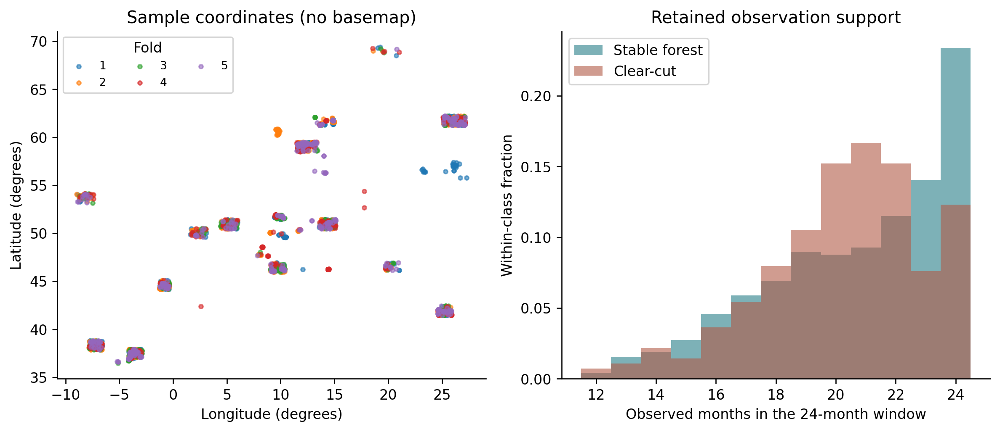
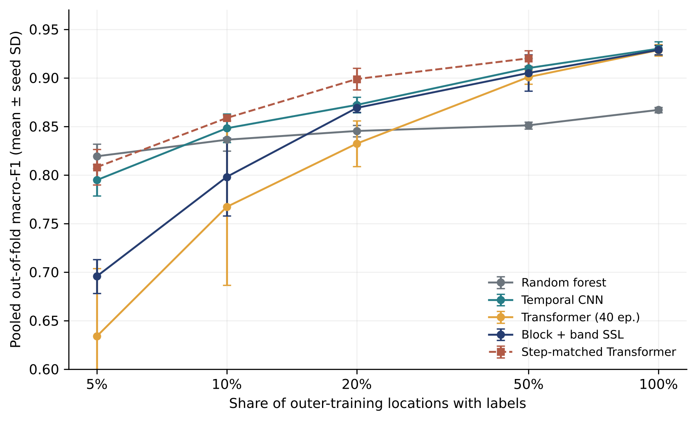
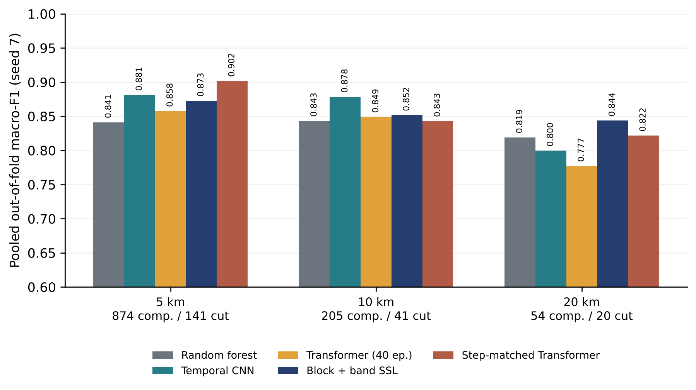

# Self-Supervised Forest Clear-Cut Detection Using Sentinel-2 Time Series

Anonymous research manuscript • revision 3 • 9 November 2026

## Abstract

Self-supervised pretraining offers a promising approach to satellite time-series classification when labeled data are limited. This study investigates its effectiveness for forest disturbance classification using 2,213 high-confidence DISFOR Sentinel-2 time series, comprising 1,937 stable-forest and 276 clear-cut locations. Random forest, temporal convolutional network (CNN), supervised Transformer and masked-reconstruction pretrained Transformer models were evaluated through spatially grouped cross-validation, three random seeds and multiple label budgets. Across 180 primary and control fits, block-and-band pretraining achieved a macro-F1 of 0.8690 and an average precision of 0.8636 with 20% of the training labels, compared with 0.8322 for a supervised Transformer trained for 40 epochs (paired difference 0.0368, spatial-component bootstrap 95% interval [0.0245, 0.0506]). However, a supervised Transformer whose optimizer-step budget was matched to the pretraining schedule reached 0.8987, and independent-cell masking (0.8609) was not clearly separated from the structured mask. With all labels, the three neural models converged between 0.9285 and 0.9299. Along a label-budget curve at 5%, 10% and 50% labels, the pretrained Transformer trailed the step-matched control, the CNN and, below 20% labels, the random forest, whereas under coarser spatial grouping at 10 and 20 km it degraded least. Covariate-only diagnostics showed that observation gaps and sampling metadata alone carry label information. The results indicate that reported gains from self-supervised pretraining depend strongly on the optimization budget of the supervised comparator and on the spatial structure of the evaluation, and they support optimization-aware, spatially grouped evaluation protocols for forest disturbance classification.

Keywords: Earth observation; Sentinel-2; forest disturbance; clear-cut detection; self-supervised learning; spatial cross-validation; optimization controls

## 1 Introduction

Forests are subject to planned harvesting and to natural disturbances whose extent and timing must be monitored for management, carbon accounting and policy reporting. Dense optical satellite time series, in particular from the Sentinel-2 mission, provide observations of vegetation condition before and after a disturbance at 10 m resolution with a revisit of a few days, whereas reliable reference labels for individual disturbance events remain costly to produce because they require visual interpretation of time series and high-resolution imagery [1, 19]. Forest disturbance mapping from optical time series therefore has a long record, from global Landsat-based cover-change products [17] and continuous change detection [20] to European disturbance regime maps [18], reviews of optical disturbance and degradation methods [19] and, recently, global disturbance-type datasets [24] and deep learning based disturbance products for Europe [28].

Deep sequence models for satellite image time series include temporal convolutions [11], self-attention over raw optical sequences [12] and pixel-set temporal attention encoders [13]. Transformers have also been applied to disturbance detection in Central European forests with Sentinel-2 series [27]. Because such models are label hungry, self-supervised learning (SSL), which exploits unlabeled observations before supervised adaptation, has received considerable attention. Masked representation learning for multivariate time series is established prior work [3], and in Earth observation the masked-token recipe of language and vision models [14] has been adopted by SITS-BERT [9], SITS-Former [10], SatMAE [15], Presto [7] and generalist geospatial foundation models [16]. For forest disturbance specifically, Zhang et al. applied a self-supervised Transformer to Sentinel-1 and Sentinel-2 time series in a subtropical ecosystem [2], and contrastive pretraining has been examined for windthrow and snow damage [29] and for remote-sensing sequences in general [8]; multimodal Sentinel-1/2 fusion is also common in the applied literature [25, 26].

Two methodological concerns motivate the present study. First, published comparisons between pretrained and purely supervised models often give the pretrained model a much larger total optimization budget, because the pretraining epochs are added on top of the fine-tuning epochs; an apparent benefit of the self-supervised objective can then be confounded with the benefit of simply training longer. Second, random cross-validation can overstate map accuracy under spatial dependence [4, 21, 22], although the appropriate design depends on the intended inference target [23]. Spatial separation alone, however, does not resolve training-budget imbalance, missingness cues or dataset-specific model development.

The objective of this work is therefore to quantify how much of the low-label improvement obtained from masked-reconstruction pretraining survives (i) an optimization-matched supervised comparator and (ii) spatially grouped evaluation, on a public European forest disturbance dataset. The contributions are as follows. A binary clear-cut versus stable-forest classification cohort of 2,213 high-confidence 24-month Sentinel-2 time series was constructed from DISFOR [1] with a documented, reproducible selection procedure. Four model families (random forest, temporal CNN, supervised Transformer and masked-reconstruction pretrained Transformer) were compared under one fixed protocol with five spatially grouped folds, three seeds and label budgets of 5%, 10%, 20%, 50% and 100%, with all 480 completed fits retained. An optimizer-step-matched supervised control, an independent-cell masking control and two covariate-only diagnostics were added to separate the effect of the pretraining objective from the effects of training budget, mask structure and sampling artefacts. Uncertainty was quantified with a paired bootstrap over spatial components, and the sensitivity of the conclusions to the spatial grouping radius was examined at 5, 10 and 20 km. Finally, the findings were placed in the context of recent forest disturbance studies and a zero-shot transfer protocol towards Türkiye was defined. To the best of the authors' knowledge, no other classification results on DISFOR had been published at the time of writing, so the reported scores also provide a first reference point for this dataset.

The remainder of the paper is organised as follows. Section II describes the dataset, the construction of the study cohort, the classification models, the training protocol and the evaluation metrics. Section III presents the experimental results, including the primary comparison, the controls, the label-budget curve, the grouping-radius sensitivity and example predictions. Section IV discusses the results in relation to each other and to the literature and lists the limitations. Section V concludes and outlines future work.

## 2 Material and methods

This section first introduces the DISFOR dataset and the characteristics of its Sentinel-2 time series (Section II.A). It then describes how the binary study cohort, the spatial grouping and the cross-validation folds were constructed (Section II.B), the four classification models and the self-supervised pretraining scheme (Section II.C), the training protocol, label budgets and control experiments (Section II.D), and finally the evaluation metrics and the uncertainty analysis (Section II.E).

## 2.1 Dataset and study sample

DISFOR is a densely labelled Sentinel-2 time-series dataset developed for the analysis of forest disturbance timing and disturbance agents in European forests [1]. Each sample is a single 10 m × 10 m Sentinel-2 pixel for which human interpreters segmented the period 2015 to 2024 into forest states and disturbance events using an open time-series browsing interface that displays spectral index trajectories together with true-colour and false-colour image chips and very high resolution imagery archives. Samples were collected in three labelling campaigns: points inside disturbance polygons of regional forest services and the European Forest Fire Information System in Germany, Sweden and Spain; a two-stage stratified random sample over thirteen Sentinel-2 tiles distributed across the biogeographic regions of Europe, with strata derived from the European disturbance atlas; and polygon centroids of twelve windstorm events. The labels follow a three-level hierarchy whose first level distinguishes healthy vegetation from disturbed states, whose second level separates undisturbed forest, revegetation, planned, salvage, biotic and abiotic disturbance, and whose third level names the agent, for example clear cut, thinning, bark beetle, wildfire or wind. Every interpretation carries a confidence flag (high when both timing and agent are certain), and interpretations with low confidence were removed by the dataset authors. The released table pairs each labelled point with the Sentinel-2 Level-2A surface reflectance of ten spectral bands (B02, B03, B04, B05, B06, B07, B08, B8A, B11 and B12), the scene classification layer and clear-sky flags for every acquisition; values are stored in the digital-number scale of the processing baseline without an added radiometric offset. The dataset is distributed under the EUPL 1.2 license and the accompanying article was under review as a preprint at the time of writing [1].

For the present study the revision of the dataset identified by hash 2562332e35c94c2339aeb341ffaed2a99faae7d6 was pinned. The downloaded sample table contains 3,822 locations; a dataset-card count of 3,823 is not used. The labels are existing human interpretations supported by ancillary source information, and no new field measurements were collected. The analysis focuses on distinguishing stable forest from clear-cut disturbance using the multitemporal Sentinel-2 observations alone; this restriction defines a specific binary task rather than representing the full thematic scope of DISFOR.

In a Sentinel-2 time series, a stable forest pixel shows a seasonal cycle of the vegetation indices with a high summer plateau, interrupted only by clouds, snow and shadows that are flagged by the scene classification layer. A clear cut removes the canopy within a few weeks; vegetation indices such as the normalised difference vegetation index (NDVI) and the normalised burn ratio (NBR) fall abruptly to the level of bare soil or slash, the shortwave infrared reflectance rises, and the indices recover only slowly in the following years as herbaceous vegetation and new trees establish. Figure 1 shows the geographic distribution and the observation support of the retained sample, Figure 2 shows true-colour image chips of one labelled clear cut before and after the event, and Figure 3 in Section III illustrates such trajectories for individual windows together with the reference labels and model predictions.

## 2.2 Study design and dataset construction

This study was designed to assess the contribution of masked-reconstruction pretraining to satellite time-series classification under limited label availability, with particular emphasis on optimization-budget comparability and spatially structured evaluation. The experimental design compares four primary modelling approaches, a random forest, a temporal convolutional network, a supervised Transformer and the same Transformer initialised through masked-reconstruction pretraining, on one fixed cohort, one fixed fold partition and identical labeled subsets. Because the model recipes had been developed on the same dataset during earlier exploratory work, the analysis is treated as a retrospective methodological audit rather than as an independent external validation.

High-confidence locations were retained and one 24-month calendar window was constructed per location. The first year of the window must be labeled stable forest. A positive window contains an eligible clear-cut event in its second year, the target year; a negative window remains stable forest through both years. Target years range from 2018 to 2023. Candidate event windows were prioritised deterministically and stable-window selection followed a fixed sample-identifier rule. The task is thus the retrospective classification of curated windows; event-onset forecasting and complete landscape mapping are outside its scope. Event dates guided the construction of the dataset but are not used as input features.

Within each month of a window, the median of the clear observations whose scene-classification value is 4 (vegetation) or 5 (bare soil) was taken for each of the ten bands, giving a 24 × 10 array per location together with a Boolean observation mask. Each retained window has at least six observed months in each year; missing months are kept as missing and no temporal interpolation is applied. Per-band means and standard deviations for normalisation were computed from observed values of the outer-training partition only. Three time features encode elapsed days and an annual sine and cosine cycle on the monthly calendar slots. Table 1 lists the sequential selection steps that lead from the downloaded table to the fixed cohort of 1,937 stable-forest and 276 clear-cut windows (12.47% positives). The wildfire class, which had been the original third class, was dropped during earlier development because its held-out support was inadequate; fire, disease, mixed disturbance and national transfer are therefore not evaluated here, and the class prevalence of the cohort is not an estimate of landscape prevalence.

Table 1. Sequential selection of the fixed study cohort.

| Stage | Locations |
| --- | --- |
| Downloaded sample table | 3,822 |
| Exclude interpretations without high confidence | −598 |
| Exclude ambiguous or unavailable two-year windows | −606 |
| Exclude windows with inadequate clear-month support | −116 |
| Exclude wildfire from the binary task | −289 |
| Retained stable forest / clear cut | 1,937 / 276 |
| Total retained locations / spatial components | 2,213 / 874 |

To limit leakage between training and test data through spatial autocorrelation and shared disturbance events [4, 21], an undirected grouping graph was built that joins locations within 5 km of each other and locations sharing a source disturbance-event identifier in the polygon-based campaigns. Its connected components (874 at 5 km, of which 141 contain clear cuts) are indivisible units. Five stratified group folds were drawn once over the complete cohort with a fixed random seed, so that every location receives exactly one held-out prediction per method and seed. After splitting, the smallest distance between any outer-training and any outer-test location was 5.0011 km (Table 2). This rule prevents nearby cross-fold pairs but does not guarantee that all spatial autocorrelation has been removed; the sensitivity of the results to the grouping radius is examined in Section III.D.

Table 2. Held-out support in each fixed fold.

| Fold | Stable | Clear cut | Nearest training point (km) |
| --- | --- | --- | --- |
| 1 | 385 | 54 | 5.0021 |
| 2 | 386 | 54 | 5.0110 |
| 3 | 391 | 58 | 5.0011 |
| 4 | 386 | 53 | 5.0011 |
| 5 | 389 | 57 | 5.0021 |

## 2.3 Classification models

The random forest [5] serves as a temporal-summary baseline without any spatial context. It uses 500 trees, a minimum leaf size of 4, 70% of the features considered at each split and class weights balanced within each bootstrap sample. Its 60 features are, for each of the ten bands, the observed mean, standard deviation, minimum and maximum, the second-year minus first-year mean and the observed fraction.

The neural models receive, for each of the 24 monthly slots, the ten normalised reflectances, the ten observation indicators and the three time features, which a linear layer projects to the model width. The temporal CNN has width 64 and three residual blocks with dilations 1, 2 and 4, each containing two convolutions of kernel size three and group normalisation, in the spirit of temporal convolutional classifiers for satellite image time series [11]. The Transformer has width 48, two encoder layers, four attention heads and a feed-forward width of 144; slots without any observation are masked out of the attention keys. Both models use GELU activations and a classifier applied to the mean of the encoded observed slots. Dropout is 0.20 for the CNN and 0.15 for the Transformer. For pretraining, a reconstruction head maps each encoded slot back to the ten band values.

Masked-reconstruction pretraining follows the masked modelling principle of [3, 14]. All outer-training sequences are used without their class labels for 60 epochs at learning rate 0.001. In each series a contiguous block of two to six months and two randomly selected complete bands are hidden; the loss is the Smooth L1 distance over the artificially hidden cells that were originally observed, so that naturally missing cells are never reconstruction targets, and a safeguard keeps both visible and hidden support in every series. On a fully observed 24 × 10 grid the nominal expected coverage of the mask is one third. After pretraining, the encoder weights are kept and the classifier is restored to the same initial state as the supervised Transformer, so that the pretrained and supervised Transformers differ only in the encoder initialisation.

## 2.4 Training protocol, label budgets and controls

Primary neural fits use 40 supervised epochs, batch size 64 and the AdamW optimizer with weight decay 0.01, learning rate 0.001 for the CNN and 0.0005 for the Transformer. The cross-entropy loss uses inverse-frequency class weights computed from the labeled training subset, label smoothing 0.02 and gradient clipping at norm 1. As augmentation, months are removed at random with probability 0.10, restoring the original mask if the removal would hide every observation. No early stopping, validation-based model selection, calibration or threshold tuning is performed; all class decisions use a probability threshold of 0.5, and the reported Brier scores therefore do not imply a calibrated deployment model [6].

For each of the three training seeds, labels are sampled in a nested random order separately within each class, using the ceiling of 5%, 10%, 20%, 50% or 100% of the training class count, so that smaller budgets are subsets of larger ones. All methods and controls share these exact labeled identifiers. Because the allocation uses known class membership, the design simulates label scarcity under control and should not be read as a prospective annotation-cost experiment. Supervised baselines may use all outer-training observations for normalisation statistics, but only the labeled subset enters the classification loss; held-out data are never used for normalisation, pretraining or fitting.

Four controls were run at 20% labels. First, an independent-cell SSL variant masks each observed cell with probability one third instead of a block and two bands; it matches the nominal masking scale while leaving the pattern unstructured. Second, a step-matched supervised Transformer receives enough epochs to approximately equal the total number of optimizer updates of pretraining plus fine-tuning: E = ceil((60 ceil(N_train/64) + 40 ceil(N_labeled/64)) / ceil(N_labeled/64)), which yields 320 epochs in all five folds. This control matches update counts within one epoch; floating-point operations, wall-clock time and the number of labeled presentations remain unmatched. Third, a random forest uses only the 240 entries of the observation mask. Fourth, another random forest uses only longitude, latitude, target year and campaign index. The two diagnostic forests use the primary forest settings and the same labeled subsets, and they quantify how much label information is available from missingness and sampling context alone.

The primary design contains 5 folds × 3 seeds × 2 label budgets (20% and 100%) × 4 methods = 120 fits plus 5 × 3 × 4 controls = 60 fits. Two extensions were declared after these 180 fits had been frozen: a label-budget curve adding 5%, 10% and 50% labels for the five recipes on the identical folds, seeds and label order (225 fits), and a grouping-radius sensitivity analysis that regroups the cohort at 10 and 20 km and refits the five recipes for one seed and 20% labels (75 fits, including a 5 km reproduction). All completed fits, including unfavourable ones, are retained and reported.

## 2.5 Evaluation metrics and uncertainty analysis

The clear-cut class is the positive class. With TP, FP, FN and TN denoting the true positives, false positives, false negatives and true negatives at the 0.5 threshold, precision and recall are P = TP / (TP + FP) and R = TP / (TP + FN), and the F1 score is their harmonic mean, F1 = 2 P R / (P + R). The primary metric is the macro-averaged F1, the unweighted mean of the F1 scores of the clear-cut and the stable-forest class. Macro-F1 was chosen because the cohort is imbalanced (12.47% positives) and overall accuracy would be dominated by the majority class, whereas the macro average weights the two classes equally and penalises both missed clear cuts and false alarms [31]. Clear-cut recall is reported separately because missed disturbances are the costlier error in monitoring applications.

Threshold-free ranking quality is summarised by the average precision, AP = Σ_k (R_k − R_(k−1)) P_k, the stepwise area under the precision-recall curve over the sorted prediction scores, and by the area under the receiver operating characteristic curve (ROC-AUC), which equals the probability that a randomly chosen clear cut receives a higher score than a randomly chosen stable window [34]. The precision-recall summary is preferred for imbalanced problems because, unlike the ROC curve, it is sensitive to the number of false positives relative to the small positive class [33, 32]. Probability quality is measured by the Brier score, BS = (1/N) Σ_i (p_i − y_i)², the mean squared difference between the predicted probability and the binary label [35].

For each method and seed the five held-out folds are pooled into 2,213 predictions and each metric is computed once on this pooled set; the mean and the sample standard deviation over the three seeds are then reported. The fifteen fold-by-seed scores are not treated as independent observations. The pre-specified primary endpoint is the difference in macro-F1 between the block-and-band pretrained Transformer and the 40-epoch supervised Transformer at 20% labels. Its uncertainty is estimated with a paired cluster bootstrap [36] that resamples the 874 spatial components with replacement 2,000 times: each draw applies identical component multiplicities to both methods, keeps the three seed predictions together and computes the mean of the three paired pooled macro-F1 differences, and the 2.5% and 97.5% percentiles are reported. No draw lacked either class. These intervals are conditional on the existing cohort, folds and trained predictions; they do not include uncertainty from adaptive recipe development or from refitting on new samples, and all secondary comparisons are exploratory and not adjusted for multiplicity.

## 3 Experimental results

This section reports the results in five parts. Section III.A presents the primary comparison of the four models at 20% and 100% labels; Section III.B reports the optimization, masking and covariate controls; Section III.C extends the comparison along the label-budget curve; Section III.D examines the sensitivity to the spatial grouping radius; and Section III.E summarises the findings and describes a declared transfer protocol. Figure 3 first illustrates the data and the model behaviour on four individual windows.

Figure 3 shows NDVI and NBR trajectories of four held-out windows with their reference labels and the mean held-out clear-cut probabilities of the four 20%-label recipes. In the detected clear cut, both indices drop within the target year and do not recover, and all models assign a probability near one. The missed clear cut shows a weak, gradual decline from an already low index level, which the models score below 0.1. The correctly classified stable window shows a regular seasonal cycle with winter gaps. The false alarm is a window labeled stable forest in which both indices fall at the start of the target year and partially recover; all four models score it above 0.85, which illustrates that some disagreements between models and reference labels concern windows whose trajectories resemble a disturbance.

## 3.1 Primary comparison

Figure 4 and Table 3 summarise the primary comparisons. At 20% labels, masked pretraining improves the macro-F1 of the Transformer from 0.8322 to 0.8690, a paired difference of 0.0368 with a conditional 95% interval of [0.0245, 0.0506] that excludes zero. The temporal CNN reaches 0.8721, slightly above the pretrained Transformer, and the random forest 0.8452. The interval of the SSL-minus-CNN difference, [-0.0194, 0.0125], spans zero. With all labels, the three neural recipes reach mean macro-F1 between 0.9285 and 0.9299 and the random forest 0.8669; the small differences among the neural models do not establish a generally best architecture.

Table 3. Primary pooled out-of-fold results. SD is the standard deviation across three seeds and should not be read as a confidence interval.

| Labels | Method | Macro-F1 ± SD | AP | Clear-cut recall | Brier |
| --- | --- | --- | --- | --- | --- |
| 20% | Random forest | 0.8452 ± 0.0058 | 0.7969 | 0.7295 | 0.0561 |
| 20% | Temporal CNN | 0.8721 ± 0.0081 | 0.8494 | 0.7983 | 0.0495 |
| 20% | Transformer | 0.8322 ± 0.0236 | 0.8419 | 0.7995 | 0.0670 |
| 20% | Block-and-band SSL | 0.8690 ± 0.0043 | 0.8636 | 0.8007 | 0.0492 |
| 100% | Random forest | 0.8669 ± 0.0028 | 0.8382 | 0.7101 | 0.0447 |
| 100% | Temporal CNN | 0.9299 ± 0.0071 | 0.9273 | 0.8853 | 0.0300 |
| 100% | Transformer | 0.9285 ± 0.0057 | 0.9227 | 0.8720 | 0.0297 |
| 100% | Block-and-band SSL | 0.9287 ± 0.0049 | 0.9337 | 0.8756 | 0.0286 |

## 3.2 Optimization, masking and covariate controls

The optimization control changes the interpretation of the primary result (Figure 5 and Table 4). The step-matched supervised Transformer reaches a macro-F1 of 0.8987, exceeding the pretrained Transformer by 0.0297; the SSL-minus-control interval is [-0.0430, -0.0179] and lies entirely below zero. The short-training comparison therefore cannot be read as evidence that reconstruction pretraining is superior to spending the same number of optimizer steps on supervised training. The pretrained model retains a higher average precision (0.8636 versus 0.8445), whereas the control has the lower Brier score (0.0417 versus 0.0492): thresholded discrimination, ranking and probability error favour different aspects of the two models.

Independent-cell masking reaches 0.8609. The advantage of the block-and-band mask is 0.0080 with interval [-0.0013, 0.0178], so these data do not establish that the structured mask is reliably better. The observation-mask-only and metadata-only random forests reach macro-F1 values of 0.5515 and 0.6455 and average precisions of 0.1738 and 0.3979, well above the positive prevalence of 0.1247 that a no-skill ranking would attain. Missingness patterns and sampling context thus contain predictive information on their own; the diagnostics do not measure how much of it the spectral models actually use.

Table 4. Controls and comparators at 20% labels. All thresholds remain 0.5.

| Method | Macro-F1 ± SD | AP | Brier |
| --- | --- | --- | --- |
| Transformer | 0.8322 ± 0.0236 | 0.8419 | 0.0670 |
| Block-and-band SSL | 0.8690 ± 0.0043 | 0.8636 | 0.0492 |
| Independent-cell SSL | 0.8609 ± 0.0098 | 0.8604 | 0.0540 |
| Step-matched Transformer | 0.8987 ± 0.0112 | 0.8445 | 0.0417 |
| Observation mask only | 0.5515 ± 0.0129 | 0.1738 | 0.1736 |
| Location / year / campaign | 0.6455 ± 0.0300 | 0.3979 | 0.1115 |

A support audit was also run over the high-confidence DISFOR locations that were not used in the cohort, searching for eligible 2017 or 2024 windows at least 5 km from any used location and without shared source-event identifiers. Only 111 windows remained, 110 stable forest and one clear cut, so no classifier scores were computed on this probe; unused DISFOR points would in any case constitute same-source rather than independent evaluation.

## 3.3 Label-budget curve

Table 5 and Figure 6 place the additional budgets of 5%, 10% and 50% on one curve with the frozen 20% and 100% results. At 5% labels the labeled training set contains 89 to 90 locations, of which about one in eight is a clear cut, so single-seed values are intrinsically noisy. The SSL-minus-short-Transformer difference is 0.0618 at 5% labels (interval [0.0387, 0.0843]), 0.0309 at 10% ([0.0161, 0.0459]) and 0.0042 at 50% ([-0.0087, 0.0179]). Against the step-matched control the differences are -0.1124 ([-0.1334, -0.0919]), -0.0606 ([-0.0796, -0.0424]) and -0.0150 ([-0.0288, -0.0020]). The random forest reaches 0.8192 at 5% and 0.8362 at 10% labels and the CNN 0.7946 and 0.8480, whereas the pretrained Transformer reaches 0.6955 and 0.7979. At the two lowest budgets every stronger comparator, including the temporal-summary random forest, therefore exceeds the pretrained Transformer, and its advantage exists only relative to the 40-epoch Transformer. At 50% labels the four neural recipes lie within 0.02 of each other and the SSL-minus-short-Transformer interval covers zero.

Table 5. Label-budget curve: pooled out-of-fold macro-F1 (mean ± SD over three seeds) on the same folds, seeds and nested label order for all budgets.

| Labels | Random forest | Temporal CNN | Transformer | Block-and-band SSL | Step-matched Transformer |
| --- | --- | --- | --- | --- | --- |
| 5% | 0.8192 ± 0.0126 | 0.7946 ± 0.0161 | 0.6338 ± 0.0699 | 0.6955 ± 0.0175 | 0.8080 ± 0.0182 |
| 10% | 0.8362 ± 0.0117 | 0.8480 ± 0.0147 | 0.7670 ± 0.0805 | 0.7979 ± 0.0403 | 0.8586 ± 0.0030 |
| 20% | 0.8452 ± 0.0058 | 0.8721 ± 0.0081 | 0.8322 ± 0.0236 | 0.8690 ± 0.0043 | 0.8987 ± 0.0112 |
| 50% | 0.8510 ± 0.0035 | 0.9100 ± 0.0099 | 0.9007 ± 0.0071 | 0.9049 ± 0.0187 | 0.9200 ± 0.0081 |
| 100% | 0.8669 ± 0.0028 | 0.9299 ± 0.0071 | 0.9285 ± 0.0057 | 0.9287 ± 0.0049 | not run |

The extension was trained on different hardware from the primary fits; recipes, seeds and label identifiers are identical, so results are comparable up to platform-level floating-point differences. Intervals at 5% and 10% are wide because few clear-cut components are labeled; they are conditional on the fixed cohort and are not adjusted for multiplicity.

## 3.4 Grouping-radius sensitivity

The primary design fixes a 5 km grouping radius. Regrouping the identical cohort at 10 and 20 km merges nearby components: the 874 components at 5 km become 205 at 10 km and 54 at 20 km, and at 20 km some held-out folds contain only two clear-cut components. Table 6 and Figure 7 show that the ranking of the recipes is not stable across radii. At 5 km the step-matched Transformer leads (0.9017 versus 0.8726 for the pretrained Transformer), at 10 km the two are close (0.8515 versus 0.8429), and at 20 km the pretrained Transformer is the strongest recipe (0.8437 versus 0.8216 for the control and 0.7997 for the CNN). The 5 km single-seed fits reproduce the primary probabilities to within 2.2e-16.

Table 6. Grouping-radius sensitivity at 20% labels, one seed. Each value is one pooled out-of-fold macro-F1 over 2,213 locations; no seed SD or interval is available.

| Radius | Components | Random forest | Temporal CNN | Transformer | Block-and-band SSL | Step-matched Transformer |
| --- | --- | --- | --- | --- | --- | --- |
| 5 km | 874 | 0.8411 | 0.8812 | 0.8576 | 0.8726 | 0.9017 |
| 10 km | 205 | 0.8434 | 0.8784 | 0.8490 | 0.8515 | 0.8429 |
| 20 km | 54 | 0.8190 | 0.7997 | 0.7772 | 0.8437 | 0.8216 |

Because radius, fold membership and the labeled subset change together, this is a descriptive sensitivity analysis and does not estimate a causal radius effect. It nevertheless indicates that the advantage of the step-matched control is specific to the 5 km design and that the pretrained representation degrades less when training and test regions are separated more aggressively. Confirming this pattern would require additional seeds and, ideally, held-out regions defined independently of the sampling campaigns.

## 3.5 Summary of findings and declared transfer protocol

Table 7. Summary of findings. Intervals are paired spatial-component bootstrap 95% intervals for the macro-F1 difference; status distinguishes the single pre-specified primary comparison from exploratory ones.

| Finding | Evidence | Interval | Status |
| --- | --- | --- | --- |
| SSL exceeds the 40-epoch Transformer at 20% labels | 0.8690 vs 0.8322 | [0.0245, 0.0506] | primary |
| Step-matched Transformer exceeds SSL at 20% labels | 0.8987 vs 0.8690 | [-0.0430, -0.0179] | exploratory |
| Block masking does not clearly beat independent-cell masking | 0.8690 vs 0.8609 | [-0.0013, 0.0178] | exploratory |
| SSL and CNN are indistinguishable at 20% labels | 0.8690 vs 0.8721 | [-0.0194, 0.0125] | exploratory |
| Missingness and sampling metadata carry label information | 0.5515 / 0.6455 macro-F1 without spectral input | descriptive | diagnostic |
| Below 20% labels SSL trails every stronger comparator | Table 5 | per budget | extension |
| At 20 km grouping SSL degrades least and leads | Table 6 | single seed | extension |
| No independent clear-cut support in unused DISFOR windows | 1 positive among 111 windows | none | support audit |

A zero-shot transfer protocol towards Türkiye was declared and frozen before execution. Candidate locations are drawn from compact tree-cover-loss patches and loss-free forest in the Global Forest Change product [17] within five Turkish forest regions, separated by at least 5 km, with Sentinel-2 inputs built under the same monthly aggregation rule as the training data and with the processing-baseline offset removed. The full-cohort versions of the four recipes will be applied without any Turkish data in training, calibration or threshold selection. Results of this probe were not available at the time of writing and no number from it appears in this manuscript; when executed, its reference labels remain tree-cover loss rather than interpreted clear cuts, and the outcome will be reported as a transfer probe with that caveat.

## 4 Discussion

## 4.1 Comparison among the experiments

The strongest result is a qualification of the initial low-label improvement from self-supervised pretraining. Relative to a short supervised fit, reconstruction pretraining improves macro-F1 with a positive conditional interval; relative to a supervised fit of equal optimizer budget, it does not. The optimization budget of the comparator is therefore a material design choice in any evaluation of pretraining. The experiment does not prove that additional optimization is the only mechanism: the reconstruction and the supervised objectives expose the model to different information, use different learning rates and induce different optimization trajectories, and a complete causal decomposition would require further controlled schedules and several independent datasets.

The label-budget curve sharpens this picture. The pretrained Transformer never exceeds the step-matched control, and at 5% and 10% labels it is also surpassed by the CNN and by the random forest on hand-crafted temporal summaries; its advantage exists only relative to the equally short supervised Transformer. At 50% labels and above the neural recipes converge, as expected when labels are no longer the bottleneck. Mask structure is similarly unresolved: block-and-band masking is a plausible way to remove coherent temporal and spectral information, but the interval includes no advantage over independent-cell masking, so the mask design cannot be presented as a demonstrated methodological innovation. The grouping-radius analysis, in contrast, points to a benefit that the primary design does not show: when training and test regions are separated by 20 km rather than 5 km, every recipe loses accuracy, but the pretrained Transformer loses least and becomes the strongest model. On this cohort the benefit of masked pretraining is thus better described as robustness to geographic shift than as label efficiency, with the caveat that the radius analysis uses one seed.

The covariate-only diagnostics matter because the sample is curated rather than a random survey of forest cover. Disturbance campaigns, geography, acquisition opportunities and target year correlate with the labels; spatial grouping limits leakage between nearby pairs, but broad geographic gradients and campaign differences remain available to every model. The reported metrics are therefore not interpreted as operational precision, map-wide false-alarm rates or performance in Türkiye. A deployment study would need a probability sampling frame, target-region preprocessing checks, independent labels and a threshold chosen for the costs of the application.

## 4.2 Comparison with the literature

A literature search carried out in November 2026 (publisher databases, the dataset repository and the discussion page of the dataset article) found no other published classification results on DISFOR, and the dataset article itself reports no baseline classifier [1]. The scores reported here therefore cannot be compared with results on the same data and are instead placed next to recent forest disturbance studies that used related tasks, sensors and model families (Table 8). Such a juxtaposition is indicative only, because the studies differ in class definition, region, sensor, sample design and metric.

Table 8. Recent forest disturbance classification studies from satellite time series next to the present work. Reported values are those stated in the cited publications; tasks, regions and metrics differ, so values are not directly comparable.

| Study | Data and region | Task | Model | Reported result |
| --- | --- | --- | --- | --- |
| Schiller et al. 2024 [27] | Sentinel-2 irregular series, Germany and Luxembourg | Disturbed vs undisturbed pixels incl. partial disturbance | SITS-BERT Transformer, pretraining + fine-tuning | F1 0.72, OA 0.92 (spatial block CV) |
| Zhang et al. 2025 [2] | Sentinel-1 + Sentinel-2 series, subtropical China | Clear cut vs disease disturbance | Self-supervised Transformer | F1 0.95; SSL 0.95 vs supervised 0.86 at 20% labels |
| Kuzu et al. 2024 [29] | Bitemporal Sentinel-1/2, boreal forest | Windthrow and snow damage | Contrastive SSL + change vector analysis | Windthrow F1 0.69, OA 76.5% (S2) |
| Viana-Soto et al. 2026 [28] | Landsat annual composites, Europe | Annual stand-replacing disturbance | 1D U-Net, TempCNN, random forest | F1 0.81 (U-Net), 0.73 (TempCNN), 0.74 (RF), independent validation |
| Giambelluca et al. 2025 [30] | Landsat dense series, Navarre, Spain | Clear cut, thinning, non-harvested stands | CCDC change detection | F-score 0.85 (all bands); clear cut 0.90 |
| This study | Sentinel-2 monthly series, DISFOR, Europe | Clear cut vs stable forest, 24-month windows | RF, temporal CNN, Transformer, masked-reconstruction SSL | Macro-F1 0.869 (SSL) / 0.899 (step-matched) at 20% labels; 0.930 at 100%, spatially grouped CV |

Three observations follow from Table 8. First, the magnitude of the low-label gain reported by Zhang et al., from 0.86 to 0.95 F1 with 20% of the training samples according to its abstract [2], is of the same order as the gain measured here against the 40-epoch Transformer (from 0.83 to 0.87 macro-F1), but the present controls show that a supervised model given the same optimizer budget removes this gain; whether a step-matched comparator would change the conclusion of that study cannot be judged from the information available to the present authors. Second, the binary clear-cut task on high-confidence DISFOR windows is easier than the pixel-wise detection of partial disturbances in Schiller et al. [27] or the annual mapping in Viana-Soto et al. [28], which explains the higher absolute scores obtained here and underlines that these scores are not map accuracies. Third, the strength of the random forest at very low label budgets is consistent with the independent validation of Viana-Soto et al., in which a random forest (F1 0.74) matched a temporal CNN (0.73) and only a deeper U-Net clearly surpassed both (0.81) [28]; simple temporal summaries remain a strong reference for stand-replacing disturbance. Pretrained models in the Earth observation literature, such as Presto [7] and SITS-Former [10], report gains of a few percentage points of overall accuracy from pretraining; the present results suggest that such gains should be read together with the training budget of the supervised comparator.

## 4.3 Limitations

Several limitations remain. The retained high-confidence binary windows omit ambiguous, mixed and rare disturbances, and the selection uses the label histories, so the cohort is easier than an operational mapping population. The primary audit uses one grouping radius and one fold partition; the radius extension is descriptive and single-seeded, and no leave-country-out analysis was possible because the pinned source table carries no country field. Three seeds quantify only a limited part of the initialisation and subset variation. The fixed 40-epoch recipes may undertrain some methods, as the step-matched control demonstrates, and the source digital numbers were not independently harmonised across processing baselines. The bootstrap does not resolve the adaptive development of the recipes on the same dataset. Foundation-model and multimodal baselines are not included in the audited comparison; a frozen linear probe on Presto embeddings [7], run as a separate exploration without fine-tuning and without the Sentinel-1, climate and elevation inputs that model expects, reached a macro-F1 of 0.71 at 20% labels and is reported only as a bounded exploratory note. A previously developed engineering ensemble that combines CNN and pretrained Transformer members is available for label-free inference in the accompanying project, but its earlier 486-location test is not reused as evidence here because its calibrated ensemble predictions are not comparable with the fixed-threshold individual recipes audited in this study.

## 5 Conclusion

Timely and reliable information on forest clear cuts is required for forest management, carbon reporting and the enforcement of forest regulations, and dense Sentinel-2 time series make such information attainable at 10 m resolution across Europe. Deep learning models can extract disturbance signals from these series, but their need for labeled examples has motivated self-supervised pretraining, whose benefits are frequently reported without controlling for the additional training it entails or for the spatial structure of the evaluation data. In this study, the contribution of masked-reconstruction pretraining to clear-cut classification was examined on a binary cohort of 2,213 high-confidence DISFOR Sentinel-2 time series under a fixed, spatially grouped protocol with explicit optimization and masking controls.

It was found that pretraining improves a supervised Transformer trained for the same short schedule at 20% labels (macro-F1 0.8690 versus 0.8322), but that a supervised Transformer with a matched optimizer-step budget reaches a higher score (0.8987), that structured masking does not clearly outperform unstructured masking, and that at 5% and 10% labels the pretrained model is also outperformed by a temporal CNN and by a random forest on simple temporal summaries. With all labels the neural models converge near a macro-F1 of 0.93. Under coarser spatial separation of training and test regions, however, the pretrained model degraded least and led at 20 km, and covariate-only diagnostics revealed that observation gaps and sampling metadata alone carry label information. The lesson drawn from these experiments is that claims of label efficiency from self-supervised pretraining should be accompanied by an optimization-matched supervised comparator, by spatially grouped evaluation at more than one grouping scale and by diagnostics for sampling artefacts; without these, the apparent benefit can be misattributed. In the present setting the benefit of masked pretraining is better described as robustness to geographic shift than as label efficiency.

Several directions follow from this work. The declared zero-shot transfer protocol towards Turkish forests should be executed to test whether models trained on European DISFOR windows detect clear cuts in a region with different forest types and management without any local labels, and the same protocol can be extended to other countries as reference data become available. The binary task should be extended to the full DISFOR agent hierarchy, in particular to wildfire, windthrow and bark beetle, where class imbalance is more severe and where multimodal inputs from Sentinel-1 radar [2, 29] and pretrained geospatial foundation models such as Presto, SatMAE and Prithvi [7, 15, 16] could be compared under the same optimization-matched controls. Larger and more diverse training populations, for example from global disturbance-type datasets [24] or European disturbance maps [28, 18], would allow the grouping-radius finding to be tested with many seeds and with held-out regions defined independently of the sampling campaigns, and would make the convergence point of the label-budget curve informative for operational annotation planning. Finally, operational use requires a probability sampling frame, calibrated probabilities and application-specific decision thresholds, which were deliberately outside the scope of this methodological audit.

## Data and code availability

The DISFOR dataset is available at https://huggingface.co/datasets/JR-DIGITAL/DISFOR [1]; the revision used is given in Section II.A. The source code, the processed cohort, the frozen folds and label subsets, the run records of all 480 fits and the pooled predictions are available at https://github.com/oguzgnrn/disfor-clearcut-ssl.

## Author review and assistance disclosure

This anonymous draft was prepared with AI assistance for coding, experiment orchestration, analysis checks, figure preparation and manuscript drafting. Human authors must review the evidence, interpretation, citations and final text before submission.

## References

[1] Viehweger, J.; Hirschmugl, M.; Puhm, M.; Burtscher, R.; Gallaun, H.; Deutscher, J. (2026). Dense labelled time-series for mapping European forest disturbance agents. Earth System Science Data Discussions, preprint under review. https://doi.org/10.5194/essd-2026-185

[2] Zhang, M.; Li, G.; Lu, D.; Xu, C.; Zhao, H.; Li, D. (2025). Self-supervised deep learning for detection of forest disturbance types in a subtropical ecosystem using transformer and Sentinel-1 and Sentinel-2 time series data. International Journal of Digital Earth, 18, article 2537325. https://doi.org/10.1080/17538947.2025.2537325

[3] Zerveas, G.; Jayaraman, S.; Patel, D.; Bhamidipaty, A.; Eickhoff, C. (2021). A Transformer-based Framework for Multivariate Time Series Representation Learning. Proceedings of the 27th ACM SIGKDD Conference on Knowledge Discovery and Data Mining. https://doi.org/10.1145/3447548.3467401

[4] Roberts, D. R.; Bahn, V.; Ciuti, S.; Boyce, M. S.; Elith, J.; Guillera-Arroita, G.; Hauenstein, S.; Lahoz-Monfort, J. J.; Schroder, B.; Thuiller, W.; Warton, D. I.; Wintle, B. A.; Hartig, F.; Dormann, C. F. (2017). Cross-validation strategies for data with temporal, spatial, hierarchical, or phylogenetic structure. Ecography, 40, 913-929. https://doi.org/10.1111/ecog.02881

[5] Breiman, L. (2001). Random Forests. Machine Learning, 45, 5-32. https://doi.org/10.1023/A:1010933404324

[6] Guo, C.; Pleiss, G.; Sun, Y.; Weinberger, K. Q. (2017). On Calibration of Modern Neural Networks. Proceedings of Machine Learning Research, 70, 1321-1330. https://proceedings.mlr.press/v70/guo17a.html

[7] Tseng, G.; Cartuyvels, R.; Zvonkov, I.; Purohit, M.; Rolnick, D.; Kerner, H. (2024). Lightweight, Pre-trained Transformers for Remote Sensing Timeseries. arXiv:2304.14065, version 4. https://doi.org/10.48550/arXiv.2304.14065

[8] Saget, A.; Lafabregue, B.; Cornuejols, A.; Gancarski, P. (2025). Resampling Augmentation for Time Series Contrastive Learning: Application to Remote Sensing. Proceedings of the TerraBytes ICML Workshop, PMLR 292, 32-45. https://proceedings.mlr.press/v292/saget25a.html

[9] Yuan, Y.; Lin, L. (2021). Self-Supervised Pretraining of Transformers for Satellite Image Time Series Classification. IEEE Journal of Selected Topics in Applied Earth Observations and Remote Sensing, 14, 474-487. https://doi.org/10.1109/JSTARS.2020.3036602

[10] Yuan, Y.; Lin, L.; Liu, Q.; Hang, R.; Zhou, Z.-G. (2022). SITS-Former: A pre-trained spatio-spectral-temporal representation model for Sentinel-2 time series classification. International Journal of Applied Earth Observation and Geoinformation, 106, article 102651. https://doi.org/10.1016/j.jag.2021.102651

[11] Pelletier, C.; Webb, G. I.; Petitjean, F. (2019). Temporal Convolutional Neural Network for the Classification of Satellite Image Time Series. Remote Sensing, 11(5), article 523. https://doi.org/10.3390/rs11050523

[12] Rußwurm, M.; Körner, M. (2020). Self-attention for raw optical Satellite Time Series Classification. ISPRS Journal of Photogrammetry and Remote Sensing, 169, 421-435. https://doi.org/10.1016/j.isprsjprs.2020.06.006

[13] Sainte Fare Garnot, V.; Landrieu, L.; Giordano, S.; Chehata, N. (2020). Satellite Image Time Series Classification With Pixel-Set Encoders and Temporal Self-Attention. Proceedings of the IEEE/CVF Conference on Computer Vision and Pattern Recognition (CVPR), 12322-12331. https://doi.org/10.1109/CVPR42600.2020.01234

[14] He, K.; Chen, X.; Xie, S.; Li, Y.; Dollár, P.; Girshick, R. (2022). Masked Autoencoders Are Scalable Vision Learners. Proceedings of the IEEE/CVF Conference on Computer Vision and Pattern Recognition (CVPR), 15979-15988. https://doi.org/10.1109/CVPR52688.2022.01553

[15] Cong, Y.; Khanna, S.; Meng, C.; Liu, P.; Rozi, E.; He, Y.; Burke, M.; Lobell, D. B.; Ermon, S. (2022). SatMAE: Pre-training Transformers for Temporal and Multi-Spectral Satellite Imagery. arXiv:2207.08051 (Advances in Neural Information Processing Systems 35). https://doi.org/10.48550/arXiv.2207.08051

[16] Jakubik, J.; Roy, S.; Phillips, C. E.; et al. (2023). Foundation Models for Generalist Geospatial Artificial Intelligence. arXiv:2310.18660. https://doi.org/10.48550/arXiv.2310.18660

[17] Hansen, M. C.; Potapov, P. V.; Moore, R.; Hancher, M.; Turubanova, S. A.; Tyukavina, A.; Thau, D.; Stehman, S. V.; Goetz, S. J.; Loveland, T. R.; Kommareddy, A.; Egorov, A.; Chini, L.; Justice, C. O.; Townshend, J. R. G. (2013). High-Resolution Global Maps of 21st-Century Forest Cover Change. Science, 342(6160), 850-853. https://doi.org/10.1126/science.1244693

[18] Senf, C.; Seidl, R. (2021). Mapping the forest disturbance regimes of Europe. Nature Sustainability, 4, 63-70. https://doi.org/10.1038/s41893-020-00609-y

[19] Hirschmugl, M.; Gallaun, H.; Dees, M.; Datta, P.; Deutscher, J.; Koutsias, N.; Schardt, M. (2017). Methods for Mapping Forest Disturbance and Degradation from Optical Earth Observation Data: a Review. Current Forestry Reports, 3, 32-45. https://doi.org/10.1007/s40725-017-0047-2

[20] Zhu, Z.; Woodcock, C. E. (2014). Continuous change detection and classification of land cover using all available Landsat data. Remote Sensing of Environment, 144, 152-171. https://doi.org/10.1016/j.rse.2014.01.011

[21] Ploton, P.; Mortier, F.; Réjou-Méchain, M.; Barbier, N.; Picard, N.; Rossi, V.; Dormann, C.; Cornu, G.; Viennois, G.; Bayol, N.; Lyapustin, A.; Gourlet-Fleury, S.; Pélissier, R. (2020). Spatial validation reveals poor predictive performance of large-scale ecological mapping models. Nature Communications, 11, article 4540. https://doi.org/10.1038/s41467-020-18321-y

[22] Meyer, H.; Pebesma, E. (2022). Machine learning-based global maps of ecological variables and the challenge of assessing them. Nature Communications, 13, article 2208. https://doi.org/10.1038/s41467-022-29838-9

[23] Wadoux, A. M. J.-C.; Heuvelink, G. B. M.; de Bruin, S.; Brus, D. J. (2021). Spatial cross-validation is not the right way to evaluate map accuracy. Ecological Modelling, 457, article 109692. https://doi.org/10.1016/j.ecolmodel.2021.109692

[24] Wang, L.; Liu, S.; Song, W.; Ding, S.; Zhang, J. (2026). Global high-resolution forest disturbance type dataset. Earth System Science Data, 18, 1601-1617. https://doi.org/10.5194/essd-18-1601-2026

[25] Maze, M.; Attaher, S.; Taqi, M. O.; Elsawy, R.; Gad El-Moula, M. M. H.; Hashem, F. A.; Moussa, A. S. (2025). Enhanced agricultural land use/land cover classification in the Nile Delta using Sentinel-1 and Sentinel-2 data and machine learning. ISPRS Journal of Photogrammetry and Remote Sensing, 229, 239-253. https://doi.org/10.1016/j.isprsjprs.2025.08.019

[26] Vyas, N.; Singh, S.; Sethi, G. K. (2025). A novel image fusion-based post classification framework for agricultural variations detection using Sentinel-1 and Sentinel-2 data. Earth Science Informatics, 18, article 40 (online 2024). https://doi.org/10.1007/s12145-024-01506-0

[27] Schiller, C.; Költzow, J.; Schwarz, S.; Schiefer, F.; Fassnacht, F. E. (2024). Forest disturbance detection in Central Europe using transformers and Sentinel-2 time series. Remote Sensing of Environment, 315, article 114475. https://doi.org/10.1016/j.rse.2024.114475

[28] Viana-Soto, A.; Mense, J. A.; Kowalski, K.; Pauls, J.; Gieseke, F.; Senf, C. (2026). Deep learning-based forest disturbance detection for Europe using Landsat time series. Remote Sensing of Environment, 347, article 115670. https://doi.org/10.1016/j.rse.2026.115670

[29] Kuzu, R. S.; Antropov, O.; Molinier, M.; Dumitru, C. O.; Saha, S.; Zhu, X. X. (2024). Forest Disturbance Detection via Self-Supervised and Transfer Learning With Sentinel-1&2 Images. IEEE Journal of Selected Topics in Applied Earth Observations and Remote Sensing, 17, 4751-4767. https://doi.org/10.1109/JSTARS.2024.3361183

[30] Giambelluca, A. L.; Hermosilla, T.; Álvarez-Mozos, J.; González-Audícana, M. (2025). Identifying forest harvesting practices: Clear-cutting and thinning in diverse tree species using dense Landsat time series. Forest Ecology and Management, 578, article 122442. https://doi.org/10.1016/j.foreco.2024.122442

[31] Sokolova, M.; Lapalme, G. (2009). A systematic analysis of performance measures for classification tasks. Information Processing & Management, 45(4), 427-437. https://doi.org/10.1016/j.ipm.2009.03.002

[32] Saito, T.; Rehmsmeier, M. (2015). The Precision-Recall Plot Is More Informative than the ROC Plot When Evaluating Binary Classifiers on Imbalanced Datasets. PLOS ONE, 10(3), e0118432. https://doi.org/10.1371/journal.pone.0118432

[33] Davis, J.; Goadrich, M. (2006). The relationship between Precision-Recall and ROC curves. Proceedings of the 23rd International Conference on Machine Learning (ICML 2006), 233-240. https://doi.org/10.1145/1143844.1143874

[34] Fawcett, T. (2006). An introduction to ROC analysis. Pattern Recognition Letters, 27(8), 861-874. https://doi.org/10.1016/j.patrec.2005.10.010

[35] Brier, G. W. (1950). Verification of forecasts expressed in terms of probability. Monthly Weather Review, 78(1), 1-3. https://doi.org/10.1175/1520-0493(1950)078<0001:VOFEIT>2.0.CO;2

[36] Efron, B. (1979). Bootstrap Methods: Another Look at the Jackknife. The Annals of Statistics, 7(1), 1-26. https://doi.org/10.1214/aos/1176344552

Figure 1. Locations and observed-month support of the retained cohort. Colors identify the five fixed outer folds. Coordinates are plotted without a geographic basemap or area interpretation. Histograms are normalized separately within each class.

Figure 2. Sentinel-2 true-colour image chips (1 km × 1 km, 2 to 98 percent stretch) around a DISFOR clear-cut location before and after the labelled event; the orange square marks the 10 m sample pixel, which lies inside the newly cleared stand in the second image. The chips are shown for illustration only and are not model inputs; they were read from the public Sentinel-2 Level-2A archive for the two least cloudy summer acquisitions.

![Figure 3. Example DISFOR windows with their reference labels and model predictions. Lines are the monthly NDVI and NBR computed from the input bands; grey bands mark months without a clear observation; the dashed line marks the start of the target year. The boxes give the mean held-out clear-cut probability of each recipe at 20% labels over the three seeds. The four windows were selected deterministically as the most confident detected clear cut, the most confidently missed clear cut, the most confident correct stable window and the most confident false alarm of the pretrained Transformer among well observed windows.](figures/06_examples.png)

Figure 3. Example DISFOR windows with their reference labels and model predictions. Lines are the monthly NDVI and NBR computed from the input bands; grey bands mark months without a clear observation; the dashed line marks the start of the target year. The boxes give the mean held-out clear-cut probability of each recipe at 20% labels over the three seeds. The four windows were selected deterministically as the most confident detected clear cut, the most confidently missed clear cut, the most confident correct stable window and the most confident false alarm of the pretrained Transformer among well observed windows.

Figure 4. Primary comparisons at 20% and 100% training labels. Large points are means of three pooled out-of-fold macro-F1 values; error bars show their sample standard deviations. Smaller points are individual seeds. These bars are seed standard deviations rather than confidence intervals.

Figure 5. Low-label controls and paired comparisons. Left: macro-F1 mean and seed standard deviation. Right: SSL-minus-comparator differences with 2,000-draw paired spatial-component bootstrap percentile intervals. Only the short-Transformer contrast is primary; other intervals are exploratory and conditional on the fixed fits.

Figure 6. Label-budget curve on the frozen folds. Points are means of three pooled out-of-fold macro-F1 values; bars are seed standard deviations and should not be read as confidence intervals.

Figure 7. Grouping-radius sensitivity at 20% labels, one seed. Each bar is a single pooled out-of-fold macro-F1; the number of spatial components and clear-cut components per radius is given below the axis. Descriptive only.
